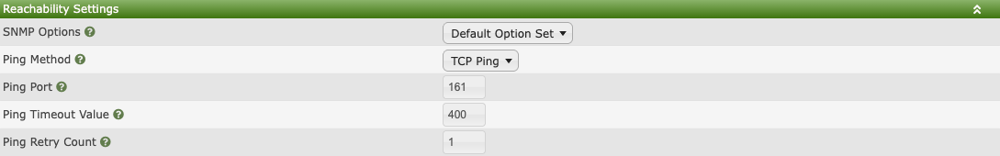
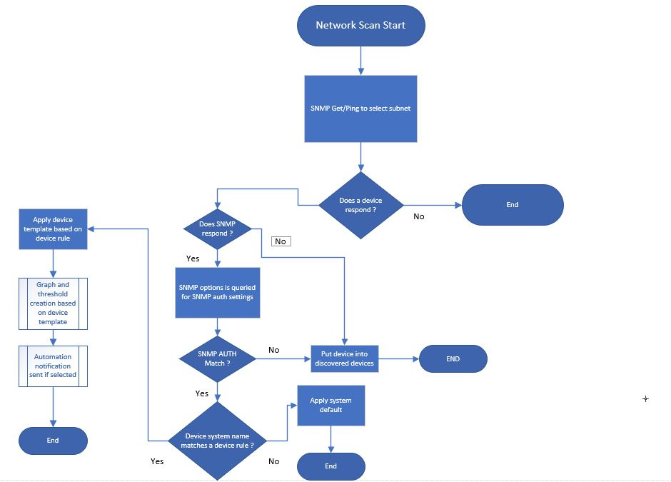

# Automation Networks

This section will describe **Automation Networks** in Cacti.

Adding a network to scan in the automation plugin is easy. On the main console
click Automation. Once on the below page click the + on the top right of the
page.

You will now see the below page. If you want to scan 192.168.1.0/24, you would
enter that in the Subnet Range textbox then enter the subnet in CIDR format.

Other important options are

| Option                     | Description                                                                                |
| -------------------------- | ------------------------------------------------------------------------------------------ |
| Schedule Type              | How often you want to scan this subnet for devices                                         |
| Discovery Threads          | How many processes to spawn during the scan                                                |
| Run Limit                  | to prevent the scan from running indefinitely                                              |
| Automatically Add to Cacti | If a device is SNMP reachable and matches a rule from this subnet the device will be added |
| Enable NetBIOS             | Attempt to resolve the hostname by netbios                                                 |

After you are done adding your network details, ensure you enable the rule and
save.

Ensure that if you have an SNMP rule for this part of the network, you select
the SNMP option set. This will tie the network to the SNMP rules.

To begin the scan, click on the bottom right drop down and select "Discover
Now". This will start the discovery.

Here is the flow of the automation scan

---

Copyright (c) 2004-2026 The Cacti Group
