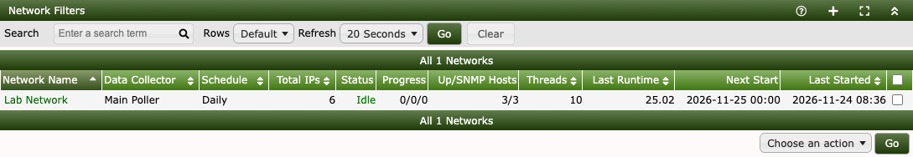
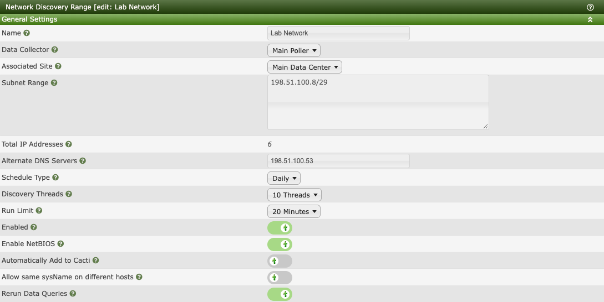
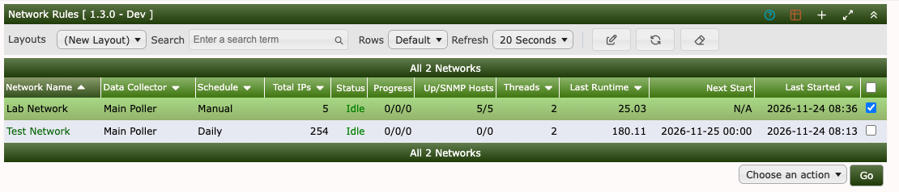

# Automation Networks

This section will describe **Automation Networks** in Cacti.

Adding a network to scan with built-in automation is easy. On the main console
click Automation. Once on the below page click the + on the top right of the
page.

You will now see the below page. If you want to scan 192.168.1.0/24, you would
enter that in the subnet range textbox then enter the subnet in CIDR format.

Other important options are

| Option                                | Description                                                                                                                                           |
| ------------------------------------- | ----------------------------------------------------------------------------------------------------------------------------------------------------- |
| Name                                  | The name of this network range                                                                                                                        |
| Data Collector                        | The Data Collector that scans this network range                                                                                                      |
| Associated Site                       | The Site to associate discovered Devices with                                                                                                         |
| Subnet Range                          | Network ranges separated by commas, such as 192.168.1.0/24, 192.168.1.0/255.255.255.0 or 192.168.*.*                                                  |
| IP Addresses to Ignore                | A comma separated list of IP addresses from this range that are not scanned                                                                           |
| Alternate DNS Servers                 | A space delimited list of DNS servers to use for name resolution.  If blank, the poller OS is used                                                    |
| Discovery Threads                     | How many processes to spawn during the scan                                                                                                           |
| Run Limit                             | After the selected Run Limit, the discovery process is terminated                                                                                     |
| Enabled                               | Enable this network range                                                                                                                             |
| Enable NetBIOS                        | Use NetBIOS to attempt to resolve the hostname of up hosts                                                                                            |
| Automatically Add to Cacti            | If a device is SNMP reachable and matches a rule from this subnet the device will be added                                                            |
| Allow same sysName on different hosts | Allow devices with duplicate sysNames to be added on different hosts                                                                                  |
| Rerun Data Queries                    | If a device previously added to Cacti is found, rerun its data queries                                                                                |
| Schedule Type                         | How often you want to scan this subnet for devices.  The other schedule fields, such as Starting Date/Time and Rerun Every, depend on the type chosen |
| Notification Enabled                  | Send a report to the Notification Email account when this network is scanned                                                                          |
| Notification Email                    | The email account the report is sent to                                                                                                               |
| Notification From Name                | The sender name for the notification email.  If blank, the default Automation Notification Name or the Cacti system default is used                   |
| Notification From Email Address       | The sender address for the notification email.  If blank, the default Automation Notification Email Address or the Cacti system default is used       |

After you are done adding your network details, ensure you enable the rule and
save.

Ensure that if you have a SNMP rule for this part of the network to select the
SNMP option set this will tie the network to the SNMP rules

To begin the scanner click on the bottom right drop down and select "Discover
Now" this will start the discovery

Here is the flow of the automation scan

---

Copyright (c) 2004-2026 The Cacti Group
