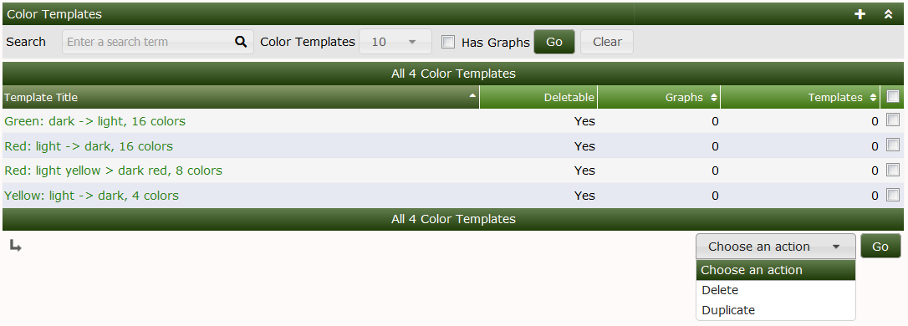
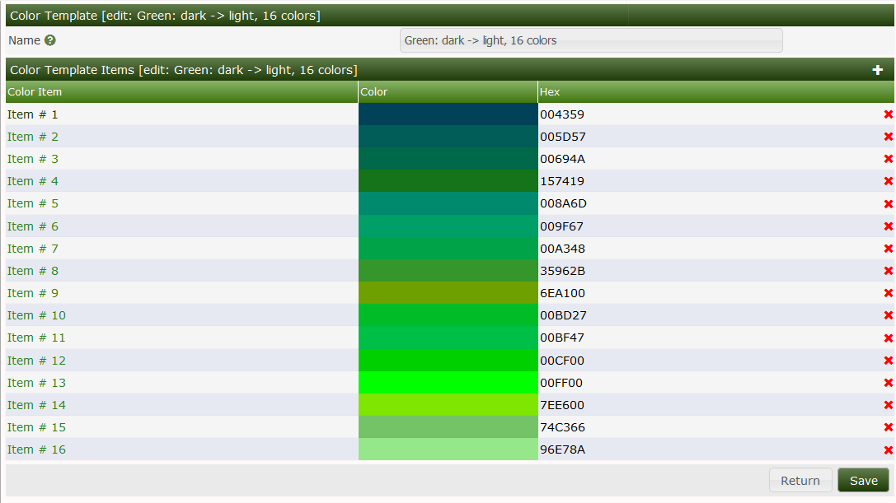
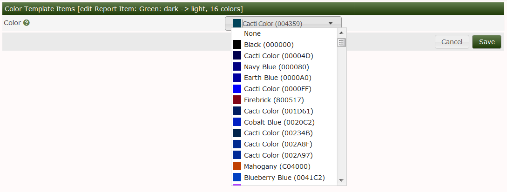

# Color Templates

**Color Templates** define a list of Colors to be used for **Aggregate Graphs**
in Cacti.  As you add **Graphs** to an **Aggregate Graph**, you need to
distinguish one **Graph** from the next within the **Aggregate Graph**.  These
**Color Templates** are a list of colors that will be looped through in Round
Robin fashion to render the **Aggregate Graph**.

Color selection rotates across member graphs for each item to which a color
template is assigned. It uses the member-graph index modulo the number of
colors; it does not advance once for every graph item or legend entry.

For example, assign an eight-color template to one plotted series shared by 16
member graphs. Each color is selected twice for that series. Additional series
can have their own assigned color templates, while uncolored legend items do
not add steps to this rotation.

Below, you can see the four standard **Color Templates**.  From the Actions
drop down you can *Delete*, *Duplicate*, or *Sync Aggregates* for the selected
**Color Templates**.  As with other Cacti objects, you will not be allowed to
*Delete* a **Color Template** in use.

In the image below, you can see the **Color Template** edit screen.  This simple
screen allows you to add, remove and re-order colors in the list.

Shown in the image below, only Cacti **Colors** are allowed to be selected for
Aggregate **Color Templates**.  The **Color** drop down can be typed into if you
wish to search through the list of approximately 340 legacy and *Named Colors*.

---
Copyright (c) 2004-2026 The Cacti Group
