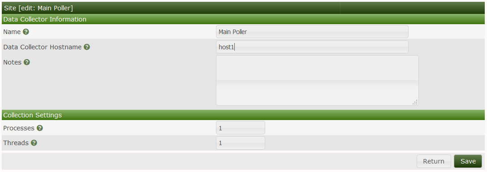
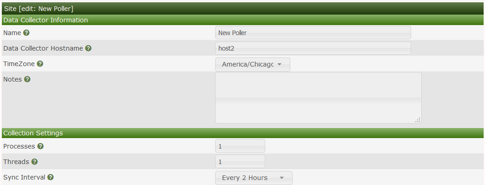
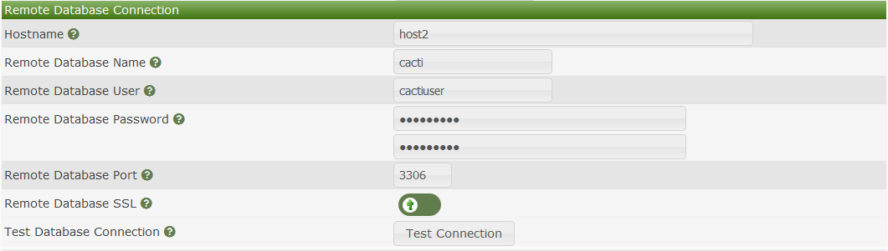
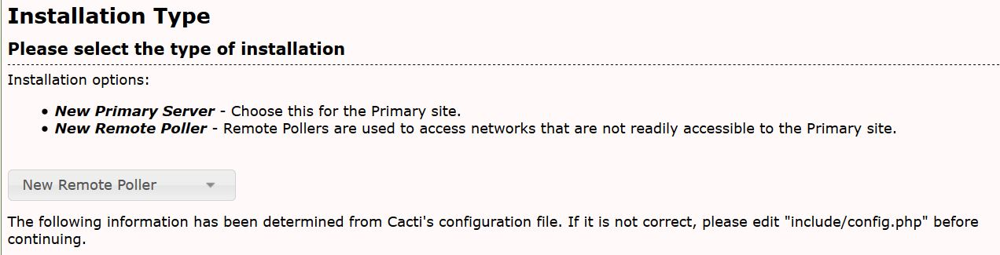

# Data Collectors

## Data Collector Background

Cacti can support from one to many **Data Collectors**.  There are two types
of **Data Collectors** they are:

- **Main Data Collector** - This is essentially your core Cacti server
  and database.  The **Main Data Collector** is also referred to as
  the **Primary Server**.
- **Remote Data Collector** - These Data Collectors are located in
  distant locations, or where reaching devices is blocked due to
  firewall or security policies.  The **Remote Data Collectors** are
  also referred to as **Remote Pollers**.

Due to the design of the Cacti **Remote Data Collector**, somone at the
remote site, can actually login to that **Data Collector** and interact
with it as if their **Data Collector** was the **Main Data Collector**.
Additionally, if for some reason the **Main Data Collector** becomes
unavailable due to a WAN outage for example, the data for the **Devices**
it manages will be cached locally until such time as the
**Main Data Collector** is reachable again.

Once the **Main Data Collector** becomes reachable, recovery can transfer
cached results back to it. Recovery depends on the remote collector retaining
its local data and on a working connection to the primary database. Monitor
outages, local capacity and recovery errors; buffering does not guarantee
lossless collection through every failure.

Remote collection is not automatic failover of the primary server. A highly
available primary deployment needs separately designed and tested database,
RRD storage and scheduler coordination. Do not run multiple primary pollers
against shared data on the assumption that installing cactid provides
cross-server fencing.

Multiple **Data Collectors** use the built-in **Boost** module for buffered
RRD updates. Cacti 1.2.31 enables Boost when multiple collectors are configured.

Remote collectors connect to the primary database, and the primary connects
to each remote database for synchronization. Collector operations also use
web requests to the configured collector hostnames. Configure reachable
addresses, the actual database and web ports, and restricted firewall rules
for these flows. Use HTTPS with a valid certificate and database TLS or a
protected network connection. Device polling protocols require their own
network access; there is no universal two-port firewall rule for a deployment.

## Data Collector User Interface

The image below shows the current online collector (aka pollers).  On this page,
we can see the current, average, and max data collection times, the
**Data Collector** processes and threads used, the number of **Devices** as well
as what those **Devices** are polling.  The Actions drop-down allows your to
Enable, Disable, and Delete **Remote Data Collectors**.  There is also a
`Full Sync` option there.  The `Full Sync` option will replicate key Cacti
tables to the selected **Remote Data Collectors** for things like authentication,
global settings, etc.

In the current Cacti design, you should not have to perform a `Full Sync`
very often.  It would mainly be used to push the user database and global
settings to the remotes, after an outage if there were database changes
during that outage.

The **Main Data Collector** resides on the central Cacti server.  It also
serves as the master **Data Collector** performing key maintenance operations
for the entire system.

In the edit page below, you can see what options are available when editing the
**Main Data Collector**.  It is important the the hostname used is resolvable
by the **Remote Data Collectors**.

When editing the **Remote Data Collector** in the images below, you can see that
it shares many of the settings of the **Main Data Collector** with the addition
of a `TimeZone` setting and MySQL/MariaDB credentials and a `Test Connection`
button. These saved credentials are used for ongoing synchronization from the
primary to the remote database as well as for the connection test.

## Set up remote collector connections

Follow [Remote Poller Setup](How-To-Setup-Remote-Pollers.md) for database
accounts, connection directions, Cacti and Spine configuration, and the
installer-assigned poller ID. Keep each collector's local database credentials
separate from its connection to the primary and the primary's reverse
synchronization credentials. Use matching account names and unique secrets;
do not copy a commented configuration block as an active setup.

Install the same Cacti version on the remote server, selecting the
**New Remote Poller** install option as shown below.

Source: Cacti 1.2.31 [remote database synchronization][sync-source],
[recovery processing][recovery-source] and [poller startup][poller-source].

[sync-source]:<https://github.com/Cacti/cacti/blob/1e8eaca26b84b128c39ce8cc8ece42d7ff76aac1/lib/poller.php>
[recovery-source]:<https://github.com/Cacti/cacti/blob/1e8eaca26b84b128c39ce8cc8ece42d7ff76aac1/poller_recovery.php>
[poller-source]:<https://github.com/Cacti/cacti/blob/1e8eaca26b84b128c39ce8cc8ece42d7ff76aac1/poller.php>

---

Copyright (c) 2004-2026 The Cacti Group
