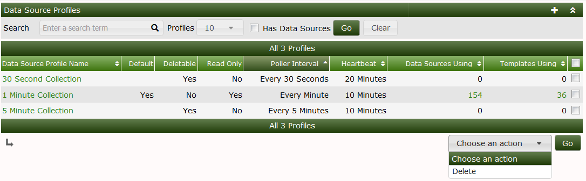
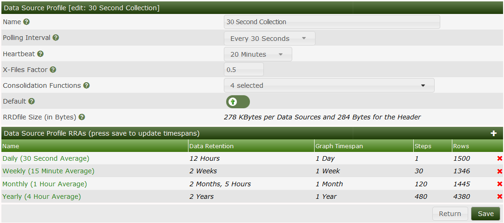
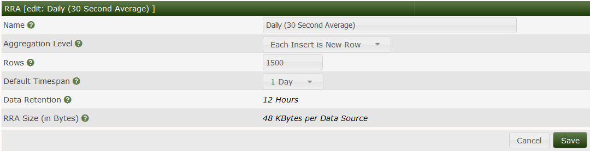

# Data Source Profiles

**Data Source Profiles** define sampling intervals, heartbeats, consolidation
functions and archive retention for data sources. A profile controls how an RRD
file is created. Selecting another profile does not convert an existing file.





## Configure a profile for new data sources

Open **Console > Presets > Data Profiles**. Create a profile or duplicate an
existing one, then set its sampling interval, heartbeat and consolidation
functions. Edit its archive rows and aggregation durations for the desired
retention before assigning it to new templates or data sources.

Archive settings are read-only when existing local sources use that profile.
Duplicate the profile and edit the copy for new sources instead of deleting all
graphs to unlock the editor. More rows, series, archives and consolidation
functions require more disk space; the profile's displayed estimate is more
useful than a fixed size table copied from a different configuration.



## Calculate retention

Each RRA row covers the base sampling step multiplied by the number of primary
data points consolidated into it:

```text
row_seconds = profile_step_seconds * archive_steps
retention_seconds = rows * row_seconds
rows = desired_retention_seconds / row_seconds
```

For three days (259,200 seconds) of one-minute rows, use 4,320 rows. For the
same retention at five-minute aggregation, use 864 rows. Round up when the
division is not exact. The GUI presents aggregation durations; the stored
`steps` value is their multiplier of the base step, not a count of rows per
hour.

Each archive maintains its own data and retention. Older data does not move
from one archive into another when the graph timespan changes. Inspect the
existing file's `step`, `pdp_per_row` and row count with `rrdtool info` before
planning a conversion.

## Change existing collection

By default, **Change Profile** changes the selected template definitions for
future sources. On this development branch, **Update database for existing Data
Sources?** also updates attached database definitions and launches a
poller-cache rebuild. That option still does not change existing RRD files. Use
it only as part of a planned migration with matching file structure and
collection settings.

Back up the database, configuration and RRD files as a matching recovery set.
Record affected sources, their actual file layouts, consolidation functions,
retention, ownership and collection schedule. Pause writes while converting
files and test the procedure on copies first.

Choose the conversion for the actual change. RRDtool can tune supported fields,
resize archives, and, in versions 1.5 and later, add or remove data sources.
Changing resolution or rebuilding archives can require a new destination RRD
and an explicit data migration. On the main collector, Cacti's
`cli/splice_rrd.php` merges an old file with a prepared destination file; it
does not choose the new profile, create a migration plan or recover detail
already consolidated away. Consult the selected release's `--help` and validate
the result before replacing a live file.

Deleting every graph is not a prerequisite for a profile migration. The
`cli/remove_graphs.php --all` selection by itself is a dry run; `--force`
performs removal, and eligible data sources are removed by default unless
`--preserve` is supplied. Do not use this operation as a profile-editing
shortcut.

For RRDtool operations, see [tune][tune], [resize][resize], and [info][info].
Changing the collector's cron interval is separate from converting its data.

[tune]: https://oss.oetiker.ch/rrdtool/doc/rrdtune.en.html
[resize]: https://oss.oetiker.ch/rrdtool/doc/rrdresize.en.html
[info]: https://oss.oetiker.ch/rrdtool/doc/rrdinfo.en.html

---
Copyright (c) 2004-2026 The Cacti Group
