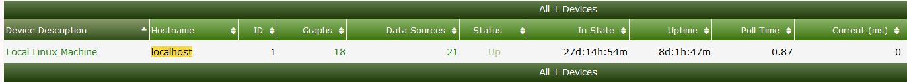
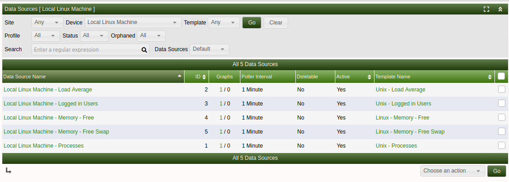

# Data Source Management

A Cacti data source connects a collection definition to an RRD file. Each file
can contain more than one named RRDtool series, such as `traffic_in` and
`traffic_out`. Graphs refer to those series; they do not each require a separate
collection definition.

## Counts and reuse

A switch with traffic graphs for 24 ports can have 24 Cacti data sources and
24 RRD files, each with inbound and outbound series. Additional graphs can
reuse those sources. Reuse depends on the template and creation settings;
creating another graph does not guarantee reuse in every case.

Poller statistics count collection items and processed RRD files separately.
Do not treat `DataSources` in the poller log as a universal count of RRD files,
graphs, or the rows shown on the Data Sources management page.

Check device-level counts under **Console > Management > Devices**:

## Storage and sampling

Storage depends on the number of series, sampling interval, archive rows,
consolidation functions, and retention defined by the
[Data Source Profile](Data-Profiles.md). Use the profile's estimate and inspect
representative files with `rrdtool info`; there is no single file size for all
one-minute or five-minute data sources.

Changing a profile or template does not automatically convert an existing RRD
file's layout. Plan and back up any migration of existing data separately from
changes to future source definitions.

## View data sources by device

Open **Console > Management > Data Sources** and filter by device or template.
Inspect the data source's collection method, path, active state, and associated
graphs before changing it.

The **Orphaned** filter identifies data sources without graph references.
Review whether a plugin or external process still needs a source before
removing it. RRD cleanup is controlled separately by the installation's
[Paths settings](Settings-Paths.md#rrd-cleaner).

For missing values, use [Data Source Debugging](Data-Debug.md) and the
[Cacti log](Cacti-Log.md). Check device reachability, poller ownership, file
permissions, and the last update time before changing a template.

---

Copyright (c) 2004-2026 The Cacti Group
