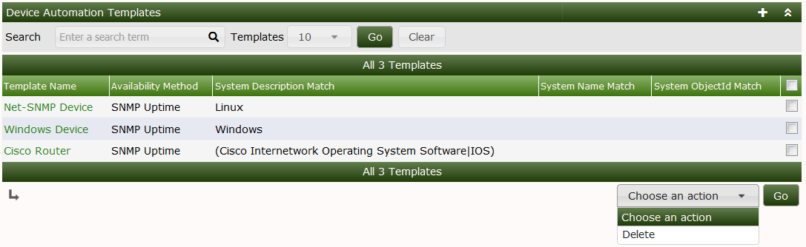
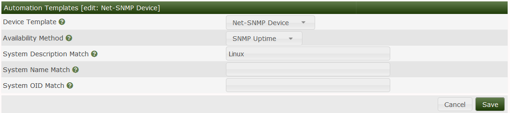

# Automation Device Rules

This section will describe **Device Rules** in Cacti.

Cacti Automation relies on create device Rules these rules help the automation
process figure out what type of device is being scanned.  Based on the device
rule REGEX the automation engine can apply the appropriate template to the
device i.e if there is a REGEX for IOS.  The automation engine may pick the
Cisco router template for the device.

Below you will be able to choose a REGEX that will help identify the device
the REGEX can be in any Perl supported format.  You can select either to
match the system description (`sysDescr`), which commonly describes the
platform and software, or the system name (`sysName`), which is the agent's
configured name.

An example regex for Cisco would be (Cisco Internetwork Operating System
Software|IOS). Apply this example to the system description, not the system
name. Check the strings actually returned by the device before using it.

Using this info automation would apply the appropriate device template you
choose.  If you see below we match for a system that matches Linux once a
device is found with the matching description it is assigned the Net-SNMP device
template.

If the System/Device you are matching has a unique OID you can also match based
on that.

Place specific product-family rules before broad vendor rules. A matching
description, name or system object ID selects a
[device template](Device-Templates.md); it does not probe every measurement
in that template or establish model compatibility. Verify the template's
queries against representative devices before enabling broad discovery.
Configure [graph rules](Graph-Rules.md) separately to select graphs from the
available query rows.

---
Copyright (c) 2004-2026 The Cacti Group
