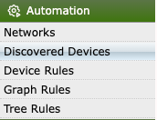
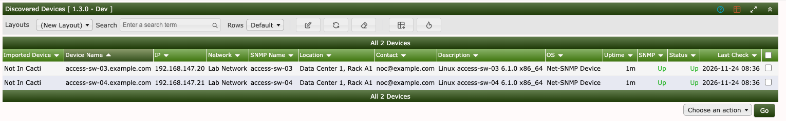

# Automation Discovered Devices

After you initiate a scan from Automation, Cacti will compare devices
found to the device rules and SNMP options you set.

If Cacti is unable to match the device to a device template or is unable to
find a proper SNMP credential, the device is placed in this section.

Also, if you have the automatically add to Cacti option set to off, the
devices will be put in this section.

The Discovered Devices section can be found by navigating to the
following area.

Below you can see devices that have been found during the scan that did
not meet the match criteria.

You will see the IP that was scanned as well as the resolved
hostname, if available, either via DNS or NetBIOS.

You can then select the device you are interested in adding. Click the
checkbox next to the device.

On the dropdown, select add device. This will bring up the below menu.
From this menu you will be able to fill out the details of the new device.

---
Copyright (c) 2004-2026 The Cacti Group
