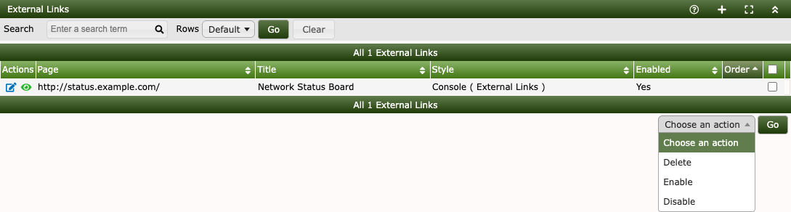
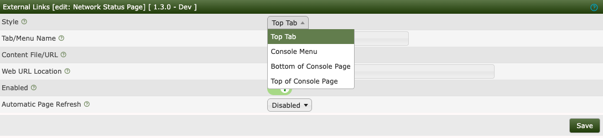
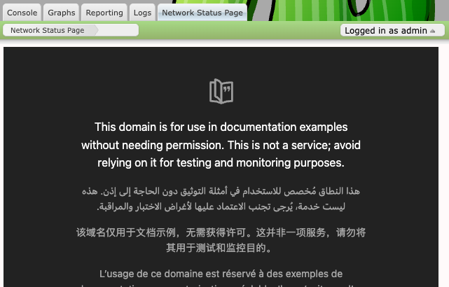

# External Links

This section will describe **External Links** in Cacti.

External Links allows Administrators to add tabs to external links within
the Cacti GUI. This can be for example to google.ca

When the user clicks on the Tab an iframe will display the webpage.

This feature can be very useful to create a single UI for helpdesk/NOC.

The settings for an External Link include:

- **Style** - Where should this page appear? The options are `Top Tab`,
  `Console Menu`, `Bottom of Console Page` and `Top of Console Page`.

- **Console Menu Section** - Under which Console heading should this item
  appear? All External Link menus will appear between Configuration and
  Utilities.

- **New Console Section** - If you don't like any of the choices above, type a
  new title in here.

- **Tab/Menu Name** - The text that will appear in the tab or menu.

- **Content File/URL** - The file that contains the content for this page. This
  file needs to be in the Cacti `include/content/` directory. Select
  `Web URL Below` to use a URL instead.

- **Web URL Location** - The valid URL to use for this external link. It must
  include the type, for example `http://www.cacti.net`. Note that many websites
  do not allow them to be embedded in an iframe from a foreign site, and
  therefore External Linking may not work. The default is
  `http://www.cacti.net`.

- **Enabled** - If checked, the page will be available immediately to the admin
  user. It is checked by default.

- **Automatic Page Refresh** - How often do you wish this page to be refreshed
  automatically. The options are `Disabled` and the poller intervals.

---
Copyright (c) 2004-2026 The Cacti Group
