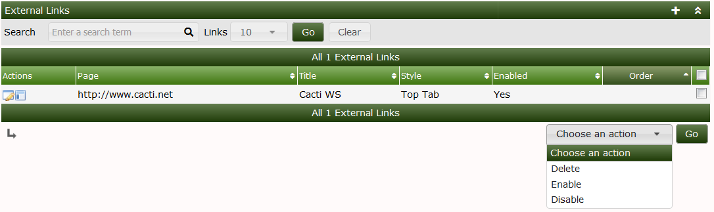
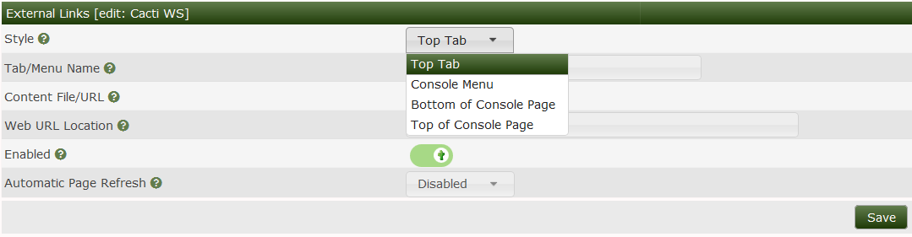
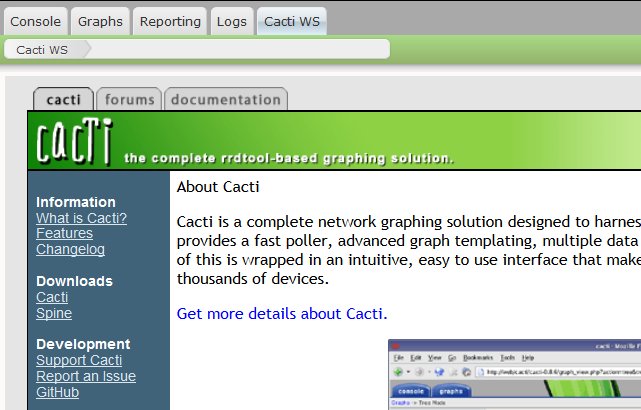

# External Links

This section will describe **External Links** in Cacti.

External Links lets administrators add navigation entries for approved URLs.
Choose a destination that permits embedding when using an iframe.

An embedded destination can refuse display through its own frame policy. HTTPS
Cacti pages also cannot freely embed HTTP content. Check the destination and
Cacti content security policy; do not weaken site-wide controls just to embed
an unrelated website.

This feature can be very useful to create a single UI for helpdesk/NOC.

---
Copyright (c) 2004-2026 The Cacti Group
