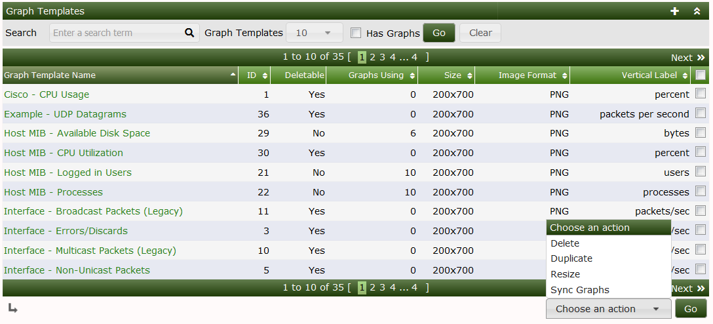
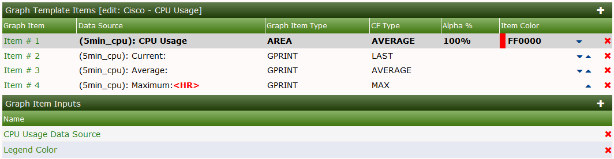
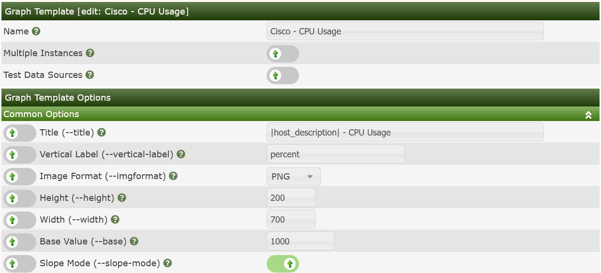
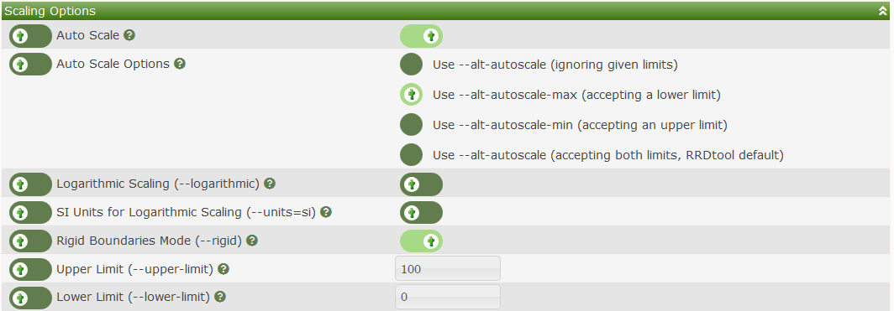
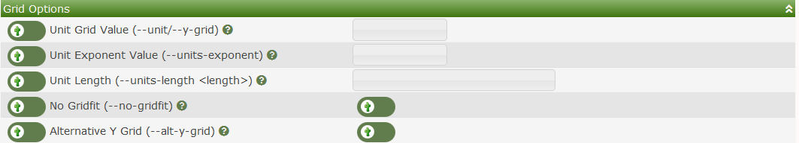
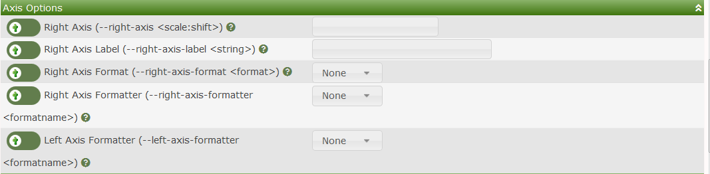
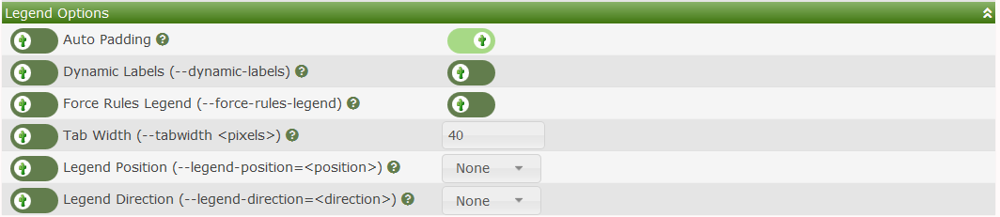

# Graph Templates

**Graph Templates** are Cacti objects that allows you to define how RRDtool is
to render a Cacti **Graph**.  Most RRDtool options are supported including
CDEF's and VDEF's, Left and Right Axis, Ticks and Dashes, multiple Auto Scaling,
Grid, and Legend Options.

The purpose of **Graph Templates** is to simplify the **Automation** process by
pre-defining the layout of **Graphs** for various metrics that are to be
monitored in Cacti.  When used in Conjunction with Cacti's **Graph Rules**, you
can automatically create just about any **Data Query** based **Graph** during
Cacti's **Network Discovery** process.

The **Graph Templates** main screen looks like the image below:

The list shows template IDs, the number of attached graphs, default size, image
format and vertical label. IDs are useful for CLI operations. Deletability is
based on referencing graph instances, not simply on a device-template
association. A template with attached graphs is shown as non-deletable.

The Actions menu contains:

###### Table 1. Graph template actions

| Action | Effect |
| --- | --- |
| Delete | Remove a deletable template. |
| Duplicate | Create a separate copy of the template. |
| Change Settings | Apply selected common settings, such as graph dimensions. Review the confirmation form before applying them. |
| Full Sync Graphs | Reconcile attached graphs with the selected template's full definition. Use when quick synchronization is insufficient. |
| Quick Sync Graphs | Repair graph-item differences with less work than a full synchronization. Try this first for item mismatches. |

Synchronization changes existing graph definitions. Back up relevant database
objects and review local graph inputs before applying a fleet-wide change.

The editor groups its fields into these sections:

###### Table 2. Graph template sections

| Section | Purpose |
| --- | --- |
| Graph Template Items | Ordered drawing and legend items. |
| Graph Item Inputs | Fields applied to one or more items; data-source inputs are normally created automatically. |
| Graph Template | Name, multiple-instance policy and data-source testing. |
| Common Options | Title, vertical label, image format, dimensions, base and slope mode. |
| Scaling Options | Automatic scaling and optional upper/lower bounds. |
| Grid Options | Canvas grid rendering. |
| Axis Options | Right-axis conversion and formatting. |
| Legend Options | Legend placement and formatting. |

Each of these sections are displayed below for reference.  For more information
on how to use these options, please visit the [RRDtool
Website](http://RRDtool.org).

The *Graph Items* make up what is draw within the canvas of the Graph.  There
are several *Graph Item* types including:

###### Table 3. Common graph item types

| Type | Purpose |
| --- | --- |
| AREA | Fill a plotted area. |
| AREA:STACK | Stack an area on a preceding plotted item. |
| COMMENT | Print legend text, including supported replacement variables. |
| GPRINT | Print a value with a GPRINT preset and applicable CDEF or VDEF. |
| GPRINT:AVERAGE / LAST / MAX / MIN | Print a value using the selected consolidation function. |
| HRULE | Draw a horizontal rule using the configured value. |
| LEGEND | Create Current, Average and Maximum GPRINT items. |
| LEGEND_CAMM | Create Current, Average, Minimum and Maximum GPRINT items. |
| LINE1 / LINE2 / LINE3 | Draw a line of the selected width. |
| LINE:STACK | Stack a line on a preceding plotted item. |
| TEXTALIGN | Set alignment for subsequent text. |
| VRULE | Draw a vertical rule at a time position. |

The canvas is painted from the first *Graph Item* till the last with each
successive *Graph Item* rendered on top of the previous.  Please keep this in
mind when creating a **Graph Template**.

## Graph Template - General and Common Options

- **Name** - Identifies the template in Cacti; it is separate from the graph's
  title pattern. A prefix such as `Net-SNMP` can help organize related
  templates.

- **Multiple Instances** - Allow more than one graph of this template on a
  device through the New Graphs interface.

- **Test Data Sources** - Require a valid data-source response before creating
  a graph. This helps a generic device template select applicable measurements.
  Long-running scripts can increase graph-creation time when testing is
  enabled.

Common options set the title pattern, vertical label, dimensions and image
format. Use base `1000` for decimal scaling, such as traffic, and `1024` for
binary scaling, such as memory. Decimal MB and binary MiB are different unit
conventions; MiB means mebibytes. The base controls display scaling, not a
conversion of stored measurements. **Slope Mode** smooths the rendered lines.

## Graph Template - Scaling Options

The *Scaling Options* allow the Administrator to apply either *Rigid* or *Auto
Scaling* settings to the resulting *Graph*.  These options are fairly self
explanatory.  However, you can always view the RRDtool Documentation online for
more information.

## Graph Template - Grid Options

The *Grid Options* are rarely necessary unless you have specific requirements to
render the resulting **Graphs** with some exotic unit.

## Graph Template - Axis Options

The *Axis Options* allow you to define a *Right Axis* and optional *Formatters*.

## Graph Template - Legend Options

The *Legend* options allow you to specify how the *Legend* should be placed on
the resulting **Graph** modern RRDtool has several options that were not
available in Cacti prior to Cacti 1.0.

---
Copyright (c) 2004-2026 The Cacti Group
