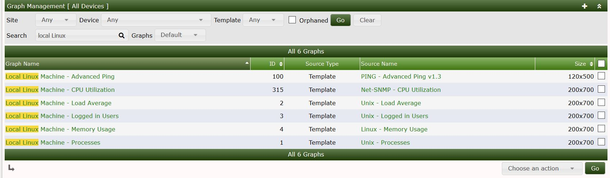
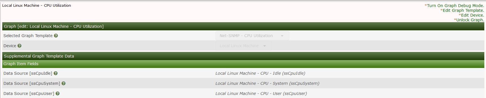
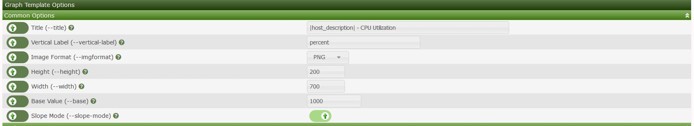

# Graph Management

This section will describe **Graph** management in Cacti.

Cacti features a way to view the graphs per device via the console. This allows
the administrator to view the graphs that are attached to a specific device. You
can also search by type of graph. Below we search for graphs that are
associated with the local linux server

Clicking on one of the graphs in the list shows the below menu. From this menu
you can enable debugging on the specific graph you can also change the template
of the graph amongst other things

### Modifying the graph template

An individual graph inherits managed settings from its graph template. Editing
that graph does not update the template or other graphs. Fields marked
**Use Per-Graph Value** in the template can be set independently on each graph.

To change shared settings, edit the [Graph Template](Graph-Templates.md) under
**Console > Templates > Graphs**. Review the affected graphs first: template
changes propagate to attached graphs for fields managed by that template.

---
Copyright (c) 2004-2026 The Cacti Group
