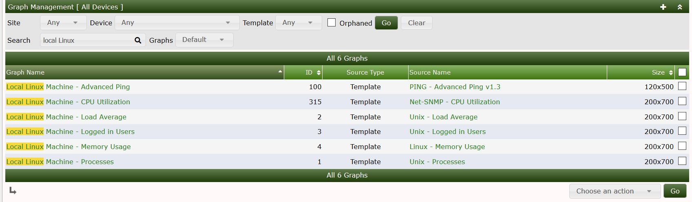
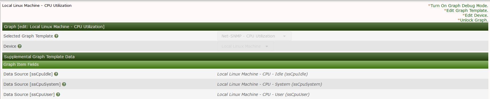
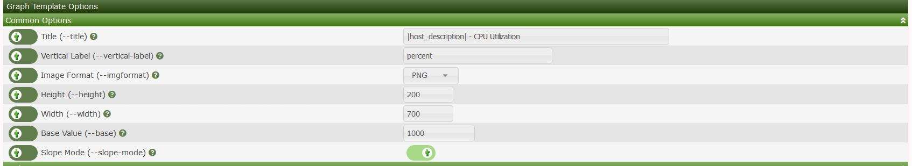

# Graph Management

This section will describe **Graph** management in Cacti.

Cacti features a way to view the graphs per device via the console. This allows
the administrator to view the graphs that are attached to a specific device. You
can also search by type of graph. Below we search for graphs that are
associated with the local linux server



### Graphs per page and PHP input limits

The **Graphs** list includes predefined page sizes through 5,000. Cacti removes
any size greater than PHP's effective `max_input_vars` value minus 20. The
20-variable reserve leaves room for the filter and action controls submitted
with the graph selections.

With PHP's default `max_input_vars = 1000`, the largest predefined value that
fits below the resulting 980-variable limit is 750. This protects bulk graph
actions: PHP emits a warning and truncates later request variables when a form
submits more values than the configured limit.

To make the 1,000 through 5,000 choices available, increase `max_input_vars` in
the configuration used by the web PHP SAPI. For example, the following value
exposes the 5,000 option while retaining Cacti's reserve:

```ini
max_input_vars = 5100
```

The CLI and web server can load different `php.ini` files. Change the
configuration used by PHP-FPM or the Apache PHP module, then restart that
service. The setting cannot be changed at runtime with `ini_set()` because PHP
classifies it as `INI_PERDIR`. Increase it only as far as the installation
requires because it also bounds how many GET, POST, and cookie variables PHP
accepts. See [PHP's `max_input_vars` documentation][ref-1].

Clicking on one of the graphs in the list shows the below menu. From this menu
you can enable debugging on the specific graph you can also change the template
of the graph amongst other things



### Modifying the graph template

An individual graph inherits managed settings from its graph template. Editing
that graph does not update the template or other graphs. Fields marked
**Use Per-Graph Value** in the template can be set independently on each graph.

To change shared settings, edit the [Graph Template](Graph-Templates.md) under
**Console > Templates > Graphs**. Review the affected graphs first: template
changes propagate to attached graphs for fields managed by that template.



[ref-1]: https://www.php.net/manual/en/info.configuration.php#ini.max-input-vars

---
Copyright (c) 2004-2026 The Cacti Group
