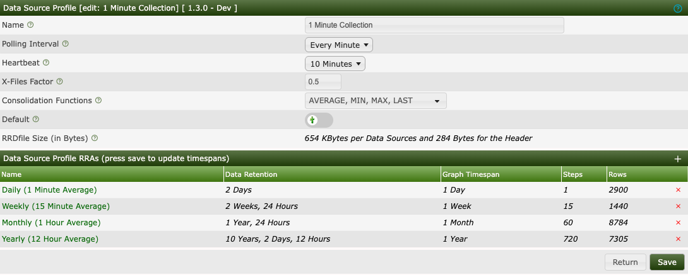
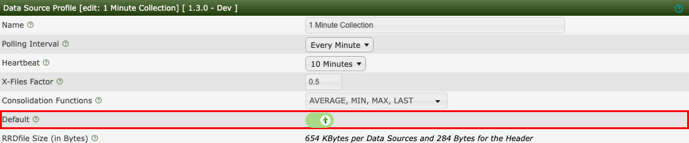
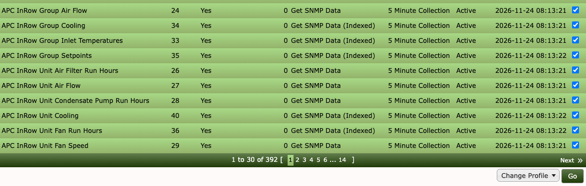

# Change poller interval from 5 minutes to 1 minute 

This howto describes all necessary steps to convert your Cacti to a 1 minute poller interval. This causes one gap in graphs during the conversion. The gap size depends on the number of your RRD files.

## Prerequisites and default values used in this howto
- Cacti installation directory is **/usr/local/share/cacti/**
- PHP binary is **/usr/local/bin/php**
- RRD files are in **/usr/local/share/cacti/rra**
- Poller is running by user **cacti**
- **Not structured RRDfile paths** (`Configuration->Settings-> Data` -> Structured RRDfile Paths). With a structured path you will have more work to splice RRD files. You need to change the splice script.
- Crontab row looks like
```shell
*/5    *       *       *       *       cacti   /usr/local/bin/php /usr/local/share/cacti/poller.php 2>&1
```


## Backup your Cacti
Before this operation, back up the Cacti database and all data in the rra folder.


## RRDCleaner (optional step)
You can run rrdcleaner and delete unused RRD files. It can decrease the conversion time.
[System Utilities](System-Utilities.md)


## Stop poller
Disable your poller in Crontab or via the GUI `Console -> Configuration -> Settings -> Poller tab -> Data Collection Enabled`


## Prepare directory structure for RRD file convert
```shell
mkdir -p /tmp/cacti/rrd_old
mkdir -p /tmp/cacti/rrd_new
mkdir -p /tmp/cacti/rrd_fin
```
Make sure that you have enough space on the temporary disk. You need more than twice the size of the rra directory.


## Move rrd files
```shell
mv /usr/local/share/cacti/rra/* /tmp/cacti/rrd_old/
```

## Check or create Presets -> Data profiles
Go to `Console -> Presets -> Data Profiles`. There should be at least a 5 Minute Collection profile (because you have been using it until now) and a 1 Minute Collection profile.
If the second is missing, create it.


Remember the Data profile ID. Edit your 1 minute collection again and the URL will be .../data_source_profiles.php?action=edit&**id=3**


## Switch to 1 min 
`Console -> Configuration -> Settings -> Poller tab`
- Poller interval = Every minute
- Cron/Daemon interval = Every minute


## Update database records
Run these SQL queries:
```shell
UPDATE data_template_data SET rrd_step=60 WHERE rrd_step=300;
UPDATE data_template_rrd SET rrd_heartbeat=600;
```
Here, replace X with the ID from the step "Check or create Presets -> Data profiles":
```shell
UPDATE data_template_data SET data_source_profile_id=X;
```

## Rebuild poller cache
`Console -> Utilities -> System utilities -> Rebuild Poller Cache`

## Set 1 min Data Profile as default
`Console -> Presets -> Data Profiles`

Edit profile **1 min Collection** and check the default checkbox.



## Change profile for all Data templates
`Console -> Templates -> Data Source`

Select all -> Change Profile



## Run the poller once
New RRD files with the correct 1 min profile will be created in the **/usr/local/share/cacti/rra** directory.
The Cacti log should not contain errors.

## Move new rrd files to temporary folder
```shell
mv /usr/local/share/cacti/rra/* /tmp/cacti/rrd_new/
```

## Run splice
You need to run the splice command for each RRD file. This could be time consuming, depending on the number of files. You can use a tool for parallel tasks.
The splice_rrd.php file is designed to allow two RRDfiles to be merged. This utility can effectively change the resolution/step of an RRDfile so long as the new RRDfile already has the correct step.

Basic script:
```shell
#!/bin/sh

cd /tmp/cacti/rrd_old/
for f in *.rrd
do
    echo $f
    /usr/local/bin/php /usr/local/share/cacti/cli/splice_rrd.php --oldrrd=/tmp/cacti/rrd_old/$f --newrrd=/tmp/cacti/rrd_new/$f --finrrd=/tmp/cacti/rrd_fin/$f
done
```

Run the script and wait. In my experience, 5200 files took 100 minutes without parallelization. The script will output something like:
```console
fortigate_1_-_fg200e4q17911506_traffic_in_7317.rrd
NOTE: Using Native Arrays due to lack of SQLite.
NOTE: Using RRDtool Version 1.8.0
NOTE: RRDfile will be written to '/tmp/cacti/rrd_fin/fortigate_1_-_fg200e4q17911506_traffic_in_7317.rrd'
NOTE: Re-Importing '/tmp/fortigate_1_-_fg200e4q17911506_traffic_in_7317.dump.27482713' to '/tmp/cacti/rrd_fin/fortigate_1_-_fg200e4q17911506_traffic_in_7317.rrd'
NOTE: Time:0.88, RUsage:18 MB
```


## Move spliced files back to cacti
```shell
mv /tmp/cacti/rrd_fin/* /usr/local/share/cacti/rra/
```
The file owner should be cacti:
```shell
chown cacti /usr/local/share/cacti/rra/*
```

## Enable poller in Cron again
Change your cron settings from 5 minutes to 1 minute and enable (uncomment). Old row:
```shell
#*/5    *       *       *       *       cacti   /usr/local/bin/php /usr/local/share/cacti/poller.php 2>&1
```
New row:
```shell
*    *       *       *       *       cacti   /usr/local/bin/php /usr/local/share/cacti/poller.php 2>&1
```

