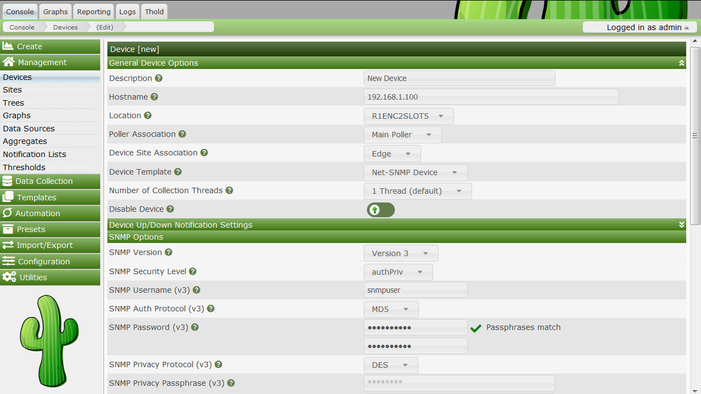
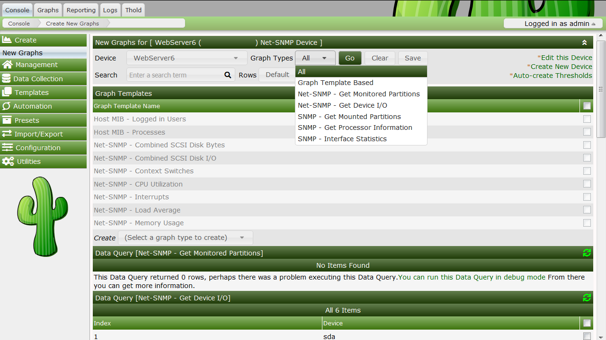

# How to Graph Your Network

Create a device, select its measurements, and verify collection before adding
its graphs to a tree. The manual workflow below is useful for a first device.
[Automation](Automation-Networks.md) can perform these tasks for larger sets of
devices once its discovery and graph rules are configured.

## Creating a Device

Open **Console > Management > Devices** and click **Add**. Enter a description
and address, choose the responsible data collector, and select a suitable
[Device Template](Device-Templates.md). The template supplies associated graph
templates and data queries; it does not restrict you to those defaults.

### Device Field Definitions

- **Description** identifies the device in lists and default graph titles.
- **Hostname** is the device's address or resolvable DNS name.
- **Device Template** associates collection and graph definitions.
- **Poller Association** determines which collector reaches the device.
- **Site** groups devices by location.
- **Notes** records local information about the device.
- **Disable Device** stops collection while retaining its configuration.

### Availability/Reachability Options

Choose a downed-device detection method appropriate to the device. Cacti can
use SNMP, ping, both, either, or no availability test. A failed availability
check can prevent measurements from being collected even when another
protocol is reachable.

For ping checks, select the method, port where applicable, timeout, and retry
count. ICMP permissions depend on the poller engine and operating system.
Test connectivity from the collector assigned to the device.

### SNMP Options

Configure the SNMP version and credentials accepted by the device:

- **SNMPv3** supports authentication and privacy. Prefer `authPriv` with
  mutually supported SHA and AES protocols where the device supports them.
- **SNMPv2c** supports 64-bit counters, but its community is not encrypted.
  Restrict access to trusted collectors and networks.
- **SNMPv1** is for legacy devices and does not support 64-bit counters.

Set the SNMP port, timeout, retries, and maximum OIDs per request. Start with
values the device supports; increase request sizes only after verifying that
responses are complete and collection remains reliable.

### Security Options for SNMP V3

Choose the security level, username, authentication protocol and passphrase,
privacy protocol and passphrase, and context or engine ID when required.
The protocols offered depend on Cacti settings and the installed SNMP builds.
The development defaults use SHA authentication and AES privacy. MD5 and DES
are legacy algorithms and can be hidden by policy or unavailable in the build.

#### SNMP Retrieval Types

Cacti's PHP paths can use PHP's SNMP extension or external Net-SNMP tools.
The extension supports SNMPv1, v2c, and v3; Cacti can select external tools for
protocol combinations unavailable in the extension. Spine uses Net-SNMP
through its C library. Verify the actual PHP, Net-SNMP, and Spine builds rather
than assuming all offered algorithms are available on every platform.

### Verify device discovery

Save the device and check the SNMP information and any error shown on the edit
page. Review **Associated Data Queries** and **Associated Graph Templates**.
If a query has no rows, run its verbose query to check connectivity, OIDs,
indexes, and credentials before creating graphs.

For interface traffic, prefer the 64-bit counter graph type when the device
and selected SNMP version support it. See [Data Queries](Data-Queries.md) for
query-to-template mappings and [Device Management](Devices.md) for other
availability and collection settings.

## Creating the Graphs

Open **Console > Create > New Graphs** or use **Create Graphs for this Device**
from the device page. Select the device, then choose the graph templates or
query rows to graph. For indexed queries, choose the appropriate graph type
before clicking **Create**.

Fill in any per-graph values requested by the templates and complete creation.
Creating a graph defines collection; it does not immediately provide historical
measurements. Allow scheduled polling to produce enough valid samples for the
selected data-source type.

## Verify and publish

1. Check the device's status and the [Cacti log](Cacti-Log.md) after polling.
2. Open the graph under **Console > Management > Graphs**. For blank graphs,
   inspect [Data Source Debugging](Data-Debug.md) and the RRD last update.
3. Add the graph or device to a [Tree](Trees.md), publish the tree, and grant
   the intended users access.
4. Confirm the result in [Viewing Graphs](Viewing-Graphs.md) with an account
   that has the intended permissions.

---

Copyright (c) 2004-2026 The Cacti Group
