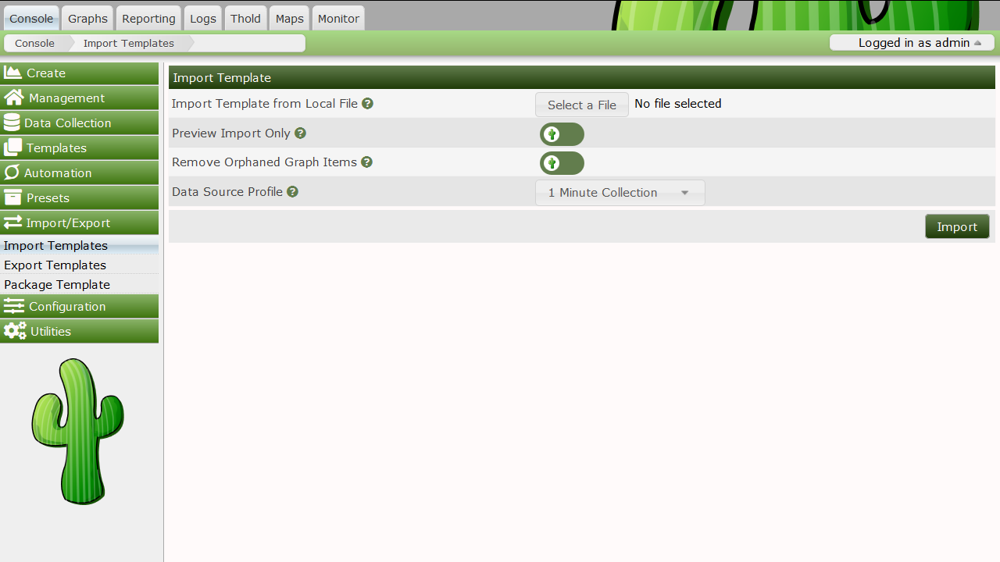

# Template Import

This section will describe **Template Import** in Cacti.

Template Import files are XML files used to add support for more graph types and
different devices that can be shared with others. These template files can
either be custom made or you could download them from the community on the cacti
forums.

## Template XML and signed packages

The **Import Templates** screen described below accepts template XML. It does
not install the signed `.xml.gz` packages bundled in `install/templates`.
Select those packages in the installer, or use `cli/import_package.php` on
the main collector for an existing installation. Run the CLI importer with
PHP from the Cacti installation and consult its `--help` output for options.
Its `--filename` option selects the signed package, and `--preview` previews
the import without applying it.

Packages include scripts and query resources as well as template definitions.
An ordinary XML import may require installing those resource files separately
according to the template author's instructions. Check the collection method
and dependencies before choosing a template; not all templates use SNMP.

## Import template XML

Once you have downloaded the graph/device template you are looking for you will
need to import the template into the cacti system. To import a device/graph
template go to `Console > Import/Export > Import Templates` you will now see
the below page

> **Important note**: When importing the template be sure to match the data source
> profile with your preferred **Data Source Profile**.

First you must click on **Select File** and browse to where the XML file is
located on your computer.  Cacti will default to preview the import to check for
any issues. If none are found, you can select the same file and then untick the
preview option to import after which the template should be available.

The `Remove Orphans` option should only be used if you have Templates that have become
damaged and the best way to correct them is to start over.  This option will
remove any **Graph Items** from any **Graph** that do not appear in the **Graph Template**
to be imported.  Use this option with care.

---
Copyright (c) 2004-2026 The Cacti Group
