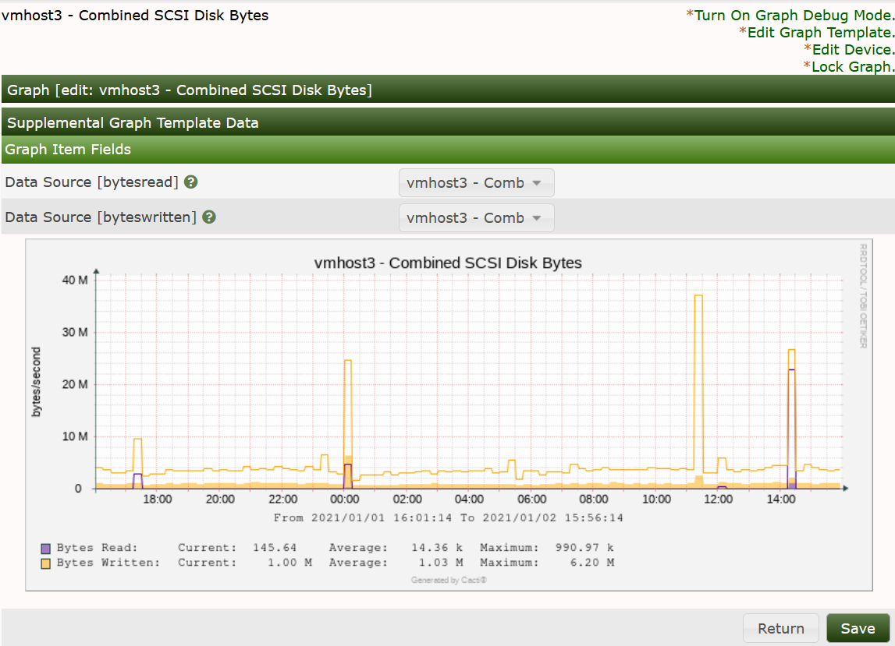

# Current Manuals and Contributed Archives

These replacements follow **develop**, the unreleased Cacti 1.3 series. Use
the [1.2.x manual][stable] for released Cacti 1.2. The version guidance follows
the website's distinction between released and development documentation.
The manuals reuse the maintained chapter content and existing documentation
styles. They do not import the website's visual design.

## Complete maintained manuals

- [PDF manual](resource/pdf/cacti-manual.pdf), with all current main chapters,
  bookmarks, screenshots, and links between chapters.
- [UTF-8 text manual](resource/manuals/manual.txt), with the same main chapters,
  command examples, image descriptions, and full link destinations.
- [HTML manual publication](resources/build/HTML-Manual.md), including all
  chapters and legacy chapter URLs.
- [Historical ReportIt manual](resource/pdf/manual_reportit.pdf). The newer
  plugin manual is maintained separately from these Cacti editions.

## Current replacements for contributed guides

The new guides are separate Cacti documentation, not revisions attributed to
the original contributors. German, Turkish, and Russian editions contain a
new localized introduction and complete relevant English chapters in their
PDF and text appendices. They are not full translations. Language review is
welcome; platform checks and runtime limitations still apply.

| Guide | Read online | PDF | Text |
| --- | --- | --- | --- |
| German installation and operation | [Deutsch](resources/manuals/Guide-de.md) | [PDF](resource/manuals/cacti-guide-de.pdf) | [Text](resource/manuals/cacti-guide-de.txt) |
| Turkish installation and operation | [Türkçe](resources/manuals/Guide-tr.md) | [PDF](resource/manuals/cacti-guide-tr.pdf) | [Text](resource/manuals/cacti-guide-tr.txt) |
| Linux installation | [English](resources/manuals/Install-linux.md) | [PDF](resource/manuals/install-linux.pdf) | [Text](resource/manuals/install-linux.txt) |
| Russian UNIX installation | [Русский](resources/manuals/Install-ru-unix.md) | [PDF](resource/manuals/install-ru-unix.pdf) | [Text](resource/manuals/install-ru-unix.txt) |
| Russian Windows installation | [Русский](resources/manuals/Install-ru-windows.md) | [PDF](resource/manuals/install-ru-windows.pdf) | [Text](resource/manuals/install-ru-windows.txt) |
| Windows installation | [English](Installing-Under-Windows.md) | [PDF](resource/manuals/install-windows.pdf) | [Text](resource/manuals/install-windows.txt) |
| Migration from Solaris | [English](resources/manuals/Migrate-solaris.md) | [PDF](resource/manuals/migrate-solaris.pdf) | [Text](resource/manuals/migrate-solaris.txt) |
| Development database schema | [Reference](resources/manuals/Schema-Reference.md) | [PDF](resource/manuals/schema-reference.pdf) | [Text](resource/manuals/schema-reference.txt) |

The German and Turkish appendices include every current main manual chapter.
Installation editions include the complete platform, first-graph,
troubleshooting, security, and upgrade chapters selected in
[editions.json](resources/manuals/editions.json). Solaris has a migration
guide rather than an unverified new-install procedure. The Windows guides
explain the current development dependency restriction before any install
instructions.

The [schema SQL](resource/manuals/cacti-schema.sql) contains only the pinned
upstream `CREATE TABLE` statements. It is a reference, not an installer or
upgrade script. It has no seed data and does not describe plugin tables.
Use the schema supplied with your exact Cacti release for installation.

This screenshot shows historical sample measurements and an earlier interface.
It is included in the operating guides, not evidence of a deployment on every
listed platform.

## Historical contributions

These originals remain archives at their existing URLs, with their original
credits and rights notices. Their obsolete dependencies and commands do not
apply to current installations. Do not overwrite them with the new guides or
present the new guides as work by the original contributors.

| Original | Credit from the original | Status |
| --- | --- | --- |
| [German documentation][old-de] | Sebastian Larisch, August 2006 | Archive |
| [Turkish handbook][old-tr] | Özgür Karataş, February 2006 | Archive |
| [Linux how-to][old-linux] | Lee Carter, 2004 | Archive |
| [Russian UNIX installation][old-ru-unix] | Translation by Александр Цапкин, December 2006 | Archive |
| [Russian Windows installation][old-ru-windows] | Translation by Александр Цапкин, December 2006 | Archive |
| [Solaris installation][old-solaris] | Original credit and notice remain in the archive | Archive |
| [Windows installation][old-windows] | Original credit and notice remain in the archive | Archive |
| [Previous PDF manual][old-pdf] | Original Cacti manual credits | Archive |
| [Previous text manual][old-text] | Original Cacti manual credits | Archive |
| [Database schema PDF][old-schema] | Original notice remains in the archive | Archive |
| [phpMyAdmin SQL][old-sql] | Original notice remains in the archive | Archive |

The [archive inventory][inventory] records each
original URL, byte count, and SHA-256 captured on 26 October 2026. Original
documents are not copied or translated into the new guides.

## Build and publish

Follow [manual publication](resources/build/Other-Manuals.md) to rebuild and
validate every edition. The [edition manifest][editions-manifest]
records exact sources and checksums. The PDF builder also records its locked
toolchain in [the PDF manifest](resource/pdf/build_manifest.json).

CI publishes review artifacts; it does not deploy the public file host.
Maintainers should publish the new editions under distinct versioned names,
link this index from the download page, and retain the original archive URLs.
Publish the main manual separately from the historic `manual.pdf` and
`manual.txt` names so an existing archive citation keeps its meaning.

[inventory]: resources/manuals/archive-inventory.json
[editions-manifest]: resource/manuals/build-manifest.json
[stable]: https://github.com/Cacti/documentation/blob/1.2.x/README.md
[old-de]: https://files.cacti.net/docs/contrib/Cacti-Doku_german.pdf
[old-tr]: https://files.cacti.net/docs/contrib/Cacti-El-Kitab.pdf
[old-linux]: https://files.cacti.net/docs/contrib/Cacti-Linux-How-To.pdf
[old-ru-unix]: https://files.cacti.net/docs/contrib/install_russian_unix.pdf
[old-ru-windows]: https://files.cacti.net/docs/contrib/install_russian_windows.pdf
[old-solaris]: https://files.cacti.net/docs/contrib/install_solaris.html
[old-windows]: https://files.cacti.net/docs/contrib/install_windows.html
[old-pdf]: https://files.cacti.net/docs/pdf/manual.pdf
[old-text]: https://files.cacti.net/docs/text/manual.txt
[old-schema]: https://files.cacti.net/docs/sql/database_schema.pdf
[old-sql]: https://files.cacti.net/docs/sql/phpMyAdmin.sql

---

Copyright (c) 2004-2026 The Cacti Group
