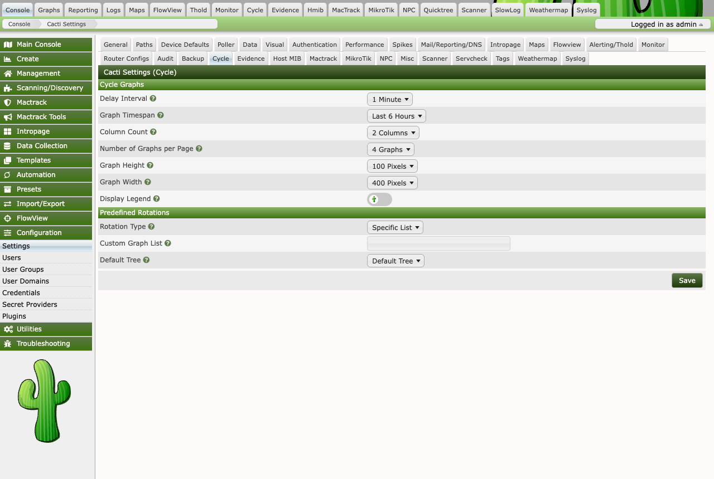

# Cycle

The Cycle plugin shows Cacti graphs one page at a time and advances
automatically after a delay. It suits operations displays that show a changing
set of graphs without anyone clicking through them. The set can come from a
graph tree or branch, from a list of graph IDs, or from all graphs.

This page follows the plugin's `develop` branch, which is unreleased and can
change. The branch declares version 4.3 and Cacti compatibility 1.2.29 in its
`INFO` file. It is not presented here as a released version.

## Requirements

- Cacti 1.2.29 or later, as declared in `INFO` (version 4.3).
- No other plugins, PHP extensions, or external programs are required.
- The plugin creates no database tables.

## Installation

Copy the plugin into `plugins/cycle` in the Cacti directory, then install and
enable it as described in [Plugin Management](Plugins.md). Grant the
**Plugin -> Cycle Graphs** realm to the users who need the view.

## Permissions

| Realm | Pages |
| --- | --- |
| **Plugin -> Cycle Graphs** | `cycle.php` |

The graph refresh is served by `cycle.php` with `action=graphs`. Graphs a user
cannot access are not shown.

## Settings

Defaults are set on the **Cycle** tab of **Console > Configuration >
Settings**. Each user can override the same fields in their own profile,
under the **Cycle** tab of the graph settings.

| Setting | Default | Purpose |
| --- | --- | --- |
| **Delay Interval** | 60 | Time in seconds before the next graph is displayed. |
| **Graph Timespan** | 5 | Default timespan of the displayed graphs (a Cacti timespan option). |
| **Column Count** | 2 | In Tree Mode, the number of columns used. |
| **Number of Graphs per Page** | 4 | Graphs shown at one time (1, 2, 4, 6, 8, or 10). |
| **Graph Height** | 100 | Graph height in pixels (75 to 500). |
| **Graph Width** | 400 | Graph width in pixels (100 to 1500). |
| **Display Legend** | unset | Show the graph legend. |
| **Rotation Type** | Specific List | **Legacy (All)**, **Specific List**, or **Tree Mode**. |
| **Custom Graph List** | empty | Comma-delimited graph IDs for **Specific List**, for example `1,2,3,4`. |
| **Default Tree** | None | The tree to cycle when **Tree Mode** is selected. |

If **Rotation Type** is **Specific List** and the list is empty, the plugin
cycles through all graphs.

The screenshot above shows the **Cycle** settings tab. It uses synthetic data.

## Using Cycle

Open the **Cycle** tab in the Cacti header. The page has a **Cycle Graph
Filter** box with a **Next Update In** countdown, and a **Cycle Graphs** box
that holds the images.

Controls in the filter box:

- Timespan, refresh delay, and graphs per page selectors.
- **Prev**, **Stop** (which becomes **Start** while stopped), **Next**,
  **Refresh**, **Clear**, and **Save** buttons.
- Column count, graph height and width, and a **Legend** checkbox.
- In Tree Mode, a tree selector and a leaf selector (**All Levels**, **Top
  Level**, or a branch).
- A regular expression field that filters graphs by title.

To run a rotation:

1. Choose the **Rotation Type** and, for a list or tree, the list or **Default
   Tree** in the Cycle settings.
2. Open the **Cycle** tab.
3. Adjust the timespan, delay, and layout as needed.
4. Click **Save** to keep the current filter values as your own defaults.
5. Use **Stop** to pause the rotation and **Prev** or **Next** to move manually.

Graphs link to the normal graph page. Images are requested as SVG without
caching.

## Command-Line Tools

The plugin provides none.

## Troubleshooting

- **No Graphs Found Matching Criteria** appears when the selected tree, list,
  or title filter matches no graph that the user may see. Check the user's
  graph permissions and the selected tree, list, or filter.
- In **Specific List** mode, only numeric entries of the list are used.

## More Information

- [Plugin repository](https://github.com/Cacti/plugin_cycle)
- [Plugin README](https://github.com/Cacti/plugin_cycle/blob/develop/README.md)
- [Plugin Management](Plugins.md)
- [Supported plugins](supported-plugins.md)

---

Copyright (c) 2004-2026 The Cacti Group
