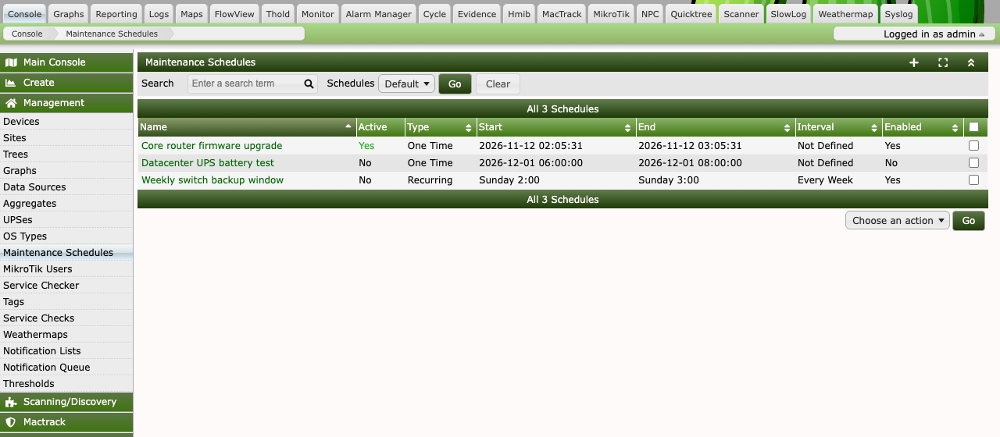

# Maintenance

The Maintenance Scheduler plugin (`maint`) lets you define maintenance
windows so that other plugins stop alerting on devices while work is in
progress. A window can be a single period or repeat every day or every week.
Administrators who use Thold, WebSeer, or Servcheck and want planned work to
stay quiet need it.

This page follows the plugin's `develop` branch, which is unreleased and can
change. That branch declares version 1.3 and Cacti compatibility 1.2.29 in its
`INFO` file.

## Requirements

- Plugin version 1.3 and Cacti 1.2.29 or later, as declared in `INFO`.
- The `INFO` file lists no required plugins and the plugin runs no external
  programs.
- The plugin does not suppress anything by itself. A plugin that supports it
  asks the Maintenance Scheduler whether an item is in maintenance. Cacti core
  hooks and the Thold, WebSeer, and Servcheck plugins use this check.
- The plugin tabs for associating items appear only when the matching plugin
  is enabled: **Thold Devices** needs Thold, **WebSeer** needs WebSeer, and
  **Servcheck** needs Servcheck.
- On Cacti older than 1.2.31, the README says to add a small snippet to
  `applySkin()` in `include/layout.js` so the **Cancel** buttons on forms
  work. See the README for the exact code.

## Installation

Install the plugin in `plugins/maint`, using the directory name `maint` rather
than `plugin_maint`. Then follow the generic steps in
[Plugin Management](Plugins.md) to install and enable it.

Installation creates two tables, `plugin_maint_schedules` and
`plugin_maint_hosts`. Uninstalling the plugin leaves both tables in place.

## Permissions

| Realm | Pages |
| --- | --- |
| **Maintenance Schedules** | `maint.php` |

The realm is added to the **System Administration** role when Cacti supports
role augmentation. Grant the realm to any other user who must manage
schedules.

## Settings

The plugin has no settings page. Everything is configured on each schedule,
described below.

## Using Maintenance

Open **Console > Management > Maintenance Schedules**. The list shows each
schedule with its name, whether it is active now, type, start, end, interval,
and enabled state.

The following example uses synthetic data. It shows the schedule list with
three schedules: a one-time schedule that is active, a one-time schedule that
is disabled, and a weekly recurring schedule.

Use the **Search** box to filter the list. The search also matches the
hostname, description, location, and site name of associated Thold devices and
the hostname and description of associated Servcheck tests.

### Create a schedule

1. Open **Console > Management > Maintenance Schedules** and click the plus
   icon.
2. On the **General** tab, enter a **Schedule Name** and leave **Enabled**
   checked.
3. Choose a **Schedule Type**: **One Time** or **Recurring**.
4. For a recurring schedule, choose an **Interval**: **Every Day** or
   **Every Week**.
5. Set **Start Time** and **End Time**. The form accepts most date and time
   formats.
6. Click **Create**.

The new schedule opens with additional tabs for associating items.

### Associate items with a schedule

1. Open the schedule and select the **Thold Devices**, **WebSeer**, or
   **Servcheck** tab.
2. Filter the list if needed. The device tab filters by site, data collector,
   location, and template, and can show only associated items.
3. Check the items and choose the **Associate** action, then click
   **Continue**. Choose **Disassociate** to remove them.

Items cannot be associated before the schedule is saved, because the tabs show
a message that the schedule must be created first.

### Schedule actions

On the schedule list, select schedules and use the actions:

- **Update Time (Now + 1 Hour)** sets the selected schedules to start now and
  end in one hour.
- **Delete** removes the schedules and disassociates their devices.

### Put a device in maintenance from the device list

The plugin adds two actions to the **Devices** list under **Console >
Management > Devices**, and two links at the top of the device edit page:

- **Enable maintenance for this device (now+1h)** creates a schedule that
  starts now and ends in one hour, and associates the selected devices with it.
  The confirmation page lets you set a schedule name (the default is Quick
  Maintenance), choose **One Time** or **Recurring**, and pick **Every Day**
  or **Every Week** for a recurring schedule.
- **Add device(s) to existing maintenance schedule** associates the selected
  devices with a schedule that you choose.

## Background Processing

The plugin has no poller hook and no scheduled task. When another plugin asks
whether an item is in maintenance, the plugin looks up the schedules for that
item and checks the time.

- A one-time window is active from its start time up to, but not including,
  its end time.
- When a recurring window has ended, the next check moves its start and end
  forward by whole days until the window is in the future or current. The new
  times are saved to the schedule and logged with an `INFO` message in the
  `MAINT` log category. The wall-clock hour stays the same across daylight
  saving changes.

## Troubleshooting

- If a recurring schedule never becomes active, check the Cacti log for a
  `WARNING` message from `MAINT` saying the schedule has an invalid recurring
  interval. The interval must be a whole number of days, so choose **Every
  Day** or **Every Week** and save the schedule again.
- A schedule must be **Enabled** and associated with the item to take effect.
- If **Cancel** buttons do nothing on Cacti older than 1.2.31, apply the
  `applySkin()` change from the README.

## More Information

- [Plugin repository](https://github.com/Cacti/plugin_maint)
- [README](https://github.com/Cacti/plugin_maint/blob/develop/README.md)
- [Plugin Management](Plugins.md)
- [Supported plugins](supported-plugins.md)

---

Copyright (c) 2004-2026 The Cacti Group
