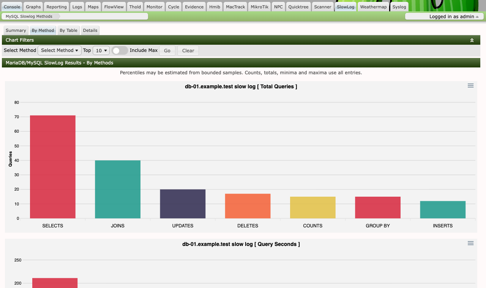

# Slowlog

The Slowlog plugin (`slowlog`) imports a MySQL or MariaDB slow query log into
the Cacti database and lets you look at it. You can see which statements are
slow, which kinds of statement and which tables they touch, and how query time
and row counts are distributed. Database administrators who tune the Cacti
database or another MySQL or MariaDB server need it.

This page follows the plugin's `main` branch, which is unreleased and can
change. That branch declares version 2.8 and Cacti compatibility 1.2.29 in its
`INFO` file.

## Requirements

- Plugin version 2.8 and Cacti 1.2.29 or later, as declared in `INFO`.
- The `INFO` file lists no required plugins.
- A MySQL or MariaDB Cacti database. On MariaDB the plugin creates its tables
  with the Aria engine, and on MySQL it uses InnoDB.
- The PHP binary configured in Cacti (the `path_php_binary` setting). A
  browser upload is queued and imported by a background `php` process started
  with that binary.
- The main Cacti server only. The `INFO` file declares no remote data
  collector support.
- The log formats read are MariaDB and MySQL 5.7 or 8.0. The time of each
  entry comes from its `SET timestamp=` line, so keep the PHP and database
  time zones the same.

## Installation

Install the plugin in `plugins/slowlog`, using the directory name `slowlog`
rather than `plugin_slowlog`. Then follow the generic steps in
[Plugin Management](Plugins.md) to install and enable it.

Installation creates these tables and loads the SQL reserved word list from
`docs/keywords.txt`:

| Table | Holds |
| --- | --- |
| `plugin_slowlog` | One row per imported log, with its status |
| `plugin_slowlog_details` | One row per slow query |
| `plugin_slowlog_details_methods` | The statement kinds found in each query |
| `plugin_slowlog_details_tables` | The tables found in each query |
| `plugin_slowlog_methods` | The statement kind dictionary |
| `plugin_slowlog_table_names` | Every table name seen, and whether it is a Cacti table |
| `plugin_slowlog_reserved_words` | SQL reserved words used by table detection |
| `plugin_slowlog_stats` | Cached totals and distributions for the charts |

Disable the plugin to keep its data. Uninstalling it drops all of these
tables, together with every imported log.

On upgrade to 2.8, users and groups that held the viewing realm receive the
management realm once so they keep import and delete access. Administrators
can narrow those grants afterward.

## Permissions

| Realm | Pages |
| --- | --- |
| **Plugin -> MySQL Slow Log Viewer** | `slowlog.php` |
| **Plugin -> MySQL Slow Log Management** | `slowlog_manage.php` |

The viewer realm gives read access. Importing, uploading, and deleting logs
need the management realm in addition to the viewer realm. A user without it
sees an error message when opening the import page.

## Settings

The plugin has no settings of its own. It registers an empty **Misc** tab
section that adds no fields.

## Using Slowlog

The plugin adds a **SlowLog** tab at the top of the Cacti interface for users
who hold the viewer realm. It opens the list of imported logs, titled
**MariaDB/MySQL SlowLog File Filters**. The plugin pages are:

- **Summary**: the imported logs with a **Search** box. Columns are
  **Description**, **Import Status**, **Status String**, **ID**, **Imported**,
  **Lines**, **Duration**, **Start Date**, and **End Date**.
- **By Method**: charts grouped by kind of statement.
- **By Table**: charts grouped by table.
- **Details**: every query of a log, with sorting, paging, and filters.
- A query page showing the original query text and its timings.

The following example uses synthetic data. It shows the **By Method** page for
a log from a test server: chart filters at the top, then bar charts of the
number of queries and of query seconds per statement kind.



Each chart page has the filters **Select Method** (or **Select Table**),
**Top**, and **Include Max**. The box-whisker charts show the 95th percentile
at the top of the box unless **Include Max** is on. Percentiles may be
estimated from bounded samples, while counts, totals, minima, and maxima use
all entries.

The **Details** page filters by **LogFile**, **Method**, **Tables**, **User**,
**Host**, a date range (**From** and **To**), and search text. Rows per page
are limited to 1000.

### Import a log from the browser

1. Open the **SlowLog** tab and click the import link in the title bar of the
   filter box. The page is **Import MariaDB/MySQL Slowlog**.
2. Choose the log file and enter a **LogFile Description**.
3. Choose **Max Query Length**: **All** or the first 1024, 2048, 4096, 8192, or
   16384 characters of each query.
4. Choose **Cacti Table Detection**:
   - **Detect all tables (no 'OTHER TABLES' grouping)** is the default.
   - **Use this Cacti Database; group other tables as 'OTHER TABLES'** compares
     tables with the Cacti database.
   - **Detect all tables; group tables not in the list below as 'OTHER
     TABLES'** uses the **Tables of Interest** list, separated by spaces. The
     list is required for this mode.
5. Submit the form.

The form also shows the **Max Upload Filesize**, **Max Post Size**, **Max
Execution Time**, and **Memory Limit** that apply. The file is staged in the
system temporary directory and a row is added to the list. The list shows
**Pre-Processing**, **Post-Processing**, **Complete**, or **Bad File Format**
for each log.

### Delete a log

On the log list, select one or more logs, choose the **Delete** action, and
confirm. Deleting needs the management realm.

## Background Processing

Browser uploads are imported by a background `php` process that runs
`import_log.php` and then removes the staged file. The plugin has no poller
hook and no recurring task. The plugin raises PHP execution time and memory
limits for the import form, uploads, and deletion only.

The command-line importer reads input incrementally and writes records in
batches of 1000. The `plugin_slowlog_details` table grows with every imported
query, so delete logs you no longer need.

## Command-Line Tools

`import_log.php` imports or reprocesses logs. Run it from the Cacti directory
as the poller user.

```console
php plugins/slowlog/import_log.php --logfile=/var/log/mysql/slow.log --description="db1 May"
```

Usage:

```console
usage: import_log.php [ --usecacti | --table-mode=cacti|reference|all ] --logid=N | --logfile=S | --reprocess=N|all
```

| Option | Meaning |
| --- | --- |
| `--logfile=S` | The log file to import as a new log |
| `--description=S` | Description to save (default `Imported using import_log.php`) |
| `--length=N` | Keep only the first N characters of each query, -1 for no limit (default -1) |
| `--table-mode=cacti\|reference\|all` | How to tell Cacti tables from other tables; `all` is the default |
| `--usecacti` | Same as `--table-mode=cacti` |
| `--table-names="t1 t2"` | Space-separated reference table list; required with `--table-mode=reference` |
| `--logid=N` | With `--logfile`, reuse an existing parent record; alone, finish processing that log |
| `--reprocess=N\|all` | Re-run method, table, and timeout classification for one log or all logs, without the original file |
| `--delete-after` | Delete the source file after successful processing |
| `--version`, `--help` | Show the version or the usage |

## Troubleshooting

- A log that shows **Bad File Format** could not be parsed as a MariaDB or
  MySQL slow log.
- If an import never starts, confirm that the `path_php_binary` setting points
  to a working PHP binary, because uploads are imported by a background
  process.
- For large logs, compare the upload and post size limits shown on the import
  form with the file size, or use `import_log.php` from the command line.
- The page `ERROR: You do not have permission to import or delete Slowlog
  files.` means the user lacks the management realm.
- Selecting the reference mode without a **Tables of Interest** list produces
  an error, because the list is required in that mode.

## More Information

- [Plugin repository](https://github.com/Cacti/plugin_slowlog)
- [README](https://github.com/Cacti/plugin_slowlog/blob/main/README.md)
- [Plugin Management](Plugins.md)
- [Supported plugins](supported-plugins.md)

---

Copyright (c) 2004-2026 The Cacti Group
