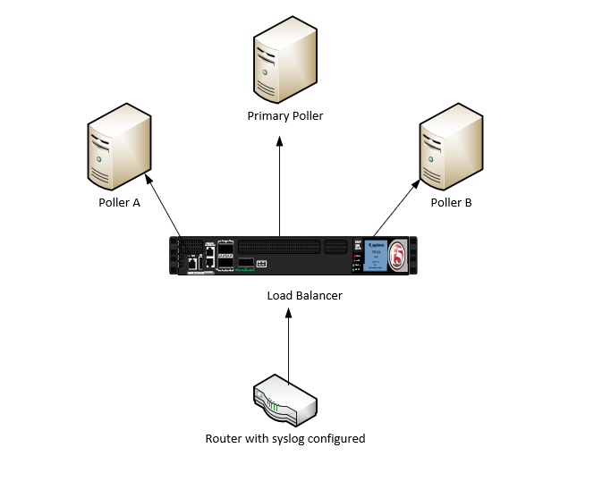

# syslog

The syslog plugin is a Cacti plugin that has been around for more than a
decade. It was inspired by the 'aloe' and 'h.aloe' plugins originally developed
by the Cacti users sidewinder and Harlequin in the early 2000s.  As you will
be able to see from the ChangeLog, it has undergone several changes throughout
the years, and remains a relevant plugin for small to medium-sized companies,
even today when enterprise offerings exist from both Elastic and Splunk.

It provides a simple Syslog event search, alert generation, and notification
interface that can generate both HTML and SMS messages for operations personnel
who wish to receive notifications inside of a data or network operations
center.

For log events that continue to be generated frequently on a device, such as
smartd's feature to notify every 15 minutes of an impending drive failure, can
be quieted using syslog's 'Re-Alert' setting.

Syslog also provides multipoller support, which allows for scalability and
redundancy by leveraging multiple servers. Rules can be created on the main
poller and pushed to the remotes for ease of management, or each server can work
independently.

## Features

- Message filter

- Message search

- Output to screen or file

- Date time picker

- Event Alerter

- Event Removal (for Events you don't want to see)

- Filter events by Cacti Graph window from Cacti's Graph View pages

- Use of native MySQL and MariaDB database partitioning for larger installs

- Remote Log Server connection capabilities

- Custom column mappings between Remote Log Server and required Syslog columns

- Remote poller support

- Saved searches, dashboards, and message recommendations in current
  development. Check the installed release's README for availability.

### Notes on upgrades

This chapter describes the current development plugin. Use the README and
release notes at your installed release tag for version-specific instructions:
[Syslog repository](https://github.com/Cacti/plugin_syslog) and [published
releases](https://github.com/Cacti/plugin_syslog/releases).

Back up the Cacti database, any separate Syslog database, and the plugin's
local configuration before an upgrade. Disable the plugin, replace its files
while preserving `config.php` or `config_local.php`, then follow Plugin
Management's upgrade advisor and re-enable it. **Do not uninstall the plugin as
an upgrade step:** uninstall options can delete messages, rules, and hosts.

<a id="note-retention-settings-can-be-changed-after-install-but-db-architecture-will-require-a-reinstall-of-the-plugin"></a>

Legacy guides described reinstalling to change the table architecture. Follow
the installed release's conversion procedure instead; a reinstall can discard
the data that a migration is meant to preserve.

The development plugin also supplies a schema audit that reports missing tables
and runs no migrations. Run this from the Cacti directory as the poller user:

```console
php plugins/syslog/cli/syslog_schema.php --audit
```

Replacing the plugin files does not upgrade the plugin, and a passing audit does
not show that an upgrade has completed. Run `php plugins/syslog/cli/syslog_schema.php --upgrade`
from the Cacti directory as the poller user, or disable and then enable the
plugin to open the Upgrade Advisor; Plugin Management shows the new version
when the upgrade is done. See the plugin README before using `--repair` or a
legacy table conversion. New development installs use partitioned history
tables; existing traditional tables are not automatically converted.
Timestamp-precision conversion is a separate maintenance-window operation, not a
routine upgrade; it preserves messages unless `--discard-data` is given.

### Cacti Configuration for RSYSLOG

Edit /etc/rsyslog.d/cacti.conf

```console
$ModLoad imudp
$UDPServerRun 514
$ModLoad ommysql

$template cacti_syslog,"INSERT INTO syslog_incoming(facility_id, priority_id, program, logtime, host, message) values (%syslogfacility%, %syslogpriority%, '%programname%', '%timegenerated:::date-mysql%', '%HOSTNAME%', TRIM('%msg%'))", SQL

*.* >localhost,my_database,my_user,my_password;cacti_syslog
```

The default incoming schema uses `logtime`, not separate `date` and `time`
columns. Use numeric facility and priority values. The example above uses
rsyslog's legacy configuration syntax; do not mix it with an unbound modern
`ommysql` action, which would use a different default table and template.
Replace the database and account placeholders with your local configuration,
and protect the file because it contains database credentials.

Install your distribution's MySQL output module for rsyslog, validate the
configuration, then restart the service:

```console
rsyslogd -N1
systemctl restart rsyslog
```

Do not load a listener or output module twice if another configuration file
already loads it. For transport, queue, and current module options, use the
[rsyslog ommysql documentation][rsyslog-mysql]. Syslog-ng is another supported
ingestion option. For sub-second timestamps and release-specific settings,
follow the Syslog README.

### Device setup

To setup log forwarding from your network switches and routers, and from your
various Linux, UNIX, and other operating system devices, please see their
respective documentation.

For a Cisco switch, a basic forwarding configuration looks like this. Replace
the example address with the address of your log collector.

```console
SW-3750#conf t
Enter configuration commands, one per line.  End with CNTL/Z.
SW-3750(config)#logging host 192.0.2.10
SW-3750(config)#logging facility local7
SW-3750(config)#logging rate-limit 100
SW-3750(config)#

```

### Mariadb/MYSQL Specific configurations

Use the database versions required by your installed Cacti and Syslog release.
The development plugin supports InnoDB and, on MariaDB, Aria for history.
Remote Data Collector options require InnoDB. Follow the plugin's setup advisor
and storage-engine guidance before changing an existing installation.

Do not copy the old `NO_AUTO_CREATE_USER` SQL mode into a current MySQL
configuration: [MySQL removed it in 8.0][m]. Inspect the actual
server and session modes when diagnosing schema errors:

```sql
SELECT @@GLOBAL.sql_mode, @@SESSION.sql_mode;
```

Use the migration guidance for your database and plugin release rather than
changing SQL modes for every application on the server.

## Installing the plugin

1. Check the plugin release's README and `INFO`. The current development plugin
   declares Cacti 1.2.23 or later and needs PHP 8.0 or later; Cacti's own PHP
   requirement also applies.
2. Place the code under `<path_cacti>/plugins/syslog`. Keep application code
   readable by the web server and poller; it does not generally need web-server
   write access. See [Plugin Management](Plugins.md).
3. Copy `config.php.dist` to `config.php` and set the database configuration
   before installation. For a remote collector with an independent Syslog
   database, use `config_local.php.dist` as the template for
   `config_local.php`. If both files exist, `config_local.php` takes
   precedence.
4. Leave `$use_cacti_db = true` to use the Cacti database. For a separate
   database, create it and its account first, set `$use_cacti_db = false`, and
   set the `$syslogdb_*` connection values. The Syslog connection needs the
   privileges required to create, migrate, and write its tables. The Cacti
   account also needs read access to that database, as described in the README.
5. Install and enable Syslog under **Console > Configuration > Plugins**.
   Complete the setup advisor, choose supported storage and retention settings,
   and assign the intended users the relevant Syslog realms.
6. Configure your log forwarder to write to `syslog_incoming`, then verify that
   Cacti's poller processes messages and that search and alert rules work.

The screenshot below shows an older setup advisor. Current development installs
use partitioned history; settings and available migration choices depend on the
installed release and existing schema.


## SNMP Trap configuration

SNMPTT translates traps received by snmptrapd into messages that Syslog can
ingest. Paths and service options depend on the distribution's packages.

1. Install your distribution's `snmptt` and `snmptrapd` packages.
2. Configure snmptrapd to emit numeric OIDs with `-On`. Check its service unit
   for the supported environment file or systemd override. For a package that
   reads `/etc/sysconfig/snmptrapd`, the option is:

   ```console
   OPTIONS="-On"
   ```

3. Configure trap authentication and forward accepted traps to SNMPTT. Replace
   the community placeholder and restrict access to intended senders. This
   example uses a community-based sender; use the appropriate authentication
   configuration for SNMPv3 senders.

   ```console
   authCommunity log,execute REPLACE_WITH_COMMUNITY
   traphandle default /usr/sbin/snmptthandler
   ```

4. Configure SNMPTT's `snmptt.ini` for daemon mode and Syslog output:

   ```ini
   mode = daemon
   ```

5. Review the plugin's `contrib/snmptt-syslog-connector.py` for preserving the
   originating device address. Configure it using the instructions for the
   installed plugin and SNMPTT packages.
6. Enable and restart the services, then send a test trap and verify its device
   identity and message in Syslog:

   ```console
   systemctl enable snmptrapd snmptt
   systemctl restart snmptrapd snmptt
   ```

## Remote poller deployment options

The syslog plugin can be deployed on each poller or on select pollers. Each
poller will need to be configured with rsyslog, and each collector with an
independent Syslog database needs a local `config_local.php` file; see the
plugin README for replication destinations.

There are a few deployment approaches:

- Multiple collectors behind a Syslog load balancer.

  

- Devices forwarding to multiple collectors without a load balancer.

  ![Collectors without a load balancer][no-lb-image]

- Devices assigned to a collector at their site.

  

## Remote poller setup

1. Decide whether each collector uses its Cacti database or a separate Syslog
   database. For an independent database, create it and configure the connection
   in `config_local.php` before enabling the remote options.
2. Keep `$use_cacti_db = true` when using the collector's Cacti database. For
   a separate database, set it to `false` and supply the `$syslogdb_*` values.
3. Configure rsyslog on the collector using the
   [current incoming-table template](#cacti-configuration-for-rsyslog). Its
   output must target the database that this collector's Syslog plugin uses.
4. Install the appropriate rsyslog MySQL output module, run `rsyslogd -N1`,
   and restart rsyslog after validation succeeds.
5. Configure the required Remote Data Collector options under
   **Console > Configuration > Settings > Syslog**. Remote options require
   InnoDB. For a separate Main Collector Syslog database, follow the README's
   `$syslog_replication_main_db_*` destination settings.
6. Verify local ingestion, processing, and any enabled replication from each
   collector before sending production traffic to it.

![Earlier remote Syslog settings][remote-settings-image]

### Note on using the cacti DB as mentioned earlier

A separate Syslog database can isolate growing message history from Cacti's
own tables. The connection and privileges must match the local collector's
configuration; do not reuse a Main Collector destination as the incoming
database unless that is the intended deployment.

<a id="note-rules-will-be-replicated-within-one-polling-cycle--to-the-remote-pollers"></a>

### Rule replication

Rule replication runs through the poller when enabled. Verify completion in
the plugin's status and logs rather than assuming a fixed delay when a poller
or database is unavailable. Independent collectors do not need rule replication.

### Syslog Alert Rules

Alert rules are used to generate alerts in the Cacti log. They are also used to
send out email alerts and to run commands that cut tickets in upstream
ticketing systems or perform initial troubleshooting. Scripts can also be
leveraged to call on services such as Slack or Trello for alerting teams.

You can leverage the built-in variable substitution to format the input to the
script.


### Syslog Removal Rules

The Syslog plugin allows administrators to delete incoming messages so they are
not stored in the DB, or to transfer them to the `syslog_removed` table. For
example, if you are not interested in seeing Syslog messages every time a user
logs into a device, you may add a rule to delete the message.

To do this, click on the Syslog settings tab in the console, then click removal
rules.


## Possible Bugs and Feature Enhancements

Bug and feature enhancements for the syslog plugin are handled in GitHub. If
you find a first search the Cacti forums for a solution before creating an
issue in GitHub.

## Authors

The syslog plugin has been in development for well over a decade with
increasing functionality and stability over that time. There have been several
contributors to syslog over the years. Chief amongst them are Jimmy Conner,
Larry Adams, SideWinder, and Harlequin. We hope that version 2.0 and beyond are
the most stable and robust versions of syslog ever published. We are always
looking for new ideas. So, this won't be the last release of syslog, you can
rest assured of that.

[rsyslog-mysql]: https://docs.rsyslog.com/doc/configuration/modules/ommysql.html
[m]: https://dev.mysql.com/doc/refman/8.0/en/upgrading-from-previous-series.html
[no-lb-image]: images/syslog-multi-poller-no-lb.png
[remote-settings-image]: images/syslog-multipoller-settings.png

---

Copyright (c) 2004-2026 The Cacti Group
