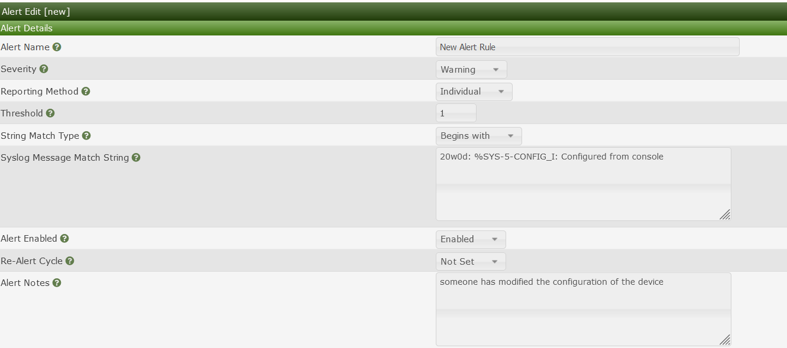

# syslog

The syslog plugin is a Cacti plugin that has been around for more than a
decade. It was inspired by the 'aloe' and 'h.aloe' plugins originally developed
by the Cacti users sidewinder and Harlequin in the early 2000s.  As you will
be able to see from the ChangeLog, it has undergone several changes throughout
the years, and remains a relevant plugin for small to medium-sized companies,
even today when enterprise offerings exist from both Elastic and Splunk.

It provides a simple Syslog event search, alert generation, and notification
interface that can generate both HTML and SMS messages for operations personnel
who wish to receive notifications inside of a data or network operations
center.

For log events that continue to be generated frequently on a device, such as
smartd's feature to notify every 15 minutes of an impending drive failure, can
be quieted using syslog's 'Re-Alert' setting.

Syslog also provides multipoller support, which allows for scalability and
redundancy by leveraging multiple servers. Rules can be created on the main
poller and pushed to the remotes for ease of management, or each server can work
independently.

## Features

- Message filter

- Message search

- Output to screen or file

- Date time picker

- Event Alerter

- Event Removal (for Events you don't want to see)

- Filter events by Cacti Graph window from Cacti's Graph View pages

- Use of native MySQL and MariaDB database partitioning for larger installs

- Remote Log Server connection capabilities

- Custom column mappings between Remote Log Server and required Syslog columns

- Remote poller support

- Saved searches, dashboards, and message recommendations in current
  development. Check the installed release's README for availability.

### Notes on upgrades

This chapter describes the current development plugin. Use the README and
release notes at your installed release tag for version-specific instructions:
[Syslog repository](https://github.com/Cacti/plugin_syslog) and [published
releases](https://github.com/Cacti/plugin_syslog/releases).

Back up the Cacti database, any separate Syslog database, and the plugin's
local configuration before an upgrade. Disable the plugin, replace its files
while preserving `config.php` or `config_local.php`, then follow Plugin
Management's upgrade advisor and re-enable it. **Do not uninstall the plugin as
an upgrade step:** uninstall options can delete messages, rules, and hosts.

<a id="note-retention-settings-can-be-changed-after-install-but-db-architecture-will-require-a-reinstall-of-the-plugin"></a>

Legacy guides described reinstalling to change the table architecture. Follow
the installed release's conversion procedure instead; a reinstall can discard
the data that a migration is meant to preserve.

The development plugin also supplies a schema audit that reports missing tables
and runs no migrations. Run this from the Cacti directory as the poller user:

```console
php plugins/syslog/cli/syslog_schema.php --audit
```

Replacing the plugin files does not upgrade the plugin, and a passing audit does
not show that an upgrade has completed. Run `php plugins/syslog/cli/syslog_schema.php --upgrade`
from the Cacti directory as the poller user, or disable and then enable the
plugin to open the Upgrade Advisor; Plugin Management shows the new version
when the upgrade is done. See the plugin README before using `--repair` or a
legacy table conversion. New development installs use partitioned history
tables; existing traditional tables are not automatically converted.
Timestamp-precision conversion is a separate maintenance-window operation, not a
routine upgrade; it preserves messages unless `--discard-data` is given.

### Cacti Configuration for RSYSLOG

Edit /etc/rsyslog.d/cacti.conf

```console
$ModLoad imudp
$UDPServerRun 514
$ModLoad ommysql

$template cacti_syslog,"INSERT INTO syslog_incoming(facility_id, priority_id, program, logtime, host, message) values (%syslogfacility%, %syslogpriority%, '%programname%', '%timegenerated:::date-mysql%', '%HOSTNAME%', TRIM('%msg%'))", SQL

*.* >localhost,my_database,my_user,my_password;cacti_syslog
```

The default incoming schema uses `logtime`, not separate `date` and `time`
columns. Use numeric facility and priority values. The example above uses
rsyslog's legacy configuration syntax; do not mix it with an unbound modern
`ommysql` action, which would use a different default table and template.
Replace the database and account placeholders with your local configuration,
and protect the file because it contains database credentials.

Install your distribution's MySQL output module for rsyslog, validate the
configuration, then restart the service:

```console
rsyslogd -N1
systemctl restart rsyslog
```

Do not load a listener or output module twice if another configuration file
already loads it. For transport, queue, and current module options, use the
[rsyslog ommysql documentation][rsyslog-mysql]. Syslog-ng is another supported
ingestion option. For sub-second timestamps and release-specific settings,
follow the Syslog README.

### Device setup

To setup log forwarding from your network switches and routers, and from your
various Linux, UNIX, and other operating system devices, please see their
respective documentation.

For a Cisco switch, a basic forwarding configuration looks like this. Replace
the example address with the address of your log collector.

```console
SW-3750#conf t
Enter configuration commands, one per line.  End with CNTL/Z.
SW-3750(config)#logging host 192.0.2.10
SW-3750(config)#logging facility local7
SW-3750(config)#logging rate-limit 100
SW-3750(config)#

```

### Mariadb/MYSQL Specific configurations

Use the database versions required by your installed Cacti and Syslog release.
The development plugin supports InnoDB and, on MariaDB, Aria for history.
Remote Data Collector options require InnoDB. Follow the plugin's setup advisor
and storage-engine guidance before changing an existing installation.

Do not copy the old `NO_AUTO_CREATE_USER` SQL mode into a current MySQL
configuration: [MySQL removed it in 8.0][m]. Inspect the actual
server and session modes when diagnosing schema errors:

```sql
SELECT @@GLOBAL.sql_mode, @@SESSION.sql_mode;
```

Use the migration guidance for your database and plugin release rather than
changing SQL modes for every application on the server.

## Requirements

This page follows the plugin's `develop` branch, which is unreleased and can
change. That branch declares version 5.0 and Cacti compatibility 1.2.23 in its
`INFO` file. Use the README and release notes of the release you install.

- Cacti 1.2.23 or later, as declared in `INFO`, and PHP 8.0 or later as stated
  in the plugin README. Cacti's own PHP and database requirements also apply.
- No other plugin is listed in `INFO` as required. Thold is optional: its
  notification lists can be selected for pipeline health email, and Alarm
  Manager is optional for forwarding alarms (see [Settings](#settings)).
- MySQL or MariaDB. Only InnoDB and, on MariaDB, Aria are supported for the
  message tables, and any Remote Data Collector option requires InnoDB.
- Cacti's **PHP Binary Path** setting (`path_php_binary`) must be valid,
  because the poller starts `syslog_process.php` with it.
- An rsyslog or syslog-ng service that writes into the `syslog_incoming`
  table. See the sections above.
- Optional: the PHP `pcntl` and POSIX extensions. Without them, or on Windows,
  setting **Maximum Syslog Processing Processes** above 1 has no effect and
  processing runs in a single process.

## Installing the plugin

1. Check the plugin release's README and `INFO`. The current development plugin
   declares Cacti 1.2.23 or later and needs PHP 8.0 or later; Cacti's own PHP
   requirement also applies.
2. Place the code under `<path_cacti>/plugins/syslog`. Keep application code
   readable by the web server and poller; it does not generally need web-server
   write access. See [Plugin Management](Plugins.md).
3. Copy `config.php.dist` to `config.php` and set the database configuration
   before installation. For a remote collector with an independent Syslog
   database, use `config_local.php.dist` as the template for
   `config_local.php`. If both files exist, `config_local.php` takes
   precedence.
4. Leave `$use_cacti_db = true` to use the Cacti database. For a separate
   database, create it and its account first, set `$use_cacti_db = false`, and
   set the `$syslogdb_*` connection values. The Syslog connection needs the
   privileges required to create, migrate, and write its tables. The Cacti
   account also needs read access to that database, as described in the README.
5. Install and enable Syslog under **Console > Configuration > Plugins**.
   Complete the setup advisor, choose supported storage and retention settings,
   and assign the intended users the relevant Syslog realms.
6. Configure your log forwarder to write to `syslog_incoming`, then verify that
   Cacti's poller processes messages and that search and alert rules work.

The screenshot below shows an older setup advisor. Current development installs
use partitioned history; settings and available migration choices depend on the
installed release and existing schema.


## Permissions

Syslog registers these realms. Assign them to users or groups under
**Console > Configuration > Users** or **User Groups**, on the **Realm
Permissions** tab.

| Realm | Pages covered |
| --- | --- |
| Syslog User | `syslog.php` (the Syslog tab) |
| Rule Viewer | `syslog_alerts.php`, `syslog_removal.php`, `syslog_reports.php` |
| Rule Administrator | `syslog_rule_administrator.php`, `syslog_device_rules.php` |
| Syslog Administration | `syslog_saved_searches.php`, `syslog_dashboards.php`, `syslog_recommendations.php` |
| Share Saved Templates | `syslog_saved_searches_share.php` |
| Share Dashboards | `syslog_dashboards_share.php` |

## Settings

Settings are on the **Syslog** tab of **Console > Configuration > Settings**.
The tab is divided into sections. The table lists the settings an
administrator usually has to decide on. The remaining settings, such as the
alert maintenance windows, cooldowns, and recovery pacing for remote
collectors, are described in the interface next to each field.

| Section | Setting | Default | Purpose |
| --- | --- | --- | --- |
| General Settings | Syslog Enabled | on | Moves records from the incoming table to the main table and enables alerts and reports. Messages still accumulate in the incoming table while disabled. |
| General Settings | Forward alarms to Alarm Manager | off | Lets rules that use the Alarm Manager destination forward alarms. |
| General Settings | Strip Domains | empty | Comma-delimited domains to remove from device names. |
| General Settings | Refresh Interval | 300 | Seconds before the Syslog page refreshes. |
| General Settings | Skip Total Row Count | off | Avoids counting every match on the System Logs and Alert Logs tabs; the page shows Previous and Next links. |
| General Settings | Max Report Records | 100 | Maximum records shown in a threshold alert report. |
| General Settings | Maximum Syslog Processing Processes | 1 | Number of parallel worker processes. |
| General Settings | Command for Opening Tickets | empty | Command run for rules with **Open Ticket** set. It receives `--alert-name`, `--severity`, `--hostlist` and `--message`. |
| Host Discovery Options | Enable Hostname Resolution | off | Resolves incoming host names through DNS, then the Cacti device table. |
| Host Discovery Options | Skip DNS Resolution for incoming hosts | off | Never uses DNS lookups. |
| HTML Notification Settings | Enable HTML Based Email | on | Sends alert email as HTML instead of plain text. |
| HTML Notification Settings | Format File to Use | default.format | HTML and CSS wrapper for reports. |
| Data Retention and Partitioning | Syslog Retention | 30 | Days to keep messages. |
| Data Retention and Partitioning | Partitioning Level | Daily | Partition size. A change takes effect only after `cli/upgrade_partitioning.php` rebuilds the tables. |
| Data Retention and Partitioning | Partition Pre-create Window | 3 Days | Days of future partitions to maintain. |
| Data Retention and Partitioning | Partition Recovery Limit | 3 per run | Missing partitions created on each poller run. |
| Data Retention and Partitioning | Collector Staleness Threshold | 300 | Delay before pipeline health alerts warn. |
| Data Retention and Partitioning | Collector Backlog Threshold | 10000 | Unprocessed messages that trigger a warning on the status page. |
| Pipeline Health Alerts | Pipeline Health Notification List | None | Thold notification list for health email. |
| Pipeline Health Alerts | Pipeline Health Email Recipients | empty | Comma-separated recipients for health email. |
| Pipeline Health Alerts | Pipeline Health Reminder Interval | 1 hour | Repeat interval for ongoing problems. |
| Pipeline Health Alerts | Syslog Alert Retention | 30 | Days to keep alert logs. |
| Alert Suppression and Maintenance | Default Alert Cooldown | 0 | Minutes to suppress repeat notifications for a rule. 0 disables. |
| Alert Suppression and Maintenance | Default Duplicate Suppression | 0 | Minutes to suppress an identical matched message set. 0 disables. |
| Remote Message Processing | Enable Remote Data Collector Message Processing | off | Remote collectors process messages in their own Syslog database. |
| Remote Message Processing | Remote Data Collector Rules Sync | off | Sends the main poller's alert, removal and report rules to remote collectors. |
| Remote Message Processing | Store Records on Remote Collector | off | Keeps processed messages on the remote collector after delivery. |

**Syslog Alert Retention** is listed under the Pipeline Health Alerts heading.

## Using Syslog

Users with the **Syslog User** realm see a **Syslog** tab in the Cacti header.
Rule pages are in the **Syslog Settings** menu group of the Console, which
contains **Alert Rules**, **Device Alert Rules**, **Removal Rules**,
**Report Rules**, **Saved Search Templates**, **Dashboards**, and
**Recommendations**. The **Purge Syslog Devices** button, which removes
devices that no longer report, is in the Syslog Utilities section of the
Cacti Utilities page.

The Syslog page has these tabs:

- **System Logs**: stored messages with a filter, saved searches, and export.
- **Alert Logs**: messages that triggered alert rules.
- **Breached Thresholds**: active threshold breaches, shown only when enabled
  threshold rules exist.
- **Dashboard**: charts built from saved searches.
- **Syslog Status**: collector and pipeline health, including the pipeline
  health card and partition state.

The screenshot shows the **System Logs** tab with the message filter and a
list of messages. The example uses synthetic data.

![System Logs tab with synthetic messages][messages-image]

To search messages for one device from a graph:

1. Open a graph in **Graphs** (the graph view page) for a device.
2. Select the **Display Syslog in Range** icon beside the graph. It appears
   only when Syslog knows the device by its description or host name.
3. The System Logs tab opens filtered to that device and the graph's time
   range.

To create an alert rule:

1. Open **Console > Syslog Settings > Alert Rules** and add a rule.
2. Set the **Name**, **Severity**, **Reporting Level**, **Reporting Method**,
   **Match Type**, and **Message Match String**.
3. Under email options, set a **Notification List** or **Emails to Notify**.
   Optionally set an **Alert command**, a **Recovery command**, or **Open
   Ticket**.
4. Set **Enabled** and save.

Removal rules, under **Console > Syslog Settings > Removal Rules**, use a
**String Match Type**, a **Syslog Message Match String**, and a **Method of
Removal** to delete messages or move them to `syslog_removed`. Report rules
under **Report Rules** send matching messages by email at a chosen
**Frequency** and **Send Time**.

## SNMP Trap configuration

SNMPTT translates traps received by snmptrapd into messages that Syslog can
ingest. Paths and service options depend on the distribution's packages.

1. Install your distribution's `snmptt` and `snmptrapd` packages.
2. Configure snmptrapd to emit numeric OIDs with `-On`. Check its service unit
   for the supported environment file or systemd override. For a package that
   reads `/etc/sysconfig/snmptrapd`, the option is:

   ```console
   OPTIONS="-On"
   ```

3. Configure trap authentication and forward accepted traps to SNMPTT. Replace
   the community placeholder and restrict access to intended senders. This
   example uses a community-based sender; use the appropriate authentication
   configuration for SNMPv3 senders.

   ```console
   authCommunity log,execute REPLACE_WITH_COMMUNITY
   traphandle default /usr/sbin/snmptthandler
   ```

4. Configure SNMPTT's `snmptt.ini` for daemon mode and Syslog output:

   ```ini
   mode = daemon
   ```

5. Review the plugin's `contrib/snmptt-syslog-connector.py` for preserving the
   originating device address. Configure it using the instructions for the
   installed plugin and SNMPTT packages.
6. Enable and restart the services, then send a test trap and verify its device
   identity and message in Syslog:

   ```console
   systemctl enable snmptrapd snmptt
   systemctl restart snmptrapd snmptt
   ```

## Remote poller deployment options

The syslog plugin can be deployed on each poller or on select pollers. Each
poller will need to be configured with rsyslog, and each collector with an
independent Syslog database needs a local `config_local.php` file; see the
plugin README for replication destinations.

There are a few deployment approaches:

- Multiple collectors behind a Syslog load balancer.

  

- Devices forwarding to multiple collectors without a load balancer.

  ![Collectors without a load balancer][no-lb-image]

- Devices assigned to a collector at their site.

  

## Remote poller setup

1. Decide whether each collector uses its Cacti database or a separate Syslog
   database. For an independent database, create it and configure the connection
   in `config_local.php` before enabling the remote options.
2. Keep `$use_cacti_db = true` when using the collector's Cacti database. For
   a separate database, set it to `false` and supply the `$syslogdb_*` values.
3. Configure rsyslog on the collector using the
   [current incoming-table template](#cacti-configuration-for-rsyslog). Its
   output must target the database that this collector's Syslog plugin uses.
4. Install the appropriate rsyslog MySQL output module, run `rsyslogd -N1`,
   and restart rsyslog after validation succeeds.
5. Configure the required Remote Data Collector options under
   **Console > Configuration > Settings > Syslog**. Remote options require
   InnoDB. For a separate Main Collector Syslog database, follow the README's
   `$syslog_replication_main_db_*` destination settings.
6. Verify local ingestion, processing, and any enabled replication from each
   collector before sending production traffic to it.

![Earlier remote Syslog settings][remote-settings-image]

### Note on using the cacti DB as mentioned earlier

A separate Syslog database can isolate growing message history from Cacti's
own tables. The connection and privileges must match the local collector's
configuration; do not reuse a Main Collector destination as the incoming
database unless that is the intended deployment.

<a id="note-rules-will-be-replicated-within-one-polling-cycle--to-the-remote-pollers"></a>

### Rule replication

Rule replication runs through the poller when enabled. Verify completion in
the plugin's status and logs rather than assuming a fixed delay when a poller
or database is unavailable. Independent collectors do not need rule replication.

### Syslog Alert Rules

Alert rules are used to generate alerts in the Cacti log. They are also used to
send out email alerts and to run commands that cut tickets in upstream
ticketing systems or perform initial troubleshooting. Scripts can also be
leveraged to call on services such as Slack or Trello for alerting teams.

You can leverage the built-in variable substitution to format the input to the
script.



### Syslog Removal Rules

The Syslog plugin allows administrators to delete incoming messages so they are
not stored in the DB, or to transfer them to the `syslog_removed` table. For
example, if you are not interested in seeing Syslog messages every time a user
logs into a device, you may add a rule to delete the message.

To do this, click on the Syslog settings tab in the console, then click removal
rules.


## How It Collects Data

Syslog does not poll devices. rsyslog or syslog-ng writes messages into the
`syslog_incoming` table. Syslog registers a `poller_bottom` hook, so at the end
of each Cacti polling cycle it checks pipeline health and starts
`syslog_process.php` in the background with Cacti's PHP binary.

The processor moves messages from the incoming table to the `syslog` table,
applies removal and alert rules, and sends reports. When **Maximum Syslog
Processing Processes** is above 1, it starts worker processes that each handle
a range of incoming messages. Syslog also maintains partitions of the `syslog`
and `syslog_removed` tables, creating future partitions and removing expired
ones according to **Syslog Retention** and **Partition Pre-create Window**.
Alert logs are kept for **Syslog Alert Retention** days.

On a remote collector with its own database, processed messages are delivered
to the Main Collector and the rule tables are replicated through Cacti's
`replicate_out` hook when **Remote Data Collector Rules Sync** is enabled.

The `syslog` table and the incoming table grow with message volume. Choose
retention and partitioning with that growth in mind.

## Command-Line Tools

Run these from the Cacti directory as the poller user.

The processing script is normally started by the poller. Run it by hand to
test or to send reports now:

```console
usage: syslog_process.php [--debug] [--force-report]

options:
    --force-report   Send email reports now.
    --debug          Provide more verbose debug output.
```

The script also accepts worker options (`--child`, `--run-id`, `--phase`,
`--seq-start`, `--seq-end`, `--lock-owner`), which the master process uses
internally.

`cli/syslog_schema.php` audits and repairs the database schema:

```console
usage: syslog_schema.php --audit | --repair | --upgrade

    --audit   - Report missing tables without changing the schema.
    --repair  - Repair missing tables and rerun schema migrations.
    --upgrade - Upgrade the schema, including missing-table repair.
    --version - Display version information.
    --help    - Display this help.
```

`cli/upgrade_partitioning.php` rebuilds the message tables to change the
partitioning level or timestamp precision:

```console
usage: upgrade_partitioning.php [--partition=hourly|daily] [--convert-ms] [--preserve-data | --discard-data]
    [--source-time-zone=<zone>] [--confirm]

    --partition     - Save and apply this Partitioning Level instead of the one in Settings.
    --convert-ms    - Also convert pipeline timestamps to TIMESTAMP(3); MariaDB only.
    --preserve-data - Preserve existing messages (the default), copying 50,000 rows at a time.
    --discard-data  - Delete messages in rebuilt tables; never discard the outbox.
    --source-time-zone - IANA zone (for example America/New_York) of legacy DATETIME values.
    --confirm       - Skip confirmation, not the size and maintenance warnings.
```

Back up the database and disable **Syslog Enabled** first. The utility refuses
to start while processing is enabled or running. The plugin README describes
the full maintenance procedure.

## Troubleshooting

- Syslog does not process messages and the poller log shows `WARNING: You have
  installed the Syslog plugin, but you have not properly set a config.php or
  config_local.php`: copy `config.php.dist` to `config.php` (or
  `config_local.php.dist` to `config_local.php`) and set the database values.
- The log shows `ERROR: Syslog database or schema is unavailable; skipping
  processing.`: the plugin cannot connect to its database or the tables are
  missing. Run `cli/syslog_schema.php --audit` to list missing tables.
- Messages accumulate in `syslog_incoming`: check that **Syslog Enabled** is
  on, that the Cacti poller runs, and that **PHP Binary Path** is correct. The
  **Syslog Status** tab shows backlog and processing state.
- The log shows `NOTE: Syslog processing skipped while
  cli/upgrade_partitioning.php rebuilds the message tables.`: processing
  resumes when the rebuild finishes.
- Saving the Syslog settings is refused: the retention, pre-create window and
  Partitioning Level need more partitions than the database server allows.
  Hourly partitioning also requires a finite retention.
- A change to **Partitioning Level** has no effect: it applies only after
  `cli/upgrade_partitioning.php` rebuilds the tables.
- Worker processes are not used: parallel processing needs the PHP `pcntl` and
  POSIX extensions and is not available on Windows.
- A ticket command does not run: it runs only when the executable named at the
  start of **Command for Opening Tickets** exists and is executable. Failures
  are written to the Cacti log with the `SYSLOG` tag.

## Possible Bugs and Feature Enhancements

Bug and feature enhancements for the syslog plugin are handled in GitHub. If
you find a first search the Cacti forums for a solution before creating an
issue in GitHub.

## Authors

The syslog plugin has been in development for well over a decade with
increasing functionality and stability over that time. There have been several
contributors to syslog over the years. Chief amongst them are Jimmy Conner,
Larry Adams, SideWinder, and Harlequin. We hope that version 2.0 and beyond are
the most stable and robust versions of syslog ever published. We are always
looking for new ideas. So, this won't be the last release of syslog, you can
rest assured of that.

## More Information

- [Syslog plugin repository](https://github.com/Cacti/plugin_syslog)
- [Syslog plugin README][syslog-readme]
- [Plugin Management](Plugins.md)
- [Supported plugins](supported-plugins.md)

[rsyslog-mysql]: https://docs.rsyslog.com/doc/configuration/modules/ommysql.html
[m]: https://dev.mysql.com/doc/refman/8.0/en/upgrading-from-previous-series.html
[no-lb-image]: images/syslog-multi-poller-no-lb.png
[messages-image]: images/plugin-syslog-messages.png
[syslog-readme]: https://github.com/Cacti/plugin_syslog/blob/develop/README.md
[remote-settings-image]: images/syslog-multipoller-settings.png

---

Copyright (c) 2004-2026 The Cacti Group
