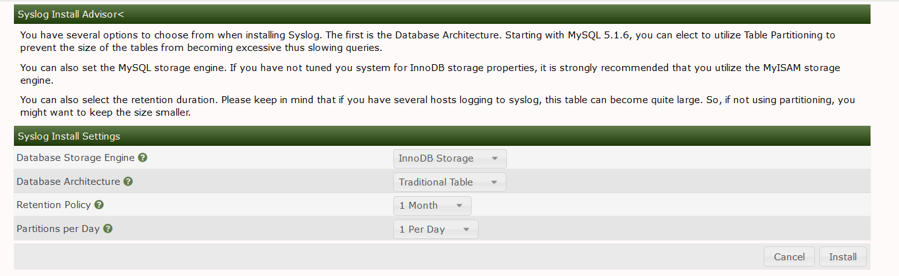
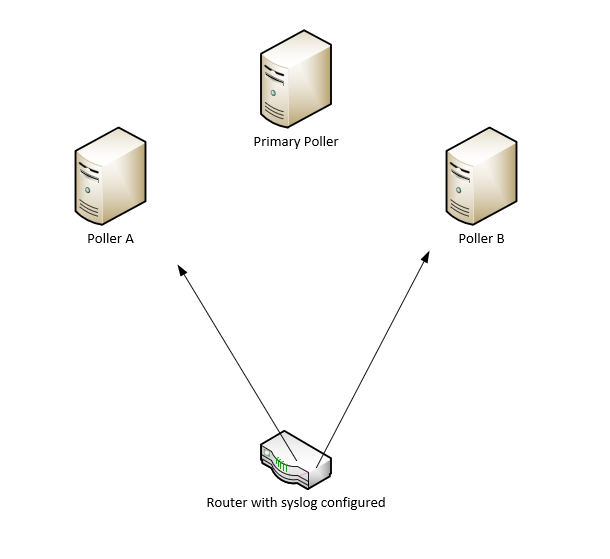
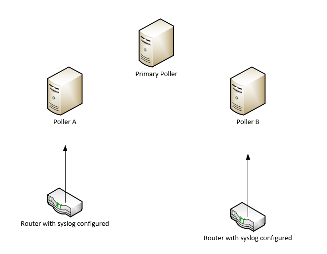
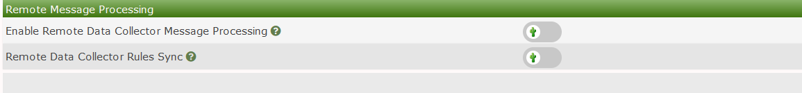
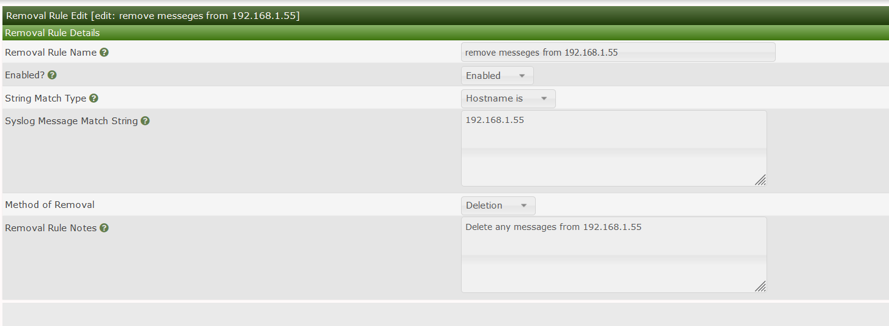

# syslog

The syslog plugin is a Cacti plugin that has been around for more than a decade.
It was inspired by the 'aloe' and 'h.aloe' plugins originally developed by the
Cacti users sidewinder and Harlequin in the early 2000s.  As you will be able
to see from the ChangeLog, it has undergone several changes throughout the
years, and remains a relevant plugin for small to medium-sized companies, even
today when enterprise offerings exist from both Elastic and Splunk.

It provides a simple Syslog event search, alert generation, and notification
interface that can generate both HTML and SMS messages for operations personnel
who wish to receive notifications inside of a data or network operations center.

For log events that continue to be generated frequently on a device, such as
smartd's feature to notify every 15 minutes of an impending drive failure, can
be quieted using syslog's 'Re-Alert' setting.

Syslog also provides multipoller support, which allows
for scalability and redundancy by leveraging multiple
servers. Rules can be created on the main poller and pushed
to the remotes for ease of management, or each server can work independently.

## Features

* Message filter

* Message search

* Output to screen or file

* Date time picker

* Event Alerter

* Event Removal (for Events you don't want to see)

* Filter events by Cacti Graph window from Cacti's Graph View pages

* Use of native MySQL and MariaDB database partitioning for larger installs

* Remote Log Server connection capabilities

* Custom column mappings between Remote Log Server and required Syslog columns

* Remote poller support

The plugin's development branch (version 5.0) adds dashboards, saved searches,
pipeline health alerts, message recommendations, hourly partitioning and, on
MariaDB, millisecond timestamps. It supports only InnoDB and, on MariaDB, Aria
tables, and new installs always use partitioned tables. See the
[Syslog README](https://github.com/Cacti/plugin_syslog#readme) for these
features.

### Notes on upgrades

Replacing the plugin files does not upgrade the plugin. After copying in a new
version, run `php plugins/syslog/cli/syslog_schema.php --upgrade` from the Cacti
base directory as the poller user, or disable and then enable the plugin in
Plugin Management to open the Syslog Upgrade Advisor. Do not uninstall the
plugin as an upgrade step, because the uninstall options can delete messages,
rules, and hosts.

If you are upgrading to 2.0 from a prior install, you must first uninstall
syslog and ensure both the syslog, syslog_remove, and syslog_incoming tables
are removed, and recreated at install time.

In addition, the rsyslog configuration has changed in 2.5.  So, for example, to
configure modern rsyslog for Cacti, you MUST create a file called cacti.conf in
the /etc/rsyslog.d/ directory:

### Cacti Configuration for RSYSLOG

Edit /etc/rsyslog.d/cacti.conf

```console
$ModLoad imudp
$UDPServerRun 514
$ModLoad ommysql

$template cacti_syslog,"INSERT INTO syslog_incoming(facility_id, priority_id,
  program, logtime, host, message) \
  values (%syslogfacility%, %syslogpriority%, '%programname%',
  '%timegenerated:::date-mysql%', '%HOSTNAME%', TRIM('%msg%'))", SQL

*.* >localhost,my_database,my_user,my_password;cacti_syslog
```

This is a change from versions 2.0 to 2.4 and below, which had the following
file format:

```console
$ModLoad imudp
$UDPServerRun 514
$ModLoad ommysql

$template cacti_syslog,"INSERT INTO syslog_incoming(facility_id, priority_id,
  program, date, time, host, message) \
  values (%syslogfacility%, %syslogpriority%, '%programname%',
  '%timereported:::date-mysql%', '%timereported:::date-mysql%', '%HOSTNAME%',
   TRIM('%msg%'))", SQL

*.* >localhost,my_database,my_user,my_password;cacti_syslog
```

For RHEL, Rocky Linux, or AlmaLinux systems you will also need to install the rsyslog-mysql package

```shell
yum install rsyslog-mysql
systemctl restart rsyslog
```

If you are upgrading to version 2.5 from an earlier version, make sure that you
update this template format and restart rsyslog.  You may lose some syslog
data, but doing this in a timely fashion, will minimize data loss.

Ensure you restart rsyslog after these changes are completed.  Other logging
servers such as Syslog-NG are also supported with this plugin.  Please see some
additional documentation here: [Cacti Documentation
Site](https://docs.cacti.net/plugin:syslog.config)

We are using the pure integer values that rsyslog provides to both the priority
and facility in this version syslog, which makes the data collection much less
costly for the database.  We have also started including the 'program' syslog
column for searching and storage and alert generation.

### Device setup

To setup log forwarding from your network switches and routers, and from your
various Linux, UNIX, and other operating system devices, please see their
respective documentation.

For Cisco routers switches configuration may look something like this

```console
SW-3750#conf t
Enter configuration commands, one per line.  End with CNTL/Z.
SW-3750(config)#logging host 192.168.1.194
SW-3750(config)#logging facility local7
SW-3750(config)#logging rate-limit 100
SW-3750(config)#

```

### Mariadb/MYSQL Specific configurations

Do not copy `sql_mode=NO_ENGINE_SUBSTITUTION,NO_AUTO_CREATE_USER` from older
instructions into a current MySQL configuration, because MySQL removed
`NO_AUTO_CREATE_USER` in 8.0.  Inspect the modes the database actually uses
when diagnosing a schema or migration failure:

```sql
SELECT @@GLOBAL.sql_mode, @@SESSION.sql_mode;
```

Follow the migration guidance for your database and plugin release rather than
changing the server-wide modes for all applications.  The plugin's own upgrade
tool, `cli/upgrade_partitioning.php`, reads the session `sql_mode` and sets it
for its own session only.  More recent versions of MySQL and MariaDB will
source multiple database configuration files.

## Requirements

* This section documents Syslog 4.2 (release tag `v4.2`), the latest
  published release for Cacti 1.2.x.

* Cacti 1.2.23 or later, from the plugin's `INFO` file.

* No other plugin is required.

* A syslog server, such as rsyslog or Syslog-NG, that inserts messages into
  the `syslog_incoming` table, as described under
  [Cacti Configuration for RSYSLOG](#cacti-configuration-for-rsyslog).

* Email alerts and reports are sent through Cacti's own mail functions, so
  Cacti's mail settings must work.

## Installing the plugin

Requirements: Cacti 1.2.23 or later, PHP 8.0 or later, and MySQL or MariaDB
using InnoDB (or Aria on MariaDB).

1.) Copy the syslog files over to /var/www/html/cacti/plugins

2.) ensure permissions are correct the files
     should typically be owned by the webserver user

```shell
chown -R apache:apache syslog
```

3.) copy config.php.dist to config.php

4.) You have two options for storing syslog information: you can either use the existing
Cacti Database or use a dedicated database for syslog. Syslog databases, especially
for large networks, can grow quickly, so it may be wise to create a dedicated database.
To use a dedicated DB, first create a database
in MySQL and assign a user, then change

```console
$use_cacti_db = true;
to
$use_cacti_db = false;
```

If you intend to use the Cacti DB, leave config.php as default. For a dedicated
DB, also set the `$syslogdb_*` values to the new database and a user that can
create and write its tables.

5.) Install the plugin in the plugins tab located
    in Console >> configuration >> plugins

6.) You will be presented with the plugin install wizard with options on how
   you would like the Syslog plugin to be installed options
   include DB arch and retention time

### Note retention settings can be changed after install but db architecture will require a reinstall of the plugin



You will also need to ensure the Cacti database user is granted select on the Syslog database

```shell
GRANT SELECT  ON syslog.* TO  'cactiuser'@'localhost';
```

The install advisor offers these choices:

* **What upgrade/install type do you wish to use**: **Truncate Syslog
  Table**, **Inline Upgrade** or **Background Upgrade**

* **Database Storage Engine**: **MyISAM Storage** or **InnoDB Storage**
  (default)

* **Database Architecture**: **Traditional Table** or **Partitioned Table**
  (default)

* **Retention Policy**: the number of days of messages to keep (default
  30 days)

* **Partitions per Day**: 1 (default), 2, 4, 6 or 12

## Permissions

Syslog registers two realms. Grant them to users in **Console >
Configuration > Users** or to groups in **Console > Configuration > User
Groups**.

###### Table 1. Syslog realms

| Realm                               | Pages                                                         | Grants                                         |
| ----------------------------------- | ------------------------------------------------------------- | ---------------------------------------------- |
| **Plugin -> Syslog User**           | `syslog.php`                                                  | The **Syslog** tab: message and alert viewing  |
| **Plugin -> Syslog Administration** | `syslog_alerts.php`, `syslog_removal.php`, `syslog_reports.php` | Alert, Removal and Report Rules management     |

## Settings

Syslog adds a **Syslog** tab to **Console > Configuration > Settings**. The
tab has four sections.

###### Table 2. Syslog settings

| Section                    | Label                                               | Default          | Purpose                                                                                                    |
| -------------------------- | --------------------------------------------------- | ---------------- | ---------------------------------------------------------------------------------------------------------- |
| General Settings           | **Syslog Enabled**                                  | Checked          | Transfers records from the incoming table to the main table and enables Alerts and Reports                  |
| General Settings           | **Enable Statistics Gathering**                     | Unchecked        | Keeps statistics on where messages arrive from and adds the **Statistics** tab                              |
| General Settings           | **Strip Domains**                                   | Empty            | Comma-delimited domains to remove from host names                                                           |
| General Settings           | **Validate Hostnames**                              | Unchecked        | Assigns records with an invalid host name to the host `invalidhost`                                         |
| General Settings           | **Refresh Interval**                                | 5 Minutes        | Refresh time of the **Syslog** page                                                                         |
| General Settings           | **Max Report Records**                              | 100 Records      | Maximum records shown in a Threshold alert report                                                           |
| General Settings           | **Command for Opening Tickets**                     | Empty            | Command run to open help desk tickets, called with `--alert-name`, `--severity`, `--hostlist`, `--message` |
| HTML Notification Settings | **Enable HTML Based Email**                         | Checked          | Sends Email in HTML; otherwise plain text                                                                   |
| HTML Notification Settings | **Format File to Use**                              | `default.format` | HTML and CSS wrapper for reports, from the `formats` directory                                              |
| Data Retention Settings    | **Syslog Retention**                                | 1 Month          | Number of days to keep events                                                                               |
| Data Retention Settings    | **Syslog Alert Retention**                          | 1 Month          | Number of days to keep alert logs                                                                           |
| Remote Message Processing  | **Enable Remote Data Collector Message Processing** | Unchecked        | Remote Data Collectors keep their own Syslog databases, configured in `config_local.php`                    |
| Remote Message Processing  | **Remote Data Collector Rules Sync**                | Unchecked        | Sends the Main Cacti Alert, Removal and Report rules to the Remote Data Collectors                          |

When **Syslog Enabled** is unchecked, the syslog server keeps adding messages
to the `syslog_incoming` table, but they are not transferred, and no alerts or
reports are produced.

## SNMP Trap configuration

To leverage SNMP traps as mentioned you will need to install SNMPTT.
SNMPTT is used to translate OID information passed from the device to a readable
format SNMPTT will then write that data into syslog for the Syslog plugin to ingest.

Follow these steps to complete the setup

1.) yum install snmptt

2.) enable snmptt and snmptrapd

```console
systemctl enable snmptrapd
systemctl enable snmptt
systemctl start snmptt
systemctl start snmptrapd
```

3.) Now that snmptt and snmptrapd are started and enabled, you will first need to
    modify the snmptrapd systemd file to include -On in the startup options

the file is located in /etc/sysconfig/snmptrapd and should look like this after

```console
# snmptrapd command line options
# '-f' is implicitly added by snmptrapd systemd unit file
OPTIONS="-On"
```

4.) Now you need to modify the snmptrapd config file to receive snmptraps. By
    default, snmptrapd will not process any traps until you configure it to do so.
    You will also need to tell snmptrapd to forward the received traps over to snmptt.

Here is an example of configuring snmptrapd to receive snmptraps from a device
using the public snmp string and forwarding it over to snmptt

```console
# Example configuration file for snmptrapd
#
# No traps are handled by default, you must edit this file!
#
# authCommunity   log,execute,net public
# traphandle SNMPv2-MIB::coldStart    /usr/bin/bin/my_great_script cold
authCommunity   log,execute,net public
traphandle default /usr/sbin/snmptthandler
```

after making all of the changes to the snmptrapd configuration restart
the snmptrapd process for the changes to take effect.

5.) configure snmptt.ini to operate in daemon mode

By default snmptt already writes data to syslog all that is left is to configure
daemon mode in snmptt.ini which is located in /etc/snmp

```console
# Set to either 'standalone' or 'daemon'
# standalone: snmptt called from snmptrapd.conf
# daemon: snmptrapd.conf calls snmptthandler
# Ignored by Windows.  See documentation
mode = daemon
```

6.) use the snmptt cacti connector

By default since snmptt resides on the syslog server all of the IP information
will appear as if its coming from localhost
to fix this there is a cacti snmptt connector which will format the trap
to be ingested to the syslog db it is located in the contrib folder

## Remote poller deployment options

The syslog plugin can be deployed on each poller or select pollers
each poller will need to be configured with rsyslog
each poller will need to be configured with a syslog config_local file

There are a few deployment approaches

1.) Multiple Pollers with a load balancer for syslog


2.) Multiple pollers no balancer but devices send syslog to multiple pollers



3.) Multiple pollers but devices are assigned to send Syslog to a specific poller
    for example poller A and device A is at one location



## Remote poller setup

To setup each remote poller you will need to enable and configure
 rsyslog with the following steps

1.) decide if you will use the cacti DB or a separate DB

### Note on using the cacti DB as mentioned earlier

You have two options for storing Syslog information you can either use the existing
Cacti Database or use a dedicated database for Syslog as Syslog databases especially
for large networks can grow pretty quickly it may be wise to create a dedicated database.
To use a dedicated DB first create a database in MySQL and assign a user then

```console
$use_cacti_db = true;
to
$use_cacti_db = false;
```

2.) If you decide to use the cacti database simply leave config_local.php default

```console
$use_cacti_db = true;
```

3.) If you decide to use a separate DB fill out the Database detailing config_local.php

4.) create a cacti.conf file in /etc/rsyslog.d and fill out either
your separate DB details or your main cacti DB details

```console
$ModLoad imudp
$UDPServerRun 514
$ModLoad ommysql

$template cacti_syslog,"INSERT INTO syslog_incoming(facility_id, priority_id,
  program, logtime, host, message) \
  values (%syslogfacility%, %syslogpriority%, '%programname%',
  '%timegenerated:::date-mysql%', '%HOSTNAME%', TRIM('%msg%'))", SQL

*.* >localhost,my_database,my_user,my_password;cacti_syslog
```

5.) install rsyslog-mysql package to allow rsyslog to write to mysql

```console
yum install rsyslog-mysql
```

6.) restart rsyslog

```console
systemctl restart rsyslog
```

7.) if you would like for rules to be replicated from the main poller
to the remotes you will need to enable the following syslog settings
found in configuration >> settings >> syslog



### note rules will be replicated within one polling cycle  to the remote pollers

if you wish to have each poller operate independently there is no need to enable
these options.

Remote Data Collector options require the InnoDB storage engine. If the Main
Collector keeps its Syslog database under another name, set
`$syslog_replication_main_db_default` in the remote collector's config file; for
a separate database server or credentials, also set
`$syslog_replication_main_db_hostname`, the username, and the password there.

## Using Syslog

Users with the **Plugin -> Syslog User** realm see a **Syslog** tab at the top
of the page. It has these tabs:

* **System Logs**: searches and lists the stored messages. Filter by
  **Devices**, **Facility**, **Priority**, **Program**, **Timespan** and
  search text, and choose the **Record Type**: **Main Records**, **Removed
  Records** or **All Records**.

* **Statistics**: shown when **Enable Statistics Gathering** is checked.
  Lists message counts by **Device Name**, **Facility**, **Priority** and
  **Program**.

* **Alert Logs**: lists the alerts that have been triggered. Selecting an
  alert shows the messages that triggered it.

In Cacti's graph view, a graph whose device is known to Syslog gets a
**Display Syslog in Range** button. It opens the **System Logs** tab filtered
to that device and to the time range of the graph.

Administrators with the **Plugin -> Syslog Administration** realm manage
rules under **Console > Syslog Settings**, which has three entries: **Alert
Rules**, **Removal Rules** and **Report Rules**. Each rule list can
**Delete**, **Disable**, **Enable** or **Export** selected rules, and each
rule type can be imported from a local file or from pasted text.

To search for messages from one device:

1. Open the **Syslog** tab and select **System Logs**.

2. Choose the device under **Devices** and a **Timespan**.

3. Enter text in **Search** if needed and press **Go**.

### Syslog Alert Rules

Alert rules are used to generate alerts in the cacti log they are also used
to send out email alerts and command execution to cut tickets to upstream ticketing
systems or perform initial troubleshooting scripts can also be leveraged
to call on services such as slack or trello for alerting teams.

you can leverage the built in variable substitution to format the input to the script


### Syslog Removal Rules

The Syslog plugin allows administrators to delete incoming messages
so they are not stored in the DB, or to transfer them to the `syslog_removed`
table.
For example, if you are not interested in seeing Syslog messages
every time a user logs into a device you may add a rule to delete the message.

to do this click on the Syslog settings tab in the console then click removal rules



A removal rule's **Method of Removal** is either **Deletion** (the default)
or **Transferal** to the `syslog_removed` table.

### Syslog Report Rules

Report rules Email a list of matching messages on a schedule. Each rule has a
**String Match Type** and **Message Match String**, a **Frequency** of
**Daily** or **Weekly**, a **Send Time**, an **Email Body Text** and the
recipients in **Notification List** or **Email Addresses**.

Alert rules, removal rules and report rules share the same match types:
**Begins with**, **Contains**, **Ends with**, **Hostname is**, **Program
is**, **Facility is** and **SQL Expression**.

## Background Processing

Syslog uses Cacti's `poller_bottom` hook. At the end of each Cacti polling
cycle it starts `syslog_process.php` in the background. When **Syslog
Enabled** is checked, each run:

1. Removes messages and partitions older than **Syslog Retention**.

2. Updates the host, program, facility and priority reference tables, and
   the statistics when they are enabled.

3. Applies the removal rules to the incoming messages.

4. Applies the alert rules and sends notifications.

5. Moves the remaining incoming messages to the `syslog` table.

6. Sends the report rules that are due.

Messages that stay in `syslog_incoming` for more than one hour are deleted,
and alert logs older than **Syslog Alert Retention** are removed. A summary of
each run is written to the Cacti log.

## Command-Line Tools

Run these scripts from the `plugins/syslog` directory as the user that runs
the Cacti poller.

`syslog_process.php` is the processing script that the poller starts. Run it
by hand to see what it does, or to send the reports immediately:

```console
php syslog_process.php [--debug] [--force-report]
```

* `--debug` or `-d`: provide more verbose debug output

* `--force-report` or `-F`: send the Email reports now

* `--version` or `-V`: display the version

* `--help` or `-h`: display the help

`syslog_batch_transfer.php` is the batch process that moves old messages out
of the main view. It accepts `--debug` (`-d`), `--version` and `--help`.

## Troubleshooting

* The Cacti log shows `WARNING: You have installed the Syslog plugin, but you
  have not properly set a config.php or config_local.php`. Copy
  `config.php.dist` to `config.php` in the plugin directory and set the
  database values. The **Syslog** tab and menu are hidden until the file
  exists and is readable.

* The log shows `WARNING: Syslog record transferral and alerting/reporting is
  disabled.` Check **Syslog Enabled** in the **Syslog** settings tab.

* Devices that no longer send messages stay in the device list. Remove them
  with **Purge Syslog Devices** under **Console > Utilities > System
  Utilities**.

* If a ticket command fails, the Cacti log records `ERROR: Ticket Command
  Failed.` with the alert name, exit code and output.

## Possible Bugs and Feature Enhancements

Bug and feature enhancements for the syslog plugin are handled in GitHub. If you
find a first search the Cacti forums for a solution before creating an issue in
GitHub.

## Authors

The syslog plugin has been in development for well over a decade with increasing
functionality and stability over that time. There have been several contributors
to syslog over the years. Chief amongst them are Jimmy Conner, Larry Adams,
SideWinder, and Harlequin. We hope that version 2.0 and beyond are the most
stable and robust versions of syslog ever published. We are always looking for
new ideas. So, this won't be the last release of syslog, you can rest assured of
that.

## More Information

* [Syslog plugin repository](https://github.com/Cacti/plugin_syslog)

* [README](https://github.com/Cacti/plugin_syslog/blob/v4.2/README.md) for
  Syslog 4.2

---
Copyright (c) 2004-2026 The Cacti Group
