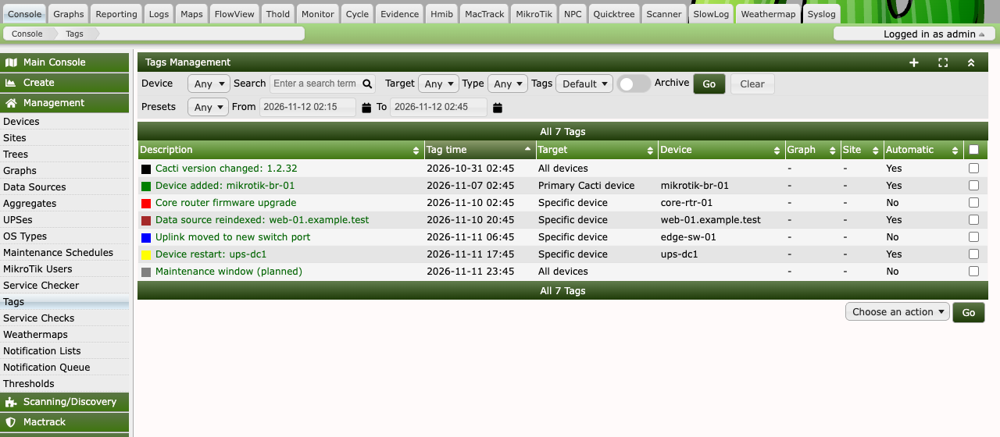

# Tags

The Tags plugin (`tags`) draws colored tags on Cacti graphs to mark events at
a point in time. You can enter tags by hand, and the plugin can create
automatic tags for events such as a device restart, a new device, a Cacti
version change, or a plugin being enabled. Administrators who want to match
graph changes with maintenance work and system events need it.

This page follows the plugin's `develop` branch, which is unreleased and can
change. That branch declares version 0.1 and Cacti compatibility 1.2.29 in its
`INFO` file. The plugin has no published release.

## Requirements

- Plugin version 0.1 and Cacti 1.2.29 or later, as declared in `INFO`.
- The `INFO` file lists no required plugins.
- The PHP binary configured in Cacti (the `path_php_binary` setting), which
  the poller uses to start the background `poller_tags.php` script. If the
  setting is empty, `php` is used from the path.
- The PHP `pcntl` functions, which `poller_tags.php` uses for signal handling.
- The main Cacti server. The `INFO` file declares no remote data collector
  support for viewing or management.
- On Cacti older than 1.2.31, the README says to add a small snippet to
  `applySkin()` in `include/layout.js` so the **Cancel** buttons on forms
  work. See the README for the exact code.

## Installation

Install the plugin in `plugins/tags`, using the directory name `tags` rather
than `plugin_tags`. Then follow the generic steps in
[Plugin Management](Plugins.md) to install and enable it.

Installation creates the tables `plugin_tags_event`,
`plugin_tags_event_archive`, `plugin_tags_uptime`, and `plugin_tags_state`.
After installing, open **Console > Configuration > Settings > Tags** and choose
a primary device. When the plugin's data is removed, these tables are dropped
and the plugin's settings are deleted.

## Permissions

| Realm | Pages |
| --- | --- |
| **Plugin Tags - view** | `tags.php` |

This is the only realm the plugin registers.

## Settings

Settings are on **Console > Configuration > Settings** under the **Tags** tab.

### Settings section

| Setting | Default | Purpose |
| --- | --- | --- |
| **Hide tags in graphs** | Off | Do not display tags in graphs. |
| **Data Retention** | 1 Year | Tags older than this are moved to the archive and are no longer displayed. Choices are Never, 7 Days, 14 Days, 1 Month, 3 Months, 6 Months, 1 Year, and 2 Years. |
| **Graph legend limit** | 4 | When the number of tags is above the limit, the legend is aggregated. The number of vertical lines is limited to 5 times this value. |
| **Select Primary Device** | None | Typically a local Cacti device. Tags related to the Cacti system are displayed on it. |

### Automatic tags - host specific

Each automatic tag has an on and off setting and a color setting. The color
choices are Black, Red, Green, Blue, Yellow, Grey, Brown, and Pink. The default
color is Black, and the plugin recommends a different color for each tag type.

| Setting | Default | Purpose |
| --- | --- | --- |
| **Host restart automatic tag** | On | Create a tag when a device restarts. |
| **Host added automatic tag. Will be displayed on 'Default' device and specific device** | On | Create tags when a device is added. |
| **Device save/change automatic tag** | On | Create a tag when a device is saved or changed. |
| **Data source reindex automatic tag** | On | Create a tag when the set of indexes returned by a device data query changes. |

### Automatic tags - others

| Setting | Default | Purpose |
| --- | --- | --- |
| **Choose how to display tags listed below** | All devices | Show the tags below on **All devices** or only on the **Primary device**. |
| **Cacti version automatic tag** | On | Create a tag when the Cacti version changes. |
| **Poller overrun automatic tag** | On | Create a tag when a polling cycle exceeds the configured poller interval. |
| **Data collector status automatic tags** | On | Create tags when a remote data collector goes down or recovers. |
| **Plugin status automatic tag** | On | Create a tag when a plugin is enabled, disabled, or upgraded. |

## Using Tags

Open **Console > Management > Tags**. The page is titled **Tags Management**.
The plus icon creates a tag.

The following example uses synthetic data. It shows the tag list with seven
tags: a mix of automatic tags (**Automatic** column **Yes**) and manual tags,
each with its color swatch, time, target, and device.



The filter bar has **Device**, **Search**, **Target**, **Type**, **Tags**,
**Archive**, **Presets**, **From**, and **To**. The list columns are
**Description**, **Tag time**, **Target**, **Device**, **Graph**, **Site**, and
**Automatic**. Select tags and use the actions **Delete**, **Disable**,
**Enable**, or **Archive**.

### Add a manual tag

1. Click the plus icon on **Tags Management**.
2. Enter a **Description** of up to 64 characters.
3. Choose **For which device**: **All devices**, **All devices with the same
   site id**, **Specific device**, **Specific graph**, or **Primary Cacti
   device**. Then select the **Device**, **Graph**, or **Site** that applies.
4. Set **Date and time of tag** and **Choose color**.
5. Leave **Enable** checked and save. A disabled tag is not shown in graphs.

### Hide tags on a graph

Tags are drawn on graphs unless **Hide tags in graphs** is set. The graph
view adds a tag icon next to the graph. Clicking it toggles **Disable Tags**
or **Enable Tags** for your session.

## Background Processing

At the end of every polling cycle, the `poller_bottom` hook runs these steps.

- On the main poller, it checks for poller overrun events.
- On every poller, it starts `poller_tags.php` in the background.

`poller_tags.php` then:

- archives tags older than the **Data Retention** setting,
- checks devices for restarts and new devices,
- checks for a Cacti version change when **Cacti version automatic tag** is on,
- checks for poller overrun events when **Poller overrun automatic tag** is on,
- checks for plugin status changes when **Plugin status automatic tag** is on,
- writes a `TAGS STATS` line to the Cacti log with the run time and the number
  of tags created, and saves it in the `plugin_tags_stats` setting.

Another run exits quietly if the previous one is still active. Reindex
tags are created when a data query run changes its indexes, and device change
tags are created when a device is saved. Archived tags move to the
`plugin_tags_event_archive` table. The `plugin_tags_event` table grows with
every tag, so set **Data Retention** to a value that suits your install.

## Command-Line Tools

`poller_tags.php` can be run by hand from the Cacti directory as the poller
user, for testing.

```console
usage: poller_tags.php [--force] [--debug]

  --force       - force execution, e.g. for testing
  --debug       - debug execution, e.g. for testing
```

## Troubleshooting

- If the Cacti log shows `Cannot create tag, primary device not set`, choose a
  device in **Select Primary Device** on the **Tags** settings tab.
- Selecting the **Primary Cacti device** target on the tag list without a
  primary device shows a message asking you to set one in the Tags settings.
- `Another Tags Process Still Running` appears in debug output when a previous
  run has not finished.
- Run `poller_tags.php --debug` to log debug messages under the `TAGS`
  category.

## More Information

- [Plugin repository](https://github.com/Cacti/plugin_tags)
- [README](https://github.com/Cacti/plugin_tags/blob/develop/README.md)
- [Plugin Management](Plugins.md)
- [Supported plugins](supported-plugins.md)

---

Copyright (c) 2004-2026 The Cacti Group
