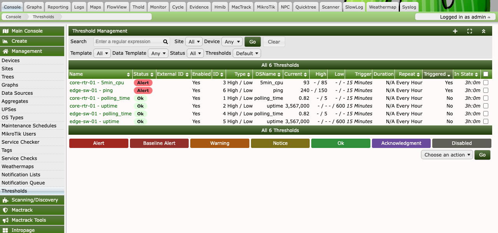

# Thold

The Thresholds plugin (`thold`) is a fault management system driven by the
data in Cacti graphs. It checks data sources against thresholds after each
poll, raises alerts and warnings, and sends notifications by email, syslog, and
SNMP trap or inform. It can also notify people when a device changes status.
Administrators and operations staff who want to be told when a measured value
or a device goes out of range need it.

This page follows the plugin's `develop` branch, which is unreleased and can
change. That branch declares version 1.8.3 and Cacti compatibility 1.2.29 in
its `INFO` file.

## Requirements

- Plugin version 1.8.3 and Cacti 1.2.29 or later, as declared in `INFO`.
- The `INFO` file lists no required plugins. Other plugins can use Thold, for
  example the Maintenance Scheduler shows a **Thold Devices** tab when Thold
  is enabled.
- Working email in Cacti, configured under **Console > Configuration >
  Settings > Mail/Reporting/DNS**, if you want email notifications.
- The PHP binary configured in Cacti (the `path_php_binary` setting). The
  poller uses it to start `poller_thold.php` and `thold_notify.php` in the
  background, and the Threshold Daemon uses it to start its child processes.
- The Cacti SNMP Agent support, if you want SNMP notifications. The setting
  states that this feature requires it.
- systemd, only if you want to run the optional Threshold Daemon as a service.
  The plugin ships a unit file.
- On Cacti older than 1.2.31, the README says to add a small snippet to
  `applySkin()` in `include/layout.js` so the **Cancel** buttons on forms
  work. See the README for the exact code.

## Installation

Install the plugin in `plugins/thold`, using the directory name `thold` rather
than `plugin_thold`. Then follow the generic steps in
[Plugin Management](Plugins.md) to install and enable it.

After installing:

1. Check that email works in Cacti with the test option under **Console >
   Configuration > Settings > Mail/Reporting/DNS**.
2. Open **Console > Configuration > Settings** and review the
   **Alerting/Thold** tab, which controls the global defaults.
3. Grant the thold realms to users, as described below.

If you use the Threshold Daemon, restart the `thold_daemon` service after
upgrading the plugin so the long-running process loads the new code. On
upgrade the plugin also prunes its own development-only files, such as the
`tests/` directory.

## Permissions

| Realm | Pages |
| --- | --- |
| **Configure Thresholds** | `thold.php` |
| **Configure Threshold Templates** | `thold_templates.php` |
| **Manage Notification** | `notify_lists.php`, `notify_queue.php` |
| **View Thresholds** | `thold_graph.php`, `graph_thold.php`, `thold_view_failures.php`, `thold_view_normal.php`, `thold_view_recover.php`, `thold_view_recent.php`, `thold_view_host.php` |

When Cacti supports role augmentation, the plugin adds **View Thresholds** to
the **Normal User** role, **Configure Threshold Templates** to the **Template
Editor** role, and the threshold and notification pages to the **General
Administration** role.

## Settings

Settings are on **Console > Configuration > Settings** under the
**Alerting/Thold** tab. Some defaults are presets used when you create new
thresholds or templates. The setting descriptions in the interface give the
details. The tables below cover each section.

### General

| Setting | Default | Purpose |
| --- | --- | --- |
| **Disable All Thresholds** | Off | Disables alerting on all thresholds, for example during network maintenance. |
| **Auto Create Thresholds** | Off | Creates all thresholds that belong to the device template when a device is created or saved, or when automation runs. |
| **Consider Unknown Data as Zero** | Off | Treats unknown data (`U`) as zero in threshold checks. |
| **Default Management Status** | Any | The default status filter on the threshold management page. |
| **Empty ifHighSpeed Default** | 10000 | Value used for expression thresholds when `ifHighSpeed` and `ifSpeed` are both zero. |

### Notification Preferences

| Setting | Default | Purpose |
| --- | --- | --- |
| **Disable Legacy Notifications** | Off | Disables specific email alerts that are not tied to a notification list. |
| **Threshold Notification Templated** | Off | A new threshold template owns its notification settings by default. |
| **Enable Command Execution** | Off | Allows commands to run on threshold breach and restoral events. |
| **Enable Per Thold Notification** | Off | Allows custom email bodies on thresholds. |
| **Enable Notification Queue** | Off | Sends notifications out of band, by the notification daemon or the notification poller, instead of inline. |
| **Enable Sending Alert Emails to Warning Notification Lists** | Off | Warning list recipients also receive alert emails. |

### Threshold Daemon

| Setting | Default | Purpose |
| --- | --- | --- |
| **Enable Threshold Daemon** | Off | Uses a dedicated daemon to check thresholds, to improve performance or to move monitoring to another server. |
| **Force Threshold Daemon Debug** | Off | Turns on daemon debug output for systemd or command-line runs. |
| **Daemon Down Notification Frequency** | 7200 | How often to send an email when the daemon is found to be down. |
| **Daemon Threads** | Cacti **concurrent_processes** setting | The number of threads the daemon uses. |

### Logging

| Setting | Default | Purpose |
| --- | --- | --- |
| **Log Threshold Breaches** | Off | Writes every threshold failure to the Cacti log. |
| **Show Data Source in Log** | Off | Adds the data source name to the log if it is not present. |
| **Log Threshold Changes** | Off | Writes threshold changes to the Cacti log. |
| **Debug Log** | Off | Writes thold debug messages. |
| **Alert Log Retention** | 1 Month (31 days) | How long threshold log entries are kept. |
| **Log action Consider Unknown Data as Zero** | Off | Logs when unknown data is treated as zero. |

### Syslog Settings

**Syslog Enabled**, **Default Priority/Level**, and **Default Facility** are
presets for new thresholds. The settings on each threshold decide the actual
syslog behavior.

### Alert Presets and Baseline Presets

| Setting | Default | Purpose |
| --- | --- | --- |
| **Weekend exemptions** | Off | Thold does not run on weekends. |
| **Default Trigger Count** | 1 | Consecutive breaches needed to raise an alert. |
| **Re-Alerting** | 12 | Repeat the alert after this many poller cycles. |
| **Baseline Time Range Default** | 86400 | Default time range for baseline thresholds. |
| **Baseline Trigger Count** | 2 | Consecutive breaches of the baseline needed to raise an alert. |
| **Baseline Deviation Percentage** | 20 | Default deviation for baseline thresholds. |

### SNMP Notification Options

| Setting | Default | Purpose |
| --- | --- | --- |
| **SNMP Notifications** | 0 | Sends status messages (informs or traps) to SNMP receivers. |
| **Disable Warning Notifications** | Off | Sends no notification for warning breaches. |
| **Disable Restoration Notifications** | Off | Sends no notification when a threshold returns to normal. |

### Emailing Options

| Setting | Default | Purpose |
| --- | --- | --- |
| **Send Emails with Urgent Priority** | Off | Marks emails as urgent. |
| **Send Alerts as Text** | Off | Sends plain text alerts with no graph. The default is HTML with the graph embedded. |
| **Send Email separately for each address** | Off | Sends one email per address. |
| **From Email Address** | Cacti **settings_from_email** value | The address threshold emails come from. |
| **From Name** | Cacti **settings_from_name** value | The sender name. |

### Device Notification Options

These settings control Cacti device up and down notifications.

| Setting | Default | Purpose |
| --- | --- | --- |
| **Enable Notifications** | On | Enables dead and recovering device notifications. |
| **Single Email Notification** | On | Sends one email per processing cycle for all down devices. Notification lists and the queue only. |
| **Single Email Notification Subject** | Thold Device Notification: Up/Down Devices Found | Subject for those combined emails. |
| **Notification Delay** | -1 | Pause large bursts of down notifications to see whether the problem is transient. Two settings share this label: the number of down devices that triggers the pause, and how long to wait. |
| **Global Notification Email** | None | Recipient of dead device notifications when the global notification list is selected. |

**Down Subject**, **Down Message**, **Recovering Subject**, and **Recovering
Message** set the device email text and support replacement tags such as
`<HOSTNAME>` and `<DESCRIPTION>`. **Status Change Command** runs a command,
with no arguments, when a device changes state.

### Alert/Warning Message Defaults

**Threshold Alert Message**, **Threshold Warning Message**, and **Threshold
Restoral Message** hold the text at the top of each notification. Each allows
up to 1024 characters and may contain HTML, which is removed from text-only
emails.

## Using Thold

The plugin adds a **Thold** tab at the top of the interface for users with the
**View Thresholds** realm. Its page has three sub-tabs: **Thresholds**,
**Log**, and **Device Status**. It also adds these console pages:

- **Console > Management > Thresholds**: **Threshold Management**, where you
  create and edit thresholds.
- **Console > Templates > Threshold**: **Threshold Templates**, which hold
  the settings used to create thresholds. This page also imports templates.
- **Console > Management > Notification Lists**: groups of email recipients.
- **Console > Management > Notification Queue**: **Event Notifications**
  waiting to be sent.

The following example uses synthetic data. It shows **Threshold Management**
with six thresholds on two test devices, the status filters, and the color
legend for Alert, Baseline Alert, Warning, Notice, Ok, Acknowledgment, and
Disabled.



The filters are **Search**, **Site**, **Device**, **Template**, **Data
Template**, **Status**, and **Thresholds**. Select thresholds and use the
actions **Acknowledge**, **Suspend Notifications**, **Resume Notifications**,
**Delete**, **Enable**, **Disable**, **Reapply Suggested Names**, and
**Propagate Template**.

### Threshold types and data manipulation

Each threshold has a **Threshold Type**:

- **High / Low** alerts when the value is above the high value or below the
  low value for the **Breach Duration**.
- **Time Based** alerts when the value breaches the high or low value a set
  number of times (**Breach Count**) within the **Breach Window**.
- **Baseline Deviation** compares the value with a floating window of past
  data and alerts when the change goes up or down by more than the configured
  deviation.

High / Low and Time Based thresholds have both warning and alert sections.
**Re-Alert Cycle** sets how often to notify again if the threshold has not
cleared.

**Data Type** chooses how the value is calculated: **Exact Value**, **CDEF**,
**Percentage** (with a **Percent Data Source** as the denominator),
**RPN Expression**, or **Upper + Lower bytes**. Expression thresholds can use
other data sources in the same graph and follow RRDtool RPN logic.

### Create thresholds from templates

Create a threshold template for a graph template, then apply it in one of
these ways.

1. Add the template to a device template. Thresholds are created for each
   device made from that device template, when **Auto Create Thresholds** is
   enabled or automation runs.
2. On **Console > Management > Graphs**, select graphs, choose **Create
   Threshold from Template**, choose a template, and continue. The same action
   exists for data sources.
3. Use `cli_thresholds.php` from the command line.

One data source can have several thresholds, for example a baseline check and
a high and low check on the same value.

### Create a notification list

1. Open **Console > Management > Notification Lists** and click the plus icon.
2. On the **General** tab, enter a **Name** and **Description** and leave
   **Enabled** set. Enter **To Email Addresses** and optionally **BCC Email
   Addresses**.
3. Save, then use the **Devices**, **Thresholds**, and **Templates** tabs to
   associate items with the list using the **Associate** action.

Lists can be duplicated or deleted from the list page. Choose a list in the
**Alert Notification List** and **Warning Notification List** fields of a
threshold or template.

### Acknowledge a breached threshold

On the **Thresholds** sub-tab, each breached threshold has icons to
acknowledge it, to suspend notifications until it clears, and to resume
notifications. The same acknowledge and suspend actions are available in
bulk on **Threshold Management**.

### Notification queue

When **Enable Notification Queue** is on, the **Event Notifications** page
lists queued notifications with their **Attempts** and **Next Attempt**
columns. Use the **Suspend** and **Resume** buttons to pause and restart
sending. The page title shows who suspended notifications and how long ago.
Failed emails are retried up to five times with a delay that grows from one
minute to eight minutes. After the fifth failed attempt the entry stops
retrying.

## Background Processing

After each polling cycle the `poller_bottom` hook starts `poller_thold.php` in
the background. It registers itself as a process, so a second copy does not
run at the same time. When the Threshold Daemon is not enabled, one run:

- checks all thresholds,
- updates device status and sends device up and down notifications,
- deletes threshold log entries older than **Alert Log Retention**,
- prunes old data,
- writes a `THOLD STATS` line to the Cacti log with the run time, number of
  thresholds, and device counts.

When **Enable Notification Queue** is on and the notification daemon is not
set, each run also starts `thold_notify.php` to send queued notifications.

When **Enable Threshold Daemon** is on, the checks run in `thold_daemon.php`
instead. The poller script then only checks that the daemon is alive and
emails administrators if it has not started or has stopped, at the interval
set by **Daemon Down Notification Frequency**.

To install the daemon on a systemd system, copy the unit file from
`plugins/thold/service/systemd/thold_daemon.service` to
`/etc/systemd/system`, replace the `<CACTIDIR>` placeholder with your Cacti
base path, change `mariadb.service` to `mysql.service` if needed, then run:

```console
systemctl daemon-reload
systemctl enable --now thold_daemon
```

If you enable the daemon but do not run it, thresholds are not checked.

Rate calculations for counter, derive, and absolute data sources handle gaps.
When the gap between samples is more than two effective sampling intervals, the
rate is treated as unknown and the next sample starts a new baseline. An
unknown rate leaves the threshold state unchanged and writes a warning.

The `plugin_thold_log` table grows with each event and is purged by
**Alert Log Retention**.

## Command-Line Tools

Run these from the Cacti directory as the poller user.

`cli_thresholds.php` creates thresholds from templates:

```console
usage: cli_thresholds.php --auto-create=N | [--host-ids='N1 N2 ...'] [--graph-template=N] [--thold-template=N] [--graph-ids='N1 N2 ...']

--auto-create=N         - Auto Create all Thresholds for this Device id using Templates associated
                          the Devices Device Template.
--host-ids='N1 N2 ...'  - The Devices ID to create Thresholds for
--graph-template=N      - The Graph Template to create Thresholds for
--thold-template=N      - The Threshold Template to use for creating Thresholds
--graph-ids='N1 N2 ...' - The Threshold Template to use for creating Thresholds
```

With the second method you must give at least one of the device, graph
template, threshold template, or graph options.

`cli_import.php` imports a threshold template exported from the plugin:

```console
usage: cli_import.php --filename=N

--filename=N  - A valid threshold template exported using the thold plugin.
```

The background scripts also accept options, for testing and service use:

```console
usage: poller_thold.php [--debug] [--force]
usage: thold_daemon.php [ --foreground | -f ] [ --debug ]
usage: thold_notify.php [--thread=N] [--debug]
```

The `--thread=N` option of `thold_notify.php` is accepted for compatibility
but ignored.

## Troubleshooting

- If thresholds appear not to work after you enable **Enable Threshold
  Daemon**, install and start the `thold_daemon` service. Without it nothing
  checks the thresholds.
- Messages from `THOLD` in the Cacti log include `Thold Daemon Child[...]
  Died!` for a failed daemon child and `The Threshold Processing Script
  'poller_thold.php' is missing` if the plugin files are incomplete.
- Turn on **Debug Log**, or run `poller_thold.php --debug`, for detailed
  messages.
- Emails not arriving: test Cacti's mail settings first, and check whether
  **Enable Notification Queue** is on. If it is, review the **Event
  Notifications** page for attempts and errors.
- No alerts at all: check that **Disable All Thresholds** is not set and that
  the threshold and its template are enabled.
- Weekend gaps: **Weekend exemptions** stops thold from running on weekends.
- Cancel buttons doing nothing on Cacti older than 1.2.31: apply the
  `applySkin()` change from the README.

## More Information

- [Plugin repository](https://github.com/Cacti/plugin_thold)
- [README](https://github.com/Cacti/plugin_thold/blob/develop/README.md)
- [Plugin Management](Plugins.md)
- [Supported plugins](supported-plugins.md)

---

Copyright (c) 2004-2026 The Cacti Group
