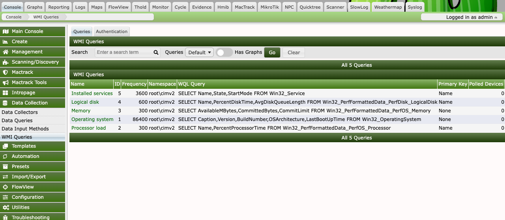

# WMI

The WMI plugin (directory `wmi`) queries Windows devices over Windows
Management Instrumentation (WMI) from the Cacti poller. You define named WQL
queries, attach them to device templates, and give each device an
authentication account. A collector then runs the due queries in the
background and stores the returned rows in cache tables. It is meant for
administrators who need inventory and performance values from Windows hosts.

This plugin is marked as under development and not for production use in the
[supported plugins](supported-plugins.md) list, and its own README carries the
same warning. This page follows the development branch (`develop`), which is
unreleased and can change. That branch declares version 1.1 and Cacti
compatibility 1.1.4 in its `INFO` file.

## Requirements

- Plugin version 1.1 and Cacti compatibility 1.1.4, as declared in `INFO`.
- No other plugins are required.
- A transport to reach the Windows hosts, chosen from the operating system of
  the Cacti server.
- On a Linux Cacti server the plugin runs the `wmic` client (DCOM). The path is
  the **WMI Client (wmic) Path** setting, default `/usr/bin/wmic`. The client
  must be installed separately.
- On a Windows Cacti server the plugin runs `powershell.exe` and uses CIM
  cmdlets over WinRM. The target hosts must have WinRM configured and
  reachable.
- The PHP binary configured in Cacti's **PHP Binary Path** setting, which the
  poller hook uses to start the collector.
- The MySQL or MariaDB server that Cacti uses. The `wmi_processes` table uses
  the MEMORY engine.

## Installation

Follow [Plugin Management](Plugins.md) for the generic steps, with these
additions:

1. Copy the plugin into `plugins/wmi`. The directory must be named `wmi`.
2. On a Linux Cacti server, install the `wmic` client and, if it is not at
   `/usr/bin/wmic`, set its path under **Settings > Paths**.
3. Install and enable the plugin.

Installation creates seven tables (`wmi_user_accounts`, `wmi_wql_queries`,
`host_template_wmi_query`, `host_wmi_query`, `host_wmi_cache`,
`wmi_processes` and `host_wmi_accounts`), adds a `wmi_account` column to the
Cacti `host` table, and creates two data input methods, **Get WMI Data** and
**Get WMI Data (Indexed)**.

Disabling the plugin keeps its tables and data. Uninstalling drops the seven
tables, removes the `wmi_account` column, and deletes the graphs and data
sources that use the two WMI data input methods. The data input methods
themselves stay in Cacti. After a reinstall, check the permissions of users
other than admin, because a new realm is created.

## Permissions

| Realm | Pages |
| --- | --- |
| **WMI Management** | `wmi_accounts.php`, `wmi_queries.php`, `wmi_tools.php` |

When Cacti provides role augmentation, the **Template Editor** role is also
given the page `wmi_queries.php`. Managing accounts and using the query tool
require **WMI Management**.

## Settings

The plugin adds settings to the **Misc** tab of **Console > Configuration >
Settings**, under the heading **WMI Settings**, and one setting to the
**Paths** tab.

| Setting | Default | Purpose |
| --- | --- | --- |
| Enable WMI Data Collection | on | Described as enabling the plugin to query Windows devices. |
| Concurrent Processes | 10 processes | How many WMI collector processes run at once. Choices are 1 to 10, then 15 to 50 in steps of 5. |
| Auto Create WMI Queries | on | Described as creating the associated queries when a device is created or saved. |
| Use WinRM over HTTPS | off | Default for accounts that inherit server settings. |
| WinRM Port Override | blank | Default port for accounts that inherit server settings. Leave blank for the Windows default. |
| WinRM Authentication | Negotiate | Default for accounts that inherit server settings: **Negotiate**, **Kerberos** or **Basic (HTTPS only)**. |
| WMI Client (wmic) Path (Paths tab) | `/usr/bin/wmic` | Path to the `wmic` binary used from a Linux Cacti server. |

The last three WinRM settings apply to the PowerShell transport. In the
source of this branch, the **Enable WMI Data Collection** setting is not
checked by the collector and the **Auto Create WMI Queries** hook does not yet
create queries.

## Using WMI

Typical use is to define queries, attach them to a device template, create
accounts, and select an account on each device.

### Queries

Open **Console > Data Collection > WMI Queries**. The list has a search box,
a row count, a **Has Graphs** switch, and the columns **Name**, **ID**,
**Frequency**, **Namespace**, **WQL Query**, **Primary Key**, **Polled
Devices**, **Last Poll**, **Failing Devices**, **Timeouts** and **Most Recent
Error**. Query failures keep the previous cached values and record an error
summary.

The screenshot shows the **WMI Queries** list with five example queries. The
data is synthetic.



A query has these fields:

| Field | Default | Purpose |
| --- | --- | --- |
| Name | none | A meaningful display name. |
| Collection Frequency | 5 Minutes | How often the query is collected when it is added to a device. Choices run from 1 Minute to 1 Day. |
| Enabled | off | Whether the query is enabled on hosts that use it. |
| Namespace | none | A WMI namespace, or `PDH` to collect native performance counter paths. |
| Query | none | WQL, or for `PDH` one counter path per line. Responses are capped at 16 MiB. |
| Primary Key | none | The column that identifies each row when a query returns several. Separate multiple columns with a comma. |

The `PDH` mode runs only when the Cacti server is Windows and uses
PowerShell remoting.

### Authentication accounts

The **Authentication** tab on the queries page lists the accounts and leads to
**WMI Accounts**. An account has a **Name**, **Username** (include the domain
if needed) and **Password**, plus these WinRM fields for the PowerShell
transport: **WinRM Transport** (**Use Server Default**, **HTTP** or
**HTTPS**), **WinRM Port Override**, and **WinRM Authentication** (**Use
Server Default**, **Negotiate**, **Kerberos** or **Basic (HTTPS only)**).

### Device templates and devices

On a **Device Template** edit page the plugin adds the section **Associated
WMI Queries**. Pick a query under **Add WMI Query** and select **Add**, or use
the delete icon to disassociate one.

On a **Device** edit page the section **WMI Account Options** holds **WMI
Authentication Account**. A device is polled only when an account is
selected. The device page also shows an **Associated WMI Queries** section
with a **Status** of **WMI Query Exists** or **WMI Query Does Not Exist** for
each query of the template.

To start collecting from a Windows host:

1. Create the query under **Console > Data Collection > WMI Queries**.
2. Create an account on the **Authentication** tab.
3. Add the query to the device template of the host.
4. Edit the device, choose the account in **WMI Authentication Account**, and
   save.
5. Wait for a poller cycle. The results are stored in the `host_wmi_cache`
   table.

### WMI Query Tool

**Console > Utilities > WMI Query Tool** runs a query against a host for
testing, before you save it. Enter **Name**, **Frequency**, **Host**,
**Username**, **Password**, **Namespace**, **Command** and **Primary Key**,
then select **Run**. The buttons **Clear**, **Queries** (a list of common
queries), **Help** (setup hints) and **Add** (create a new WMI query from the
current one) are also available. Results show the columns and the first one
or two rows.

## Background Processing

The plugin registers the `poller_bottom` hook. On the main poller (poller id
1) it starts `poller_wmi.php -M` in the background after each polling cycle.
The master process:

1. Selects devices that are not down and not disabled, have an account, and
   have an enabled query whose frequency has elapsed since it last started.
2. Starts one `poller_wmi.php --host-id=N` process per device, at most
   **Concurrent Processes** at a time.
3. Waits for the children and writes a `WMI STATS` line to the Cacti log.

Children run the due queries and store the rows in `host_wmi_cache`. Running
collectors are tracked in the `wmi_processes` table. The master exits with
`WARNING: Another WMI Collector is still running!  Exiting` while the table
has rows. When the setting `wmi_autopurge` is `on`, the master also deletes
cache rows of devices that no longer exist. That setting has no field on the
Settings page.

## Command-Line Tools

`poller_wmi.php` is started by the poller. Its usage text is:

```console
master process: poller_wmi.php [-M] [-f] [-d]
child  process: poller_wmi.php --host-id=N [--seed=N] [-f] [-d]
```

| Option | Meaning |
| --- | --- |
| `-M` | Master run, polls every device that is due. |
| `--host-id=N` | Child run for one device. Required without `-M`. |
| `-f`, `--force` | Accepted and passed to children. |
| `-d`, `--debug` | Prints debug messages. |
| `-V`, `-v`, `--version` | Print the version. |
| `-H`, `-h`, `--help` | Print the usage text. |

`wmi_script.php` and `script/wmi-script.php` are script server entry points
for running a saved WMI query.

## Troubleshooting

Messages use the `WMI` tag in the Cacti log.

- `WARNING: Another WMI Collector is still running!  Exiting`: rows exist in
  `wmi_processes`. If no collector is running, a collector was killed and left
  rows behind.
- `WARNING: Errored WMI Query[id] for Device [id]`: the query failed. Raise the
  logging level for that device to see the error text.
- `WARNING: WMI Device[id] experienced N WMI Errors while performing data
  collection`: one or more of the device's queries failed.
- `WARNING: Unable to create a private directory for the wmic credentials` or
  `Unable to write the wmic credentials file`: the plugin falls back to
  passing the credentials as command arguments.
- `ERROR: wmic did not finish within 120 seconds`: the `wmic` client was
  stopped after its timeout.
- A device is never polled: check that it has an account selected, that it is
  up and enabled, that its template has the query, and that the query is
  enabled.
- For `wmic` over DCOM, the Windows account needs Distributed COM permissions
  and the Windows firewall must allow DCOM, as the **Help** button of the
  query tool explains.

## More Information

- [Plugin repository](https://github.com/Cacti/plugin_wmi)
- [README](https://github.com/Cacti/plugin_wmi/blob/develop/README.md)
- [Plugin Management](Plugins.md)
- [Supported plugins](supported-plugins.md)

---

Copyright (c) 2004-2026 The Cacti Group
