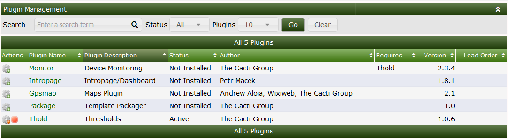
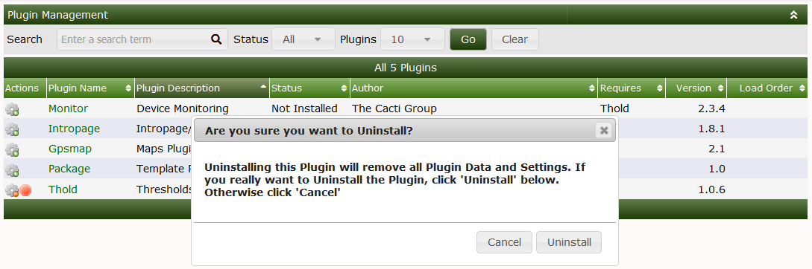
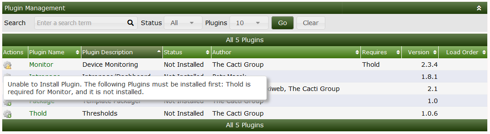

# Plugin Management

Plugins extend Cacti with additional features. Before installing one, read its
README and `INFO` file, check its compatibility with your Cacti release, and
review required dependencies and database changes.

## Installing Plugins

1. Download a compatible release from the plugin's project repository. Place
   its files under `<path_cacti>/plugins/` using the directory name expected by
   the plugin. For example, `plugin_thold` is installed in `plugins/thold`,
   not `plugins/plugin_thold` or an extra nested directory.
2. Make the code readable by the web server and poller. Use the ownership and
   permissions required by your installation; application code generally does
   not need to be writable by the web server.
3. Open **Console > Configuration > Plugins** and install the plugin.
4. Enable it, complete its configuration, and grant the intended users access.

Do not assume the repository's development branch is a release suitable for
production. Use the plugin's release instructions and verify any prerequisites
reported by the management page.

## Updating a Plugin

Back up the Cacti database, plugin files, and any plugin-specific data before
updating. Read the release's migration instructions, including any required
Cacti or plugin dependencies.

1. Disable the plugin without uninstalling it.
2. Replace or update the code in its existing directory, preserving local
   configuration as directed by the plugin's instructions.
3. Check file ownership and permissions.
4. Re-enable the plugin, complete any required upgrade steps, and verify its
   functionality and scheduled jobs.

**Do not uninstall a plugin as an upgrade step.** Uninstalling can remove its
tables, settings, and stored data. Disabling and uninstalling are different
operations.

### Video Walkthrough

## Uninstall a Plugin

Disable the plugin under **Console > Configuration > Plugins**, then use its
uninstall action and review the confirmation. Back up data before proceeding:
uninstall behavior is plugin-specific and can delete database tables.

Uninstalling does not necessarily remove the plugin's files. Remove its code
from `plugins/` separately when it is no longer needed. Some plugins expose an
additional reset or data-removal action; review what it deletes before using it.

### Dependencies in plugins

Dependencies vary by plugin and release. Use its `INFO` file, README, and the
management page's dependency message to identify what must be installed first.
Do not infer a dependency merely because plugins are commonly used together.

---

Copyright (c) 2004-2026 The Cacti Group
