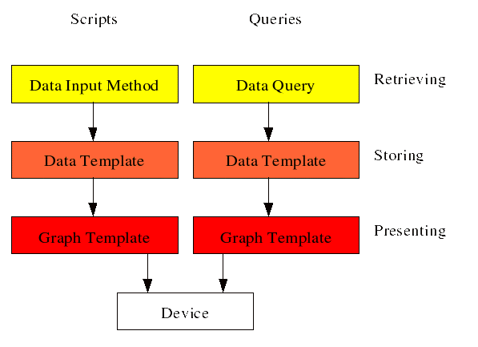
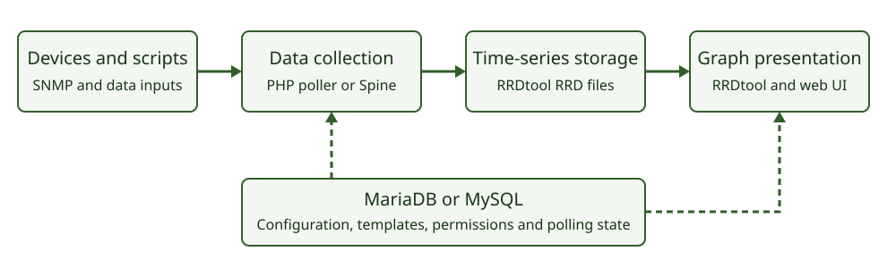

# Principles of Operation

Cacti collects measurements, stores them in Round Robin Database (RRD) files,
and uses RRDtool to render graphs. A MySQL or MariaDB database holds device
configuration, templates, permissions, polling state, and intermediate results.
RRD files hold the time-series measurements.

## Devices and sites

A [Device](Devices.md) represents something Cacti monitors, such as a server,
switch, sensor, or service. Its configuration identifies the responsible data
collector, address, availability checks, and SNMP settings where needed.
[Site](Sites.md) assignments organize devices by location; they do not create
separate database or security boundaries.

[Device Templates](Device-Templates.md) associate graph templates and data
queries with a device. [Automation](Automation-Networks.md) can discover devices
and apply rules for creating devices, graphs, and tree entries.

## Data collectors and scheduling

The main [Data Collector](Data-Collectors.md) runs on the central Cacti system.
Remote collectors poll devices closer to their location and exchange
configuration and results with the main system. During a loss of connectivity,
a configured remote collector can retain results locally for later delivery.
This does not replace backups or provide automatic failover of the main server.

An operating-system scheduler or the Cacti daemon starts `poller.php`.
It coordinates collection and launches the configured engine: the PHP
`cmd.php` poller or the C-based [Spine](Spine.md) poller. The scheduler
interval,
poller interval, and data-source profiles must agree; changing cron alone does
not change an existing RRD file's sampling interval.

## Data retrieval

Cacti uses SNMP, external scripts, and resident PHP script-server functions.
The available SNMP algorithms depend on the device, Net-SNMP, PHP, and Spine
builds. Scripts execute with the poller's operating-system permissions, not
with an interactive administrator's environment.

[Data Input Methods](Data-Input-Methods.md) describe commands and their input
and output fields. [Data Queries](Data-Queries.md) enumerate indexed objects,
such as network interfaces or disk partitions. Query input fields describe
those objects; output fields provide measurements to collect.

## Collection and storage

[Data Sources](Data-Sources.md) connect collection definitions to RRD files and
the series stored in them. The poller writes results to database output tables.
Cacti's update processing writes those measurements to RRD files, either during
normal polling or through [Boost](Boost.md) when on-demand updating is enabled.
Spine does not directly render graphs or replace the RRD update process.

[Data Source Profiles](Data-Profiles.md) define sampling, heartbeat,
consolidation functions, and retention when files are created. RRD archives
have bounded storage for their configured layout. Older measurements are
consolidated or expire according to that layout; changing a graph's timespan
does not recover detail already consolidated away.

An RRD file can contain multiple named series. Database data-source counts,
poller item counts, graph counts, and RRD file counts therefore need not match.

## Graphing

[Graph Templates](Graph-Templates.md) define presentation settings and graph
items. A graph item can draw a series, calculate a value, or add legend text.
Several graphs can reuse an existing data source without collecting it again.
[CDEFs](CDEFs.md), [VDEFs](VDEFs.md), and [GPRINT presets](GPRINTs.md) control
calculations and formatting at graph-rendering time.

Users view permitted graphs through the tree, list, and preview views described
in [Viewing Graphs](Viewing-Graphs.md). Permissions and tree publication control
which graphs a user can reach; adding a graph to a tree does not start polling.

## Extensions

Plugins add features through Cacti's plugin API. Check each plugin's release
compatibility, installation instructions, and permissions before enabling it.
Template import and export share definitions; they do not transfer historical
RRD measurements. See [Plugin Management](Plugins.md) and
[Template Import](Import-Template.md).

---

Copyright (c) 2004-2026 The Cacti Group
