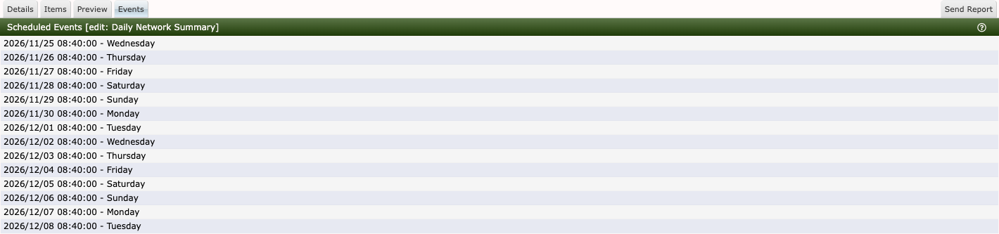

# Report Events

The report editor has **Details**, **Items** and **View Reports** sub-tabs.
It has no **Events** sub-tab, so no page lists the dates and times of future
sends.  The **Next Start** column on the **Reports** list shows when a report
is next due to start.

The image below shows an **Events** page that the develop source does not
contain.

Cacti records each report it sends in the `reports_log` table, including the
report output as sent.  To view an earlier send, select it in the **Report
Date** drop-down on the **View Reports** sub-tab.  See
[Report Preview](Reports-Preview.md).

---
Copyright (c) 2004-2026 The Cacti Group
