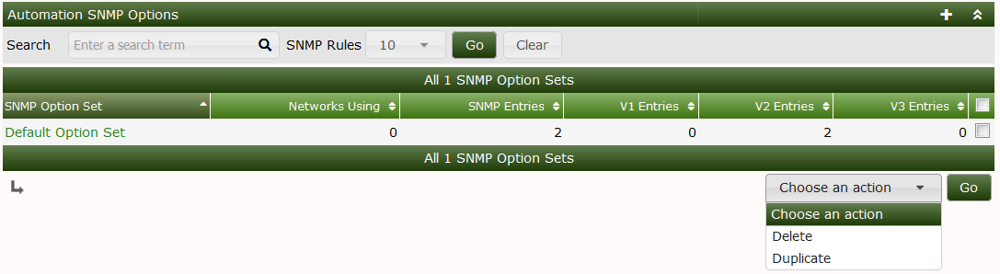
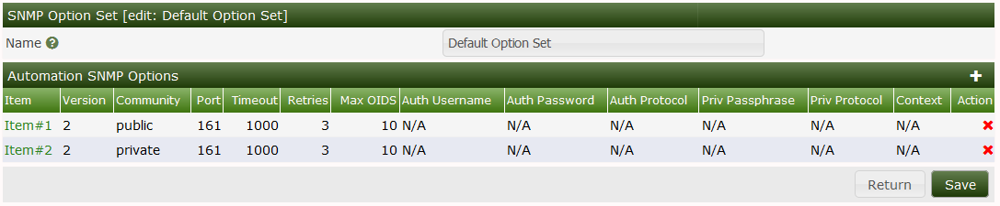
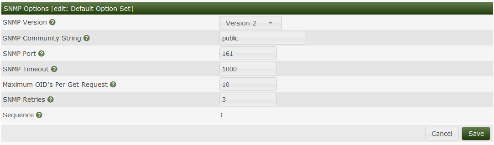
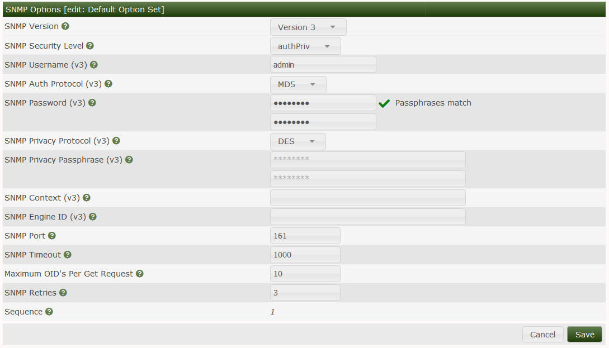

# Automation SNMP Options

The **SNMP Options** page manages named credential sets for Cacti's built-in
network discovery. It is not the SNMP configuration page for an individual
device.

Create a named set and add entries for the SNMP credentials discovery should
try. Entries can use SNMPv1, SNMPv2c or SNMPv3 and include the corresponding
community or user/security settings, port, timeout and retries. Review their
sequence in the set.

Select the intended set in the **SNMP Options** field of the
[discovery network](Automation-Networks.md). Creating a credential set alone
does not assign it to every network or configure the target devices' agents.

For a device already managed by Cacti, configure its polling credentials in
[device settings](Devices.md). An automation credential-set change is not a
bulk credential update for existing devices. Keep the device's SNMP settings
consistent with its agent and the collector that polls it.

.

.

.

.

Before starting a scan, confirm that the selected set contains the intended
credentials and that the collector can reach the target agents. A successful
SNMP response establishes access to the permitted objects, not support for
every query in a device template.

---

Copyright (c) 2004-2026 The Cacti Group
