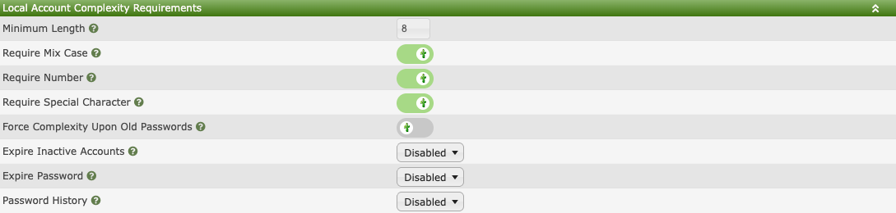
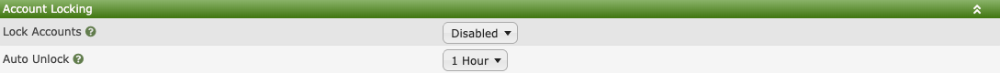

# Local Authentication

## Overview

Cacti's Built-in Authentication is sufficient for most small work-group Cacti
installations. Cacti stores local accounts and password hashes in its database,
not recoverable plaintext passwords. Protect database access and backups as
part of the installation's credential security.

## Local Account Complexity Requirements

Additionally, Cacti has the ability to remember password history, force
complexity rules, minimum lengths, force change frequency, etc. on new
passwords.  These settings are configurable as well.  The image below
shows the local complexity settings available in Cacti.

Those options include:

- **Minimum Length** - The minimum length password that is acceptable
- **Require Mix Case** - Require that the password have mixed case
- **Require Number** - The password must include a number.
- **Require Special Character** - The password must include a Special
  Character.
- **Force Complexity Upon Old Passwords** - If set, and a user attempts
  to log in with a password that does not meet the current complexity
  requirements, they will be forced to change their password.
- **Expire Inactive Accounts** - Disable inactive accounts after
  a certain number of days of inactivity.  The Admin account is excluded from
  this policy.  The default is 0.
- **Expire Password** - The maximum number of days before a password is set to
  expire.  The default is 0.
- **Password History** - Maintain a list of previous passwords, and
  do not allow a user to use one of those prior passwords during
  their password changes.

## Account Locking

If a user attempts to use an incorrect password more than a certain
number of times without a successful login, Cacti can automatically
lock out the user from that account for a certain amount of time.
This technique prevents hackers from continually attempting to
break a user's password from the Cacti interface.  The image
below shows the two settings associated with this Cacti feature.

The settings are fairly self-explanatory, so additional detail is not
provided here.

## Pwned Checks

The **Pwned Checks (Online)** settings check new passwords against
haveibeenpwned.com:

- **Pwned Check** - Check the password against haveibeenpwned.com.  Off by
  default.
- **Pwned Threshold** - Block use of a password once it reaches this reported
  usage level.  The default is 8.

## Localized 2FA

- **Enable Localized 2FA** - Check this option if you wish users to locally
  enable Two Factor Authentication for their accounts.  Most Enterprise level
  MFA does not require intervention by the Cacti Administrator.
- **Token Lifetime** - How long the Two Factor Authentication token lasts before
  being rechecked, up to a maximum of 1 week.

Both settings follow the development source: **Enable Localized 2FA** is
unchecked by default and **Token Lifetime** defaults to 1 Day.  Each user then
enables two-factor authentication for their own account; see
[Two-Factor Authentication](User-Profile.md#two-factor-authentication).

## Account Email Notification

These settings control informational Emails sent when an account is created or
its password is changed:

- **Send email to new user** - When an admin creates a new account and an Email
  address is entered, send an informational Email to it.
- **Subject of new account message** - The Email subject for a new account
  message.
- **Email body for new account message** - The message sent to the new user.
  The maximum is 1024 characters, and HTML is allowed.  The replacement tags
  `<CACTIURL>`, `<USERNAME>` and `<PASSWORD>` may be used.
- **Send email when an admin changes an account password** - When an admin
  changes the password of an account that has an Email address, send an
  informational Email to that address.
- **Subject of password reset message** - The Email subject used when an admin
  changes an account password or a user uses `Forgot password`.
- **Email body for password reset message** - The message sent when a user
  requests a password reset.  The maximum is 1024 characters, and HTML is
  allowed.  The same replacement tags may be used.
- **Reset link validity** - How long the password reset link is valid, in
  minutes.  The default is 15.

## Maintenance Settings

- **Maintenance Lockout Type** - How maintenance lockout is enforced when the
  Cacti system is locked out for maintenance.  Options are
  `Disable Cacti Lockout Feature`, `Primary Admin (all logins)` (the default)
  and `Primary Admin (lockout session only)`.

---
Copyright (c) 2004-2026 The Cacti Group
