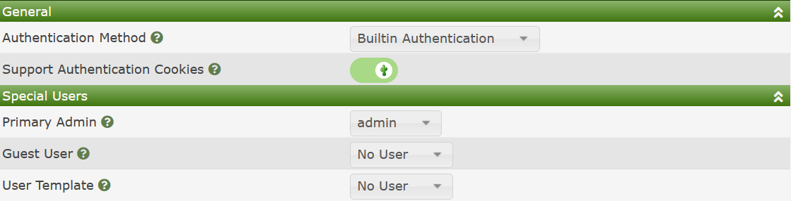

# Authentication

## Overview

Authentication options depend on the Cacti version. In the unreleased Cacti
1.3 development branch, choose from:

- **Cacti Builtin Authentication** - Local accounts use password hashes and
  Cacti's password policies. See [Local Authentication](Settings-Auth-Local.md).
- **Web Basic Authentication** - The web server authenticates the user and
  passes the authenticated identity to Cacti. Cacti still controls access to
  its features and objects. See [Basic Authentication](Settings-Auth-Basic.md).
- **Login Providers** - Configure LDAP, Active Directory, SAML2, or OpenID
  Connect through [Login Providers](Login-Providers.md).

Cacti 1.2 instead provides separate **LDAP Authentication** and **Multiple
LDAP/AD Domains** methods. The [LDAP](Settings-Auth-LDAP.md) and
[domain](Settings-Domains.md) guides retain those version-specific details.
Do not assume that development interface labels are present in a 1.2 release.

For most of these `Authentication Methods`, there are some common settings
shown in the image below.

Those options include:

- **Authentication Method** - One of the options below.
- **Support Authentication Cookies** - Offers a `Keep me signed in` checkbox
  on the login page.  The authentication cookie keeps the user signed in on
  that browser and expires after 90 days without use.  The client must use
  HTTPS for the cookie to be issued.
- **Primary Admin** - This is the Primary Cacti Admin account.  This user
  account receives Cacti administrative notifications, such as when the
  Cacti system is experiencing issues.
- **Guest User** - If you select a **Guest User**, people within an organization
  will be able to access certain Cacti pages without first authenticating.
  This setting is good for pages like the **Graph Page** where you may
  wish to embed live Cacti **Graphs** in other corporate websites.
- **User Template** - When creating new accounts, whether LDAP, Web Basic,
  or new Cacti local accounts, Cacti takes the user's default authorization
  from this Template User account.  For some Cacti **Authentication Methods**
  you can have more than one Template User, for example
  **Login Providers**, or **Multiple LDAP/AD Domains** in Cacti 1.2.

In the sections below, we will go over these various
**Authentication Methods** and their settings.

[Built-in Authentication](Settings-Auth-Local.md)

[Web Basic Authentication](Settings-Auth-Basic.md)

[LDAP Authentication](Settings-Auth-LDAP.md)

[Login Providers (development)](Login-Providers.md)

[Multiple LDAP/AD Domains (1.2)](Settings-Domains.md)

---
Copyright (c) 2004-2026 The Cacti Group
