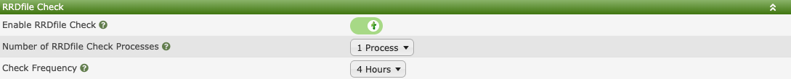
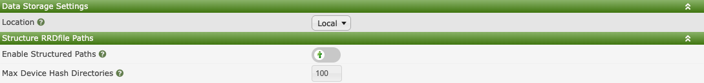

# Data Settings

The Cacti Data settings include settings for gathering statistical data
about Cacti's **Data Sources** and about settings around how Cacti
stores its **Round Robin Archives** Time Series Databases (TSDB),
otherwise known as RRDfiles.

There are presently three sub-sections for these settings.

## Data Source Statistics

Cacti has the ability to store peak and average data for all your
**Data Sources**.  You can then use that data to easily build
dashboards using third party plugins including plugins like
Superlinks from Howard Jones.

Below you will find an image of the default settings.


Those settings include:

- **Enable Data Source Statistics Collection** - This setting
  will either enable or disable the statistics collection.

- **Number of DSStats Processes** - For very large Cacti installs
  the **Data Source Statistics** can take quite a long time to complete.
  This setting allows Cacti to perform the statistics calculation
  at orders of magnitude faster.  You can allocate as many as 20
  concurrent processes to perform all the updates.

- **Daily Update Frequency** - This setting determines how often
  daily averages and peaks should be calculated.  You can set
  it to run hourly, up to every 6 hours, or after Cacti's boost
  process completes.

- **Hourly Average Window** - This is a floating time window where
  Cacti holds onto all samples for determining the hourly averages
  for your **Data Sources**.  You have to watch this cache as by
  default it's stored in a memory table.  You can run out of space.

- **Maintenance Time** - This is the time in the day that Cacti
  will calculate Weekly, Monthly and Yearly numbers and perform table
  maintenance.

- **Memory Limit for Data Source Statistics Data Collector** - This
  setting controls the peak memory that the statistics poller
  will be allowed to use.  Most systems can work fine using the
  default 1GByte setting.

By default, **Enable Data Source Statistics Collection** is off, **Number of
DSStats Processes** is `1 Process`, **Daily Update Frequency** and **Hourly
Average Window** are `1 Hour`, **Maintenance Time** is `12:00am` and the
memory limit is `1 GByte`.

### Collection Process

When the collection is enabled, the statistics are built in these steps:

- While the main **Data Collector** processes the poller output, it stores
  every sample in the table `data_source_stats_hourly_cache`.

- At the end of each poller run, the main **Data Collector** starts
  `poller_dsstats.php` in the background. It removes the samples that are
  older than the **Hourly Average Window** from the cache and stores the
  average and peak of the remaining samples per **Data Source** in the table
  `data_source_stats_hourly`.

- When the **Daily Update Frequency** has elapsed, `poller_dsstats.php`
  starts as many child processes as set in **Number of DSStats Processes**.
  They read the RRDfiles and store the daily average and peak values.

- Once a day, after the **Maintenance Time**, the child processes calculate
  the weekly, monthly and yearly values in the same way.

If **Enable On-demand RRD Updating** is checked in the
[Performance](Settings-Performance.md) settings, the daily values are not
calculated on the **Daily Update Frequency**. They are calculated at the end
of each Boost run that updated RRDfiles instead. If the **Daily Update
Frequency** is set to `After Boost` while Boost is not enabled, Cacti logs a
warning and resets the setting to `1 Hour`.

The runtime of `poller_dsstats.php` is limited by the **Data Source
Statistics Timeout** in the [Poller](Settings-Poller.md) settings, which
defaults to 5 minutes.

You can also start the process from the command line:

```console
shell>php -q poller_dsstats.php [--force] [--debug]
```

- `--force` - Force the execution of an update process. The process runs
  even when the collection is disabled, and it does not wait for the **Daily
  Update Frequency** or the **Maintenance Time**. The daily values are still
  left to Boost when Boost is enabled.

- `--debug` - Display verbose output during execution.

The options `--type` and `--child` are set by Cacti when it starts the child
processes and are not meant to be used by hand.

To remove all collected statistics, use `Purge Data Source Statistics`, see
[System Utilities](System-Utilities.md#purge-data-source-statistics).

## RRDfile Check



The RRDfile checker scans RRDfiles and tries to find problems like stale values.

Those settings include:

- **Enable RRDfile Check** - This setting
  will either enable or disable the RRD checker.

- **Number of RRDfile Check Processes** - For very large Cacti installs
  the **RRDfile Checker** can take quite a long time to complete.
  This setting allows Cacti to perform the checks at orders of magnitude faster.

- **Check Frequency** - This setting determines how often
  checks should be executed.  You can set
  it to run hourly, up to 24 hours, or after Cacti's boost
  process completes.

By default, **Enable RRDfile Check** is off, **Number of RRDfile Check
Processes** is `1 Process` and **Check Frequency** is `4 Hours`. The problems
that the checks find are shown on the RRDfile Checker page, see
[System Utilities](System-Utilities.md#rrdfile-checker).

## Data Storage Settings

These settings determine how you store your RRDfiles.  This
sub-section has two layouts as shown in the images below.



The settings above include:

- **Location** - Either Local or RRDtool Proxy Server.  The example
  above shows the local storage option.

- **Enable Structured Paths** - In very large systems having a flat
  directory structure has severe performance consequences.  However,
  with the Structured Paths option, Cacti will separate RRDfiles by
  Device ID and use the Data Source ID as the RRDfile name.

- **Directory Pattern** - Which Directory Pattern to use for Structured RRD
  Paths.  The options are `Device ID`, which is the default,
  `Device ID/Data Query ID`, `Device Hash/Device ID` and
  `Device Hash/Device ID/Data Query ID`.  Use `Device ID/Data Query ID` when
  you have **Devices** with thousands of **Graphs**.  After changing the
  Directory Pattern, you must run the Structured Path CLI script again.

- **Max Device Hash Directories** - The maximum number of **Device**
  directories to be created based upon hashed **Device** IDs.  The default is
  100.

> **NOTE**: If you are migrating from non-structured to structured
> paths setup, you must run the CLI script to move those files
> per the updated specification right after making this change.

The RRD Proxy settings below are more involved.

> **NOTE**: It should be noted that although the RRD Proxy is
> in production at large commercial sites, it continues to not
> support replication.  The author claims that it's 95%
> complete, but to date, has not completed the last 5%.


The settings above include:

- **Proxy Server** - The IP or DNS name of the primary RRDfile proxy
  server.

- **Proxy Port Number** - The port number to connect to in order to
  communicate with the RRD Proxy.  The default is 40301.

- **RSA Fingerprint** - The fingerprint of the current public RSA
  key the proxy is using.  This is required to establish a trusted
  connection to the RRD Proxy service.

> **WARNING**: None of the settings below are implemented.

- **Load Balancing** - Whether calls to the RRD Proxy should be
  load balanced.

- **Proxy Server** - The secondary Proxy server IP or DNS name.

- **Proxy Port Number** - The port number on the secondary RRD Proxy
  to talk to.

- **RSA Fingerprint** - The fingerprint of the current public RSA
  key the proxy is using.  This is required to establish a trusted
  connection to the RRD Proxy service.

---
Copyright (c) 2004-2026 The Cacti Group
