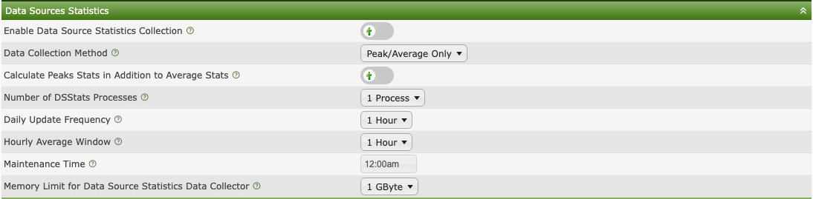
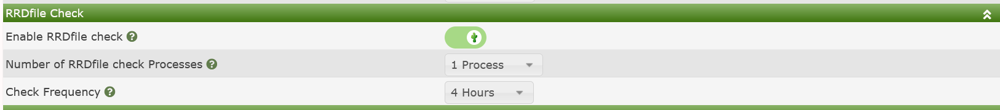
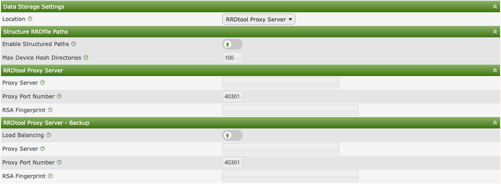

# Data Settings

The Cacti Data settings include settings for gathering statistical data
about Cacti's **Data Sources** and about settings around how Cacti
stores its **Round Robin Archives** Time Series Databases (TSDB),
otherwise known as RRDfiles.

The sections below cover statistics, file checks, and storage.  In the
development source, this settings tab is labeled **Data/Statistics**.

## Data Source Statistics

Cacti has the ability to store peak and average data for all your
**Data Sources**.  You can then use that data to easily build
dashboards using third party plugins including plugins like
Superlinks from Howard Jones.

Below you will find an image of the default settings.



Those settings include:

- **Enable Data Source Statistics Collection** - This setting
  will either enable or disable the statistics collection.

- **Data Collection Method** - Data Source Statistics can use a legacy method
  that determines peak and average values (`Peak/Average Only`, the default), or
  an advanced mode that calculates several additional statistical values
  (`All Statistical Metrics`).  Using `All Statistical Metrics` can place
  additional CPU and I/O load on the system.

- **Calculate Peaks Stats in Addition to Average Stats** - This option doubles
  the data collection time.  It uses the `MAX` consolidation function and
  calculates statistics from the max values in each of the respective time
  ranges.

- **Number of DSStats Processes** - For very large Cacti installs
  the **Data Source Statistics** can take quite a long time to complete.
  This setting controls the number of concurrent statistics workers.  You can
  allocate as many as 20
  concurrent processes to perform all the updates.

- **Daily Update Frequency** - This setting determines how often
  daily averages and peaks should be calculated.  You can set
  it to run hourly, up to every 6 hours, or after Cacti's boost
  process completes.

- **Hourly Average Window** - This is a floating time window where
  Cacti holds onto all samples for determining the hourly averages
  for your **Data Sources**. Monitor its size and database load. The current
  development schema uses InnoDB; older installations may have a different
  engine and capacity limit.

- **Maintenance Time** - This is the time in the day that Cacti
  will calculate Monthly and Yearly numbers and perform table
  maintenance.

- **Memory Limit for Data Source Statistics Data Collector** - This
  setting controls the peak memory that the statistics poller
  will be allowed to use.  Most systems can work fine using the
  default 1GByte setting.

### Data Source Retention Settings

- **Save Historical Data in Database Tables** - Keeps a table for each day,
  week, month, and year of data.  Daily, Weekly, Monthly and Yearly tables are
  created per day, week, month and year, with the suffixes `YYYYDDD`, `YYYYWW`,
  `YYYYMM` and `YYYY` respectively.

- **Daily Partition Retention**, **Weekly Partition Retention**,
  **Monthly Partition Retention** and **Yearly Partition Retention** - How long
  to keep the daily, weekly, monthly and yearly statistics.

### Data Source Statistics Defaults and Collection

In the development source, the statistics settings have these defaults:

| Setting                                                | Default           |
| ------------------------------------------------------ | ----------------- |
| Enable Data Source Statistics Collection               | Unchecked         |
| Data Collection Method                                 | Peak/Average Only |
| Calculate Peaks Stats in Addition to Average Stats     | Unchecked         |
| Number of DSStats Processes                            | 1 Process         |
| Daily Update Frequency                                 | 1 Hour            |
| Hourly Average Window                                  | 1 Hour            |
| Maintenance Time                                       | 12:00am           |
| Memory Limit for Data Source Statistics Data Collector | 1 GByte           |
| Save Historical Data in Database Tables                | Unchecked         |

When collection is enabled, the main **Data Collector** starts
`poller_dsstats.php` in the background at the end of each polling cycle.  That
script maintains the hourly cache on every run, and calculates the daily
statistics at the **Daily Update Frequency**.  The weekly, monthly and yearly
statistics are calculated once a day, after the **Maintenance Time**.

When **Boost** on-demand RRD updates are enabled, the daily statistics are
calculated when the Boost poller finishes, instead of at the
**Daily Update Frequency**.  If **Daily Update Frequency** is set to
`After Boost` while Boost is not enabled, Cacti logs a warning and resets the
frequency to 1 hour.

The run is limited by the **Data Source Statistics Timeout** on the
[Scheduler](Settings-Poller.md#scheduler-settings) tab.  To start a run by
hand, for example after enabling the feature, use:

```console
php -q poller_dsstats.php --force --debug
```

`--force` forces the update process to run and `--debug` displays verbose
output.  To remove all collected statistics, use **Purge Data Source
Statistics** in [System Utilities](System-Utilities.md).

## RRDfile Checker



RRDfile checker scans RRDfiles and tries to find problems like stale values.

Those settings include:

- **Enable RRDfile Checker** - This setting
  will either enable or disable the RRD checker.

- **Number of RRDfile Checker Processes** - For very large Cacti installs
  the **RRDfile Checker** can take quite a long time to complete.
  More workers increase concurrency and database and storage load.

- **Check Frequency** - This setting determines how often
  checks should be executed.  You can set
  it to run hourly, up to 24 hours, or after Cacti's boost
  process completes.

In the development source, the first two settings are labeled
**Enable RRDfile Check** and **Number of RRDfile Check Processes**, under the
**RRDfile Check** heading.  The check is disabled by default, uses 1 process,
and has a **Check Frequency** of 4 hours.  The results are shown by the
[RRDfile Checker](System-Utilities.md#rrdfile-checker).

## Data Storage Settings

These settings determine how you store your RRDfiles.  This
sub-section has two layouts as shown in the images below.


The settings above include:

- **Location** - Either Local or RRDtool Proxy Server.  The example
  above shows the local storage option.

- **Structured RRD Paths** - In very large systems having a flat
  directory structure has severe performance consequences.  However,
  with the Structured Paths option, Cacti will separate RRDfiles by
  Device ID and use the Data Source ID as the RRDfile name.

- **Directory Pattern** - The directory pattern used for Structured RRD Paths.
  `Device ID` is the default.  `Device ID/Data Query ID` should be used when you
  have **Devices** with thousands of **Graphs**.  The choices are:

  - **Device ID**
  - **Device ID/Data Query ID**
  - **Device Hash/Device ID**
  - **Device Hash/Device ID/Data Query ID**

  After changing the pattern, you must run the structured path CLI script again
  to move the RRDfiles to the new pattern.

- **Max Device Hash Directories** - The maximum number of Device directories to
  create based upon hashed Device IDs.  The default is 100.

When changing structured-path settings on an existing installation, back up
files and database definitions, then use `php cli/structure_rra_paths.php
--help` to plan the move. Run the migration after changing the settings, with
appropriate file ownership and a controlled collection window. The development
branch supports device, query, and hashed directory patterns; changing the
pattern requires another migration.

RRD Proxy stores files through a separate service. Configure and verify the
proxy deployment independently; Cacti's connection settings do not configure
storage replication or guarantee failover of that service.



The settings above include:

- **Proxy Server** - The IP or DNS name of the primary RRDfile proxy
  server.

- **Proxy Port Number** - The port number to connect to in order to
  communicate with the RRD Proxy.

- **RSA Fingerprint** - The fingerprint of the current public RSA
  key the proxy is using.  This is required to establish a trusted
  connection to the RRD Proxy service.

On the development branch, **Load Balancing** selects between the configured
primary and backup endpoints and can try the other endpoint after a connection
failure. Both must serve the intended data. Confirm compatibility and
replication on the proxy side before enabling this option.

- **Load Balancing** - Whether calls to the RRD Proxy should be
  load balanced.

- **Proxy Server** - The secondary Proxy server IP or DNS name.

- **Proxy Port Number** - The port number on the secondary RRD Proxy
  to talk to.

- **RSA Fingerprint** - The fingerprint of the current public RSA
  key the proxy is using.  This is required to establish a trusted
  connection to the RRD Proxy service.

---
Copyright (c) 2004-2026 The Cacti Group
