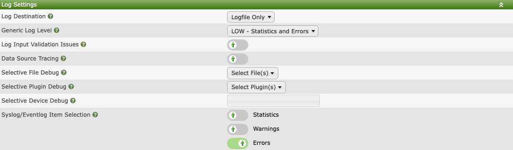
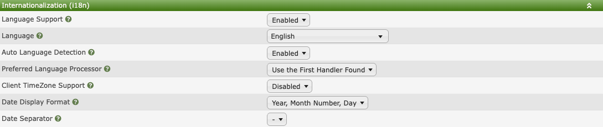
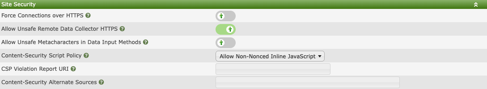

# General Settings

General Settings in Cacti consist of the following categories:

- **Log Settings** - This is where you setup Cacti's logging.  These settings,
   including Log Rotation, are on the **Logging** tab
- **Internationalization (i18n)** - Settings around how Cacti handles languages
   other than English
- **Other Settings** - Other not object settings in Cacti
- **Site Security** - Web Site Security settings such as
   `Content-Security-Policy`,
   use of external JavaScript API's for plugins like Google Maps, forcing https,
   etc.
- **Remote Agent** - Settings for communication between Data Collectors
- **GitHub/GitLab API Settings** - Where Cacti looks up the latest Plugin
   versions
- **Package Creation Defaults** and **Package/Template Import Defaults** -
   Defaults used when creating and importing **Device Templates** and Packages
- **Automation** - Miscellaneous settings around Cacti's Automation
- **Graph Template Defaults** - Defaults for **Graph Templates**

Each of these settings will be documented below.

## Log Settings

Cacti has the ability to log at various levels for various files.  It has the
ability
to log to both the standard cacti.log file, as well as sending some
notifications
to Syslog for forwarding to centralized logging servers.  The image below
show what this settings sub-tab section looks like:

Those settings include:

- **Log Destination** - Where to place Cacti log output.
   Options include:

   - **Logfile Only** - Only send log data to the Cacti log file
   - **Logfile and Syslog** - Send log data to both the Cacti log file and the
      System log facility
   - **Syslog Only** - Send select log data to just the System log facility

   This setting is quite self explanatory, when it comes to what type of
   messages
   are sent to the System log facility, see the `Syslog/Eventlog Item Selection`
   section below.

- **Generic Log Level** - This is the level of logging that Cacti will use.
   Options include:

   - **NONE** - Don't perform any logging, not recommended.
   - **LOW** - Statistics and Errors
   - **MEDIUM** - Statistics, Errors and Results
   - **HIGH** - Statistics, Errors, Results and Major I/O Events
   - **DEBUG** - Statistics, Errors, Results, I/O and Program Flow
   - **DEVEL** - Developer level messages, mainly **SQL Queries**

   Select the log level that works best for your logging needs.  Be advised that
   **DEBUG** generates a large amount of log data.  **DEVEL** should only log
   **SQL Queries**.

- **Log Actions** - Which log actions the Cacti Administrator is given: purge,
   rotate, or both.  Base files can be both purged and rotated, and already
   rotated files can only be purged if you grant that permission.

- **Expand log details** - What level of expansion to use on the log file.
   Increased expansion can slow search results.

- **Log Input Validation Issues** - This is a Developer option to log the use of
   request variables that have not been validated through Cacti's validation
   functions.

- **Data Source Tracing** - This is a debug options for logging of program
   flow around the creation of **Data Sources**.

- **Selective File Debug** - A Multi-select setting that allows you to place
   any Cacti file to be placed into debug mode.  This prevents the cacti.log
   file from being flooded with messages as is common in a general debug
   context.

- **Selective Plugin Debug** - For Plugins, the same level of debug that is
   available for core Cacti files are available for Plugin files as well.

- **Log Ignored General Errors** - Cacti masks certain errors that are often
   considered fatal and that would otherwise disable plugins and confuse some
   users.  Check this to see those errors instead.

- **Selective Device Debug** - This is a comma delimited list of Cacti
   `device_id` that debugging of **Data Collection** services will be enabled
   for.

- **Syslog/Eventlog Item Selection** - In order to not saturate the
   System logging facility, Cacti will only forward some events as defined
   by the various check-boxes.

- **Log Rotation** - `Rotate the Cacti Log`, `Rotation Frequency` and
   `Log Retention`.

## Internationalization (i18n)

The image below shows system level Internationalization settings for Cacti,
commonly
referred to as i18n.

Those settings include:

- **Language Support** - Whether or not to allow selecting other languages for
   Cacti

- **Language** - The default language to use at login time, or by default
   when the user has not specified a language.

- **Auto Language Detection** - Whether or not Cacti should read the language
   from the browser and use that language by default.

- **Preferred Language Processor** - Some PHP distributions doe not come with
   the php-gettext module.  In those cases, the various Linux distributions
   come with alternate GetText processors.  You can select the one that works
   best for your environment here.

- **Client TimeZone Support** - How Cacti supports Client Dates based upon the
   Client browser's timezone.  Options are `Disabled` (the default) and
   `Enabled`.

- **Date Display Format** - The default Date/Time display format.

- **Date Separator** - The default Data/Time separator character.

## Other Settings

These are additional settings for Cacti that fall into various categories, but
that
done have enough entries to justify a separate section.  The image below shows
that
sub-section.

Those settings include:

- **Show only site specific locations** - Show only locations that are
   available at a **Device's** selected site.

- **Has Graphs/Data Sources Checked** - If from the Console, you enter
   a pages that has the various **Has** options, if checked here, the default
   will be to check that setting.

- **RRDtool Version** - Selecting the correct RRDtool Version will unlock
   features
   expected in modern graphing frameworks that leverage SVG (Canvas) rendering.

- **Enable Gradient Support** - Enables gradient support for `AREA` and `STACK`
   charts.

- **Graph Permission Method** - The development branch offers Permissive,
  Restrictive, Device Based, and Graph Template Based policies. These combine
  direct graph access with device and template policies in different ways.
  See [User Management](User-Management.md#graph-permissions) and verify the
  affected user's effective permissions before changing the global method.

- **Graph/Data Source Creation Method** - If you wish to only create **Graphs**
   from **Graph Templates** choose the **Simple** method.  The **Advanced**
   method should only be used by people who wish to define individual **Graphs**
   with their own settings.

- **Show Form/Setting Help Inline** - If this option is checked, you will be
   able to read all form/setting help inline.  Otherwise, you will receive a
   pop-up to access form help.

- **Local Page Help Only** - By default Cacti page help is located at
   docs.cacti.net.  If your system does not have access to the Internet, you
   can host the documentation locally in HTML format in the `docs` location of
   your Cacti server, and check this option to use only that location.

- **Delete Verification** - For simple object removal, things that can be
   removed
   by clicking and 'X' on the page, whether or not you wish to confirm those
   deletes.

- **Data Source Preservation Preset** - Whether or not you wish to preserve
   **Data Sources** by default, or remove them when deleting **Graphs**. In
   all cases, Cacti will not allow the removal of a **Data Source** if there
   are **Graphs** using the **Data Source**.  However, some **Data Sources**
   are managed externally to Cacti, and removing those **Data Sources** by
   default may not be desired.

- **Graphs Auto Unlock** - If when editing a Graph you wish to always unlock
   it by default, select this option.  Not that this does have performance
   implications that may make the User Interface slower on vary large systems
   where devices have tens of thousands of **Data Sources**.

- **Hide Cacti Dashboard** - This is an option used by some plugin developers
   who replace the default Cacti `Console` with their own contents, for example
   the Intropage plugin.

- **Enable Drag-N-Drop** - Certain Cacti pages allow Drag-N-Drop.  If you
   with to use it, check that option.

## GitHub/GitLab API Settings

These settings control where Cacti looks up the latest Plugin versions.

- **Base API Repository URL** - The GitHub or GitLab API URL.  The default is
   `https://api.github.com/`.  Change this only if you maintain your own
   repository for Cacti Plugins.

- **GitHub User Account** - The user account that holds your GitHub/GitLab
   repositories.  The default is `cacti`.

- **Personal Access Token** - A Personal Access Token to avoid overly
   restrictive rate limiting when getting the latest Plugin versions.

- **Enable Unsafe Plugin Installs** - Allows the installation of Plugins from
   their `develop` branch.

## Package Creation and Import Defaults

The **Package Creation Defaults** are used when publishing a
**Device Template** or Package:

- **Author Name** - The name of the author published with the package.  The
   default is `The Cacti Group`.

- **Author Email Address** - The Email address of the author published with the
   package.

- **Template/Package Copyright** - The default copyright for your packaged
   **Device Templates** and Packages.

The **Package/Template Import Defaults** are:

- **Package Location** - The location of the Packages that you wish to import.

- **Remove Orphaned Graph Items** - If checked, Cacti deletes any Graph Items,
   from both the **Graph Template** and associated **Graphs**, that are not in
   the imported **Graph Template**.  On by default.

- **Replace Suggested Value Patterns** - Replace **Data Source** and
   **Graph Template** Suggested Value records.  **Graphs** and **Data Sources**
   take on new names after either a **Data Query** `Re-index` or the forced
   Replace Suggested Values process.  On by default.

## Site Security

The image below shows Site Security settings for Cacti.

Those settings include:

- **Force Connections over HTTPS** - Even if the web site allows http, redirect
   their browsers to HTTPS.

- **Inline JavaScript Protection** - Controls how the
   `Content-Security-Policy` restricts inline JavaScript.  Options include:

   - **HTMX (Default)** - Keeps the `unsafe-inline` policy that all current
      themes and plugins rely on, matching the behavior of prior releases.
   - **Nonce Migration (Report Only)** - Emits a strict nonce policy in
      report-only mode, so incompatible core and plugin scripts can be
      identified without breaking the user interface.
   - **Nonce Enforcement (Advanced)** - Blocks scripts without the request
      nonce.  It requires `CACTI_CSP_NONCE_ENFORCE` to be true in
      `include/config.php`; without that explicit gate it remains in
      report-only mode.
   - **None** - Also permits unsafe `eval()` calls, and is the least
      restrictive option.

- **CSP Violation Report URI** - Used in the Nonce Migration and Nonce
   Enforcement modes.  The URL where browsers post `Content-Security-Policy`
   violation reports.  If blank, Cacti uses the bundled `csp_report.php`
   handler under the configured Cacti URL path.

- **Content-Security Alternate Sources** - If for some reason your Cacti site
   requires content from a CDN or a third party site, you can include a space
   delimited list of URLs that will be able to be traversed for Cacti content.

- **Enable htmx for in-place filter updates** - When enabled, the htmx loader is
   included so pages that opt in can refresh their filter results without a
   full page reload.  Disable only if plugins misbehave.  On by default.

## Remote Agent Settings

When using multiple Data Collectors, these are the settings for communicating
between Data Collectors.

- **TCP Port** - The TCP port used to communicate with the Remote Data
   Collectors.  The protocol matches the Central Cacti web server (HTTP or
   HTTPS).  Leave blank to use the default ports.

- **Timeout** - The time, in seconds, that the Central Cacti web server waits
   for a response from the Remote Data Collector before abandoning the request.
   The default is 5.

- **Verify Remote Agent TLS Certificates** - Require a trusted certificate whose
   name matches the Remote Data Collector hostname.  Disable only while
   replacing legacy self-signed certificates.  On by default.

- **Remote Agent CA File** - An optional absolute path to a PEM CA bundle used
   to verify Remote Data Collector certificates.  If blank, the PHP/OpenSSL
   system trust store is used.

## Automation Settings

The image below shows general Automation Settings for Cacti.

Those settings include:

- **Logging Level** - The logging level for Automation activities: Low, Medium
   or High.

- **Force Serial Automation Scans** - When enabled, Automation scans one network
   at a time instead of in parallel.  This can help when your Cacti web servers
   have limited cores for Automation checks.

- **Enable Automatic Graph Creation** - If a Cacti **Device** has Non **Data
   Query**
   **Graph Templates** associated with it, create those **Graphs** automatically
   when
   adding a new **Device**.  Additionally, if you have **Graph Rules** apply
   those
   at **Device** creation time and save time.  When disabled, Automation does
   not actively create any **Graph**, though invoking **Graph Rules** manually
   is still possible.

- **Enable Automatic Tree Item Creation** - If you have Cacti **Tree Rules**
   apply
   then at **Device** creation and save time.

- **Automation Notification To Email** - When Network Automation finishes, send
   a notification to this Email address.

- **Automation Notification From Name** - The `From Name` on the Automation
   Email.

- **Automation Notification From Email** - The `From Email` such as
   noreply@cacti.net that will be used for Automation notifications.

## Graph Template Defaults

This is where Cacti obtains defaults for **Graph Templates**.

- **Graph Template Test Data Source** - If checked, **Data Sources** are tested
   prior to their creation for new and newly imported **Graph Templates**.  If a
   **Data Source** does not return valid data, the **Graph** is not created.

- **Graph Template Image Format** - When creating a new **Graph Template**
   what `Image Format` should be used.  There is either:

   **SVG** - Scalable Vector Graphics, which retain detail when scaled.
   **PNG** - Portable Network Graphics, a raster image format.

- **Graph Template Height** - The height in pixels of the Graph Canvas for new
   **Graph Templates**

- **Graph Template Width** - The width in pixels of the Graph Canvas for new
   **Graph Templates**

---
Copyright (c) 2004-2026 The Cacti Group
