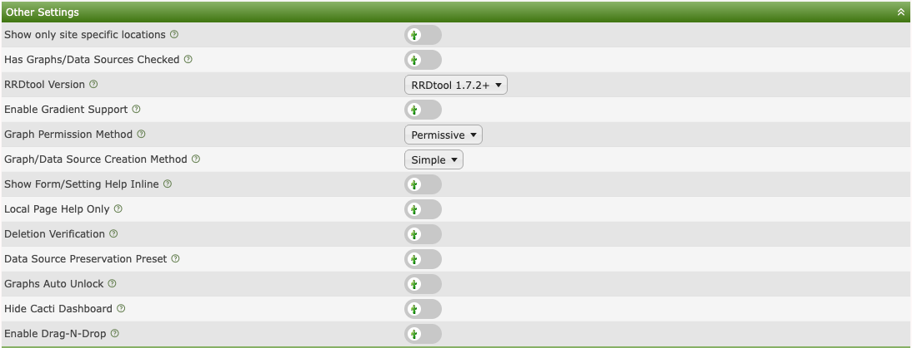
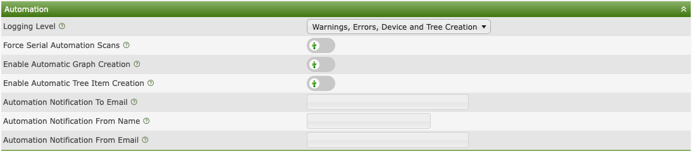
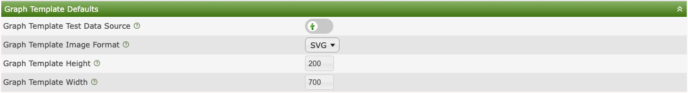

# General Settings

General Settings in Cacti consist of the following categories:

- **Log Settings** - This is where you set up Cacti's logging
- **Internationalization (i18n)** - Settings around how Cacti handles languages
  other than English
- **Other Settings** - Other miscellaneous settings in Cacti
- **Site Security** - Web Site Security settings such as `Content-Security-Policy`,
  use of external JavaScript APIs for plugins like Google Maps, forcing https, etc.
- **Automation** - Miscellaneous settings around Cacti's Automation
- **Graph Template Defaults** - Defaults for **Graph Templates**

Each of these settings will be documented below.

## Log Settings

Cacti has the ability to log at various levels for various files.  It has the ability
to log to both the standard cacti.log file, as well as sending some notifications
to Syslog for forwarding to centralized logging servers.  The image below
shows what this settings sub-tab section looks like:

Those settings include:

- **Log Destination** - Where to place Cacti log output.
  Options include:

  - **Logfile Only** - Only send log data to the Cacti log file
  - **Logfile and Syslog/Eventlog** - Send log data to both the Cacti log file
    and the System log facility
  - **Syslog/Eventlog Only** - Send select log data to just the System log
    facility

  This setting is quite self-explanatory when it comes to what type of messages
  are sent to the System log facility; see the `Syslog/Eventlog Item Selection`
  section below.

- **Generic Log Level** - This is the level of logging that Cacti will use.
  Options include:

  - **NONE** - Syslog Only if Selected, not recommended.
  - **LOW** - Statistics and Errors
  - **MEDIUM** - Statistics, Errors and Results
  - **HIGH** - Statistics, Errors, Results and Major I/O Events
  - **DEBUG** - Statistics, Errors, Results, I/O and Program Flow
  - **DEVEL** - Developer DEBUG Level

  Select the log level that works best for your logging needs.  Be advised that
  **DEBUG** generates a large amount of log data.

- **Log Input Validation Issues** - This is a Developer option to log the use of
  request variables that have not been validated through Cacti's validation
  functions.

- **Data Source Tracing** - This is a debug option for logging of program
  flow around the creation of **Data Sources**.

- **Selective File Debug** - A Multi-select setting that allows you to place
  any Cacti file into debug mode.  This prevents the cacti.log
  file from being flooded with messages as is common in a general debug
  context.

- **Selective Plugin Debug** - For Plugins, the same level of debug that is
  available for core Cacti files is available for Plugin files as well.

- **Selective Device Debug** - This is a comma delimited list of Cacti
  `device_id` that debugging of **Data Collection** services will be enabled
  for.

- **Syslog/Eventlog Item Selection** - In order to not saturate the
  System logging facility, Cacti will only forward some events as defined
  by the various check-boxes.

## Internationalization (i18n)

The image below shows system level Internationalization settings for Cacti, commonly
referred to as i18n.

Those settings include:

- **Language Support** - Whether or not to allow selecting other languages for
  Cacti

- **Language** - The default language to use at login time, or by default
  when the user has not specified a language.

- **Auto Language Detection** - Whether or not Cacti should read the language
  from the browser and use that language by default.

- **Preferred Language Processor** - Some PHP distributions do not come with
  the php-gettext module.  In those cases, the various Linux distributions
  come with alternate GetText processors.  You can select the one that works
  best for your environment here.

- **Client TimeZone Support** - How Cacti supports Client Dates based upon the
  Client browser's timezone.  The options are **Disabled** and **Enabled**, and
  the default is **Disabled**.

- **Date Display Format** - The default Date/Time display format.

- **Date Separator** - The default Date/Time separator character.

## Other Settings

These are additional settings for Cacti that fall into various categories, but that
do not have enough entries to justify a separate section.  The image below shows that
sub-section.

Those settings include:

- **Show only site specific locations** - Show only locations that are
  available at a device's selected site.

- **Has Graphs/Data Sources Checked** - If from the Console, you enter
  a page that has the various **Has** options, if checked here, the default
  will be to check that setting.

- **RRDtool Version** - Selecting the correct RRDtool Version will unlock features
  expected in modern graphing frameworks that leverage SVG (Canvas) rendering.

- **Enable Gradient Support** - Enable Gradient Support for AREA and STACK
  charts.

- **Graph Permission Method** - There are four methods for determining a User's
  Graph Permissions.  Under **Permissive**, the default, a User only needs
  access to either the **Graph**, **Device** or **Graph Template** to gain
  access to the **Graphs** that apply to them.  Under **Restrictive**, the User
  must have access to the **Graph**, or to both the **Device** and the
  **Graph Template**.  These first two methods have scalability problems for
  very large installs, so two additional options are available.  **Device
  Based** means that if you have access to the **Device**, you get access to its
  **Graphs**.  **Graph Template Based** means that if you have access to the
  **Graph Template**, you get access to all **Device Graphs** of that
  **Graph Template**.

- **Graph/Data Source Creation Method** - If you wish to only create **Graphs**
  from **Graph Templates** choose the **Simple** method.  The **Advanced**
  method should only be used by people who wish to define individual **Graphs**
  with their own settings.

- **Show Form/Setting Help Inline** - If this option is checked, you will be
  able to read all form/setting help inline.  Otherwise, you will receive a
  pop-up to access form help.

- **Deletion Verification** - For simple object removal, things that can be
  removed by clicking an 'X' on the page, whether or not you wish to confirm
  those deletes.

- **Data Source Preservation Preset** - Whether or not you wish to preserve
  **Data Sources** by default, or remove them when deleting **Graphs**. In
  all cases, Cacti will not allow the removal of a **Data Source** if there
  are **Graphs** using the **Data Source**.  However, some **Data Sources**
  are managed externally to Cacti, and removing those **Data Sources** by
  default may not be desired.

- **Graphs Auto Unlock** - If when editing a Graph you wish to always unlock
  it by default, select this option.  Note that this does have performance
  implications that may make the User Interface slower on very large systems
  where devices have tens of thousands of **Data Sources**.

- **Local Page Help Only** - By default Cacti page help is located at
  docs.cacti.net.  If your system does not have access to the Internet, you can
  download the documentation locally in HTML format and host it in the `docs`
  location of your Cacti server.  Check this option to use only that local
  location for page help.

- **Hide Cacti Dashboard** - This is an option used by some plugin developers
  who replace the default Cacti `Console` with their own contents, for example
  the Intropage plugin.

- **Enable Drag-N-Drop** - Certain Cacti pages allow Drag-N-Drop.  If you
  wish to use it, check that option.

## Site Security

The image below shows Site Security settings for Cacti.

Those settings include:

- **Force Connections over HTTPS** - Even if the web site allows http, redirect
  their browsers to HTTPS.

- **Allow Unsafe Remote Data Collector HTTPS** - Allow the use of Self Signed
  Certificates and allow the hostname of the Certificate to differ from that of
  the Remote Data Collector.  This option is enabled by default.

- **Allow Unsafe Metacharacters in Data Input Methods** - When unchecked, the
  default, Cacti restricts shell-style metacharacters such as quotation marks,
  curly brackets, vertical bars, backslashes, and backticks in
  **Data Input Methods**.  Check it only if you have older **Data Input
  Methods** that contain these characters and have not converted them to local
  scripts in the `scripts` directory.

- **Content-Security Script Policy** - Controls the `script-src` Content
  Security Policy.  The options are **Allow Non-Nonced Inline JavaScript**,
  **Allow both unsafe-eval and Non-Nonced Inline JavaScript**, and
  **Nonce Mode - Reporting Only**.  In the nonce mode, Cacti Plugins that use
  inline JavaScript must include the nonce attribute from Cacti's built-in
  function `CactiSecureHeaders::getNonceAttribute()`.

- **Content-Security Alternate Sources** - If for some reason your Cacti site
  requires content from a CDN or a third party site, you can include a space
  delimited list of domain names that will be permitted to be accessed outside
  of the Web Server itself.  Sources can include wildcards, for example
  `*.mydomain.com`, or a protocol, for example `https://*.example.com`.  These
  Alternate Sources include Image, CSS and JavaScript types only.

- **CSP Violation Report URI** - The URL where browsers POST CSP violation
  reports in the nonce modes.  Leave it empty to use `csp_report.php` in the
  Cacti installation.

## Automation Settings

The image below shows general Automation Settings for Cacti.

Those settings include:

- **Enable Automatic Graph Creation** - If a Cacti **Device** has Non **Data Query**
  **Graph Templates** associated with it, create those **Graphs** automatically when
  adding a new **Device**.  Additionally, if you have **Graph Rules**, apply those
  at **Device** creation time and save time.

- **Enable Automatic Tree Item Creation** - If you have Cacti **Tree Rules** apply
  them at **Device** creation and save time.

- **Automation Notification To Email** - When Network Automation finishes, send
  a notification to this Email address.

- **Automation Notification From Name** - The `From Name` on the Automation Email.

- **Automation Notification From Email** - The `From Email` such as
  noreply@cacti.net that will be used for Automation notifications.

## Graph Template Defaults

This is where Cacti obtains defaults for **Graph Templates**.

- **Graph Template Test Data Source** - Check this to test the **Data Sources**
  prior to their creation for new and newly imported **Graph Templates**.  With
  test **Data Sources** enabled, if a **Data Source** does not return valid
  data, the **Graph** will not be created.  Note that a long running script as
  a **Data Source** increases the time to create **Graphs**.

- **Graph Template Image Format** - When creating a new **Graph Template**
  what `Image Format` should be used.  There is either:

  **SVG** - Scalable Vector Graphics (preferred, though larger size)
  **PNG** - Portable Network Graphics (backup, smaller but lose resolution
  when scaled)

- **Graph Template Height** - The height in pixels of the Graph Canvas for new
  **Graph Templates**

- **Graph Template Width** - The width in pixels of the Graph Canvas for new
  **Graph Templates**

---
Copyright (c) 2004-2026 The Cacti Group
