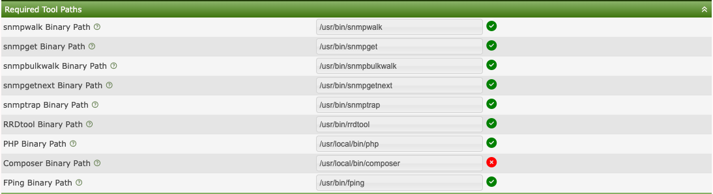
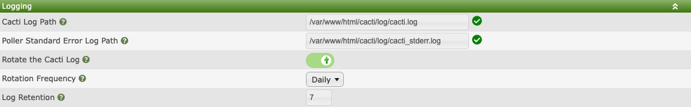
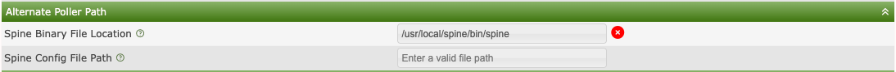
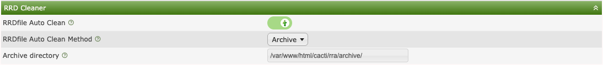

# Path Settings

Cacti's Path Settings include mainly the locations of core binaries that
Cacti must call in order to operate correctly.  Generally, these binaries
are included in the Web Server's path, but being able to override these
settings is important, especially for debugging issues.  Cacti's Paths
sub-tab is broken into the following sub-sections:

- **Required Tool Paths** - Paths that are essential for Cacti's operation
- **Logging** - The locations of Cacti's log files.  Log level and log
   rotation settings are on the **Logging** tab
- **Alternate Poller Path** - Locations for Cacti's spine binary and spine
   config file if not in the established default locations
- **RRD Cleaner** - Settings for Cacti's RRDfile disposal of removed RRDfiles
   when Data Sources are removed.

When using Cacti's **Remote Data Collectors** or **Remote Pollers** the
settings that refer to a `File Path`, or `Directory Path` will be local
to the **Data Collector**.  Therefore, you can have one set of paths for
your Main Cacti site, and another set of paths for your Remote Poller,
say in the case that they are on Windows.

## Required Tools Paths

The image below shows Cacti's **Required Tool Paths** settings.

Those settings include:

**snmpwalk Binary Path** - This is the path to the `snmpwalk` binary.

**snmpget Binary Path** - This is the path to the `snmpget` binary.

**snmpbulkwalk Binary Path** - This is the path to the `snmpbulkwalk` binary.
This binary
path is essential if you use SNMPv2 or SNMPv3 versions where **Data Queries**
perform
bulkwalks by default to increase performance.

**snmpgetnext Binary Path** - This is the path to the `snmpgetnext` binary.

**snmptrap Binary Path** - This is the path to the `snmptrap` binary.  This
binary
is important for SNMP Notification and Trap generation.

**RRDtool Binary Path** - The location of the RRDtool binary that matches your
RRDtool version.

**PHP Binary Path** - The full path to the PHP CLI binary used by the poller,
for example `/usr/bin/php`. Verify its version and extensions separately from
the PHP runtime used by the web server.

**Composer Binary Path** - The path to the `composer` binary.  Composer is
required when installing or upgrading a Cacti instance whose `include/vendor`
directory is not pre-packaged, for example a Git checkout.

**FPing Binary Path** - The path to the FPing binary file, which provides a
more precise ping command.

## Logging

The next set of settings define where Cacti's Standard Output, Standard
Error and Boost log files are to be placed.  You can see those settings from
the image below.

Those settings include:

**Cacti Log Path** - The location of Cacti's Standard Output (stdout) log file.

**Poller Standard Error Log Path** - For Cacti's **Data Collector** functions
only,
the location of the Standard Error (stderr) log file.

**Boost Debug Log** - The log file where Boost writes its information.  It
must be located in the same directory as the Cacti Log file.

Log rotation settings (`Rotate the Cacti Log`, `Rotation Frequency` and
`Log Retention`) are on the **Logging** tab.

> **NOTE**: Some package maintainers control log rotation and therefore the log
> rotation settings may be missing from certain versions of Cacti if you install
> through a packaging tool such as `apt-get`, `yum` or `dnf`.

## Alternate Poller Path

This subsection holds information on how to configure Cacti's `spine` binary
path.
Since `spine` is written in C, it is compiled by the Cacti Administrator to
match
the system's environment. The primary benefit of `spine` is that it is
multi-threaded and highly scalable, capable of polling tens of thousands of data
sources per minute. The image below shows this subsection.

Those settings include:

- **Spine Binary File Location** - The path to the spine binary.

- **Spine Config File Path** - This setting is optional.  If blank, Cacti will
   search the following locations for a `spine.conf` file.

   - **pwd** - The same directory as spine
   - **../etc/** - One sibling `etc` directory of the `spine` binary directory.
   - **/etc/** - The system's /etc/ directory.

## RRD Cleaner

This setting defines how Cacti manages RRDfiles from **Data Sources** that have
been removed.  By default, Cacti does not manage these files, and leaves it to
the Cacti Administrator to pro-actively manage them.  The RRD Cleaner settings
can be seen in the image below.  Note that unless you enable
`RRDfile Auto Clean`, you will not see the other settings by default.

Those settings include:

- **RRDfile Auto Clean** - Denotes that you wish Cacti to manage RRDfiles from
   removed **Data Sources** potentially automatically.

- **RRDfile Auto Clean Method** - This is the method to perform cleanup.
   Options include:

   - **Delete** - Simply remove the files once the **Data Source** is removed
   - **Archive** - Archive the RRDfile to an Archive directory once it's
     removed.

- **Archive directory** - The Archive directory to move old RRDfiles to.

---
Copyright (c) 2004-2026 The Cacti Group
