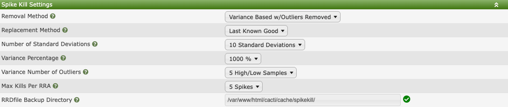
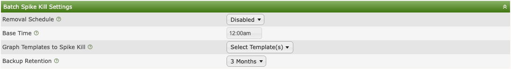

# Spike Kill

Certain types of RRDtool based **Data Sources** can from time to time generate
what are look like to the casual observer spikes. These spikes can make your
Cacti **Graphs** unreadable.

Spike happen when you either have set no maximum value on your Cacti **Data
Template** by using a 'U' as the Maximum Value, or when certain `COUNTER` based
RRDfiles have their counter data overflow, and start counting again from zero.
When this happens recent versions of RRDtool, like version 1.7, handle these
overflows quite well, but for some older RRDtool versions, these changes can
result in these spikes.

There are also cases where for some reason the Cacti system goes offline, and
therefore your Cacti Graphs will develop what are referred to as gaps.

## Spike Kill Settings

Cacti provides several spike removal options from the user interface. In the
image below, you can see the default Settings for Cacti's Spike Killer GUI.

Those settings include:

- **Removal Method** - The method used to find spikes.  The `Standard
  Deviation` method removes any sample that is a given number of standard
  deviations away from the average of the samples.  The Gap Fill, Float and
  Absolute Max methods are chosen from the Spikekill menu next to a **Graph**.
  See [Spikekill](Spikekill.md) for details.

- **Replacement Method** - When filling the Gap, what data point should be used.
  There is `Last Known Good`, which would be the last good known value,
  `Average`, which uses the Average value for the RRDfile data source, and
  `NaN's` which will cause the **Graph** to gap, but the spikes will be removed.

- **Number of Standard Deviations** - This is the number of
  `Standard Deviations` above the Average that are required before the value is
  considered a spike. It only applies to the `Standard Deviation` spike removal
  method.

- **Max Kills Per RRA** - The maximum number of spikes to remove from a
  **Graph** RRA.

- **Absolute Maximum Value** - The maximum raw value of any data point.  When
  using the `Absolute Max` method, data points above this value are removed.
  The default is 12.5 Billion (100 Gigabits).

- **DS Filter** - Specifies the data sources inside an RRDfile upon which
  Spikekill will operate, as a comma-separated list of index numbers or names.
  If blank, all data sources match.  For example, `5,traffic_*` matches data
  source index 5 and any data source whose name begins with `traffic_`.

- **RRDfile Backup Directory** - If you wish to backup RRDfiles that have been
  altered by Spike Kill, they will be placed in this directory.

## Batch Spike Kill Settings

Cacti also allows administrators to kill Cacti spikes on a periodic basis using
a batch process. From this batch process, you select the time of day, the
**Graph Templates** to perform Spike Kill operations on, and the backup
retention for RRDfiles that have spikes removed from them. The image below shows
those settings.

Of note is that first of all, the only **Graph Templates** that are shown are
**Graph Templates** that include `COUNTER` type **Data Sources**. It is also
worth noting that only **Data Query** type **Graph Templates** are supported as
of the current Cacti version.

---

Copyright (c) 2004-2026 The Cacti Group
