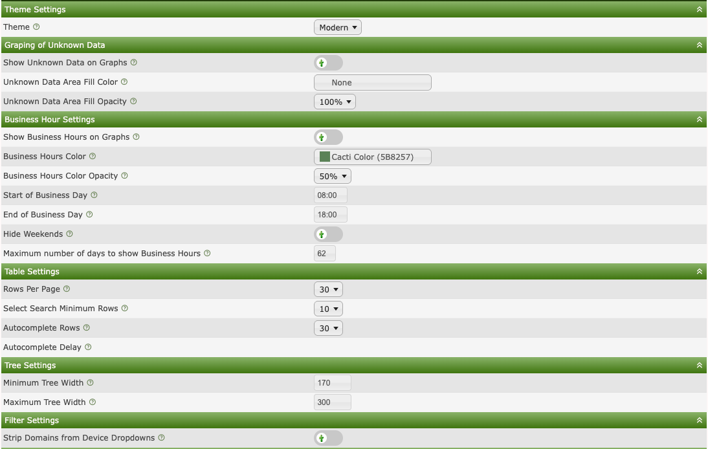
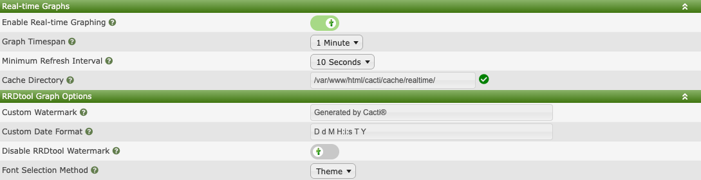
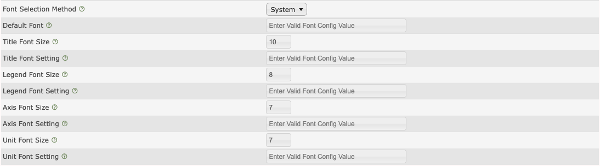

# Visual Settings

## Overview

Cacti's Visual settings page is where you can go to globally control the
behavior of Cacti's GUI. Settings like the default Theme, the maximum allowed
size of a Graph Title, auto-complete settings, as well as a myriad of other
settings can be found here.

The Visual page is broken down into several sub-sections. We will cover them and
the meaning of the various settings here.

> **NOTE**: This is a popular page for Plugin developers to augment. Therefore,
> if you have installed Plugins, your Settings page may look different than the
> default page.

## Theme, Table, Tree, and Filter Settings

The image below shows the default layout for these sub-sections.

Those settings include:

- **Theme** - The default theme that users logging into Cacti receive

- **Rows Per Page** - For all standard Cacti tables, the number of rows to show
  per page.

- **Autocomplete Enabled** - Many drop-downs do not scale well with thousands
  of items. In those cases, Cacti has enabled a drop-down auto-complete feature
  most large installs should leverage it. However, if you are a small install
  you can choose to disable auto-complete.

- **Autocomplete Rows** - The maximum rows to show in an auto-complete
  response.

- **Select Search Minimum Rows** - The minimum number of options a drop-down
  must have before Cacti shows a search box inside it.  Choose `Always` to show
  the search box regardless of the number of options.

- **Minimum Tree Width** - The minimum width of the Tree panel in Cacti

- **Maximum Tree Width** - The maximum width of the Tree panel in Cacti. Above
  this width, tree items will scroll into the panel.

- **Site Graph Template Expansion** - When viewing Site Trees, whether the
  **Graph Templates** branch is included as a Site sub-branch.

- **Strip Domains from Device Dropdowns** - Strip domain names from Device
  drop-downs to save horizontal filter space.

## Graph, Data Source, Data Query, Log Settings

The image below shows the default layout for these sub-sections.

Those settings include:

- **Maximum Title Length** - The maximum length of a Graph or Data Source title.
  Titles above this length will be clipped.

- **Data Source Field Length** - When applying |query\_\*| replacement values,
  the maximum supported length of those variables. Variables longer than this
  will be clipped.

- **Default Graph Type** - When on the **New Graphs** page, which **Graph Type**
  filter should be the default. With **Device Templates** with many **Data
  Queries** or **Graph Templates**, this page can become very long. Allowing you
  to select your preferred **Graph Type** makes navigating the page easier.

- **Default Log Tail Lines** - When viewing the Cacti Log, how many lines should
  appear per page.

- **Maximum number of rows per page** - The user defined number of lines for
  the Cacti Log to tail when selecting `All lines`.

- **Log Tail Refresh** - The frequency that the log pages should auto-refresh.

- **Exclusion Regex** - This setting allows you to exclude certain log messages
  by regular expression from normal users. Expressions that include login log
  entries are common here to mask the login accounts of users.

## Realtime and RRDtool Graph Options

The image below shows the default layout for these sub-sections.

Those settings include:

- **Enable Real-time Graphing** - Allow Realtime graphs to be used in Cacti.

- **Graph Timespan** - The default system level `Graph Timespan` use use when a
  user opens a Realtime **Graph** for the first time.

- **Minimum Refresh Interval** - The minimal supported time between **Graph**
  updates in the Realtime interface.  This value is also used to set certain
  RRDfile attributes.

- **Cache Directory** - Where should Cacti cache Realtime PNG's and RRDfiles.

- **Custom Watermark** - A watermark that will appear on every Cacti **Graph**

- **Custom Date Format** - The format to use for `|date_time|` on a **Graph**.

- **Disable RRDtool Watermark** - Every RRDtool Graph includes a vertical
  watermark. This option allows you to disable that.

- **Font Selection Method** - This allows the system administrator to control,
  at a global level, how various text elements on RRDtool **Graphs** appear. The
  settings include: Theme, or System. When choosing `System`, your settings page
  will expand where you will then have additional control.

- **Default Font** - When not using Theme based font control, the Pango
  font-config font name to use for all **Graphs**. Optionally, you may leave it
  blank and control font settings on a per object basis.

> **NOTE**: The RRDtool Watermark control requires a recent version of RRDtool,
> such as the 1.7 release. If you attempt to use this setting and your
> **Graphs** break, then upgrade RRDtool.

## Business Hours Settings

These settings control the display of business hours on **Graphs**.

Those settings include:

- **Start of Business Day** - The time your business hours start. Format:
  hh:mm. The default is `08:00`.

- **End of Business Day** - The time your business hours end. Format: hh:mm.
  The default is `18:00`.

- **Hide Weekends** - Only show business hours during weekdays. This is
  disabled by default.

- **Show business hours** - Display business hours on rrd graphs. This is
  disabled by default.

- **Color to use for business hours** - The color to be shown for business
  hours. The default is `ccccccff`.

- **Maximum number of days to show business hours** - After this number of
  days, the business hours will not be added to the graph. Recommended: 62
  days. The default is `62`.

## Font Selection Options

The image below shows the available Font Selection options when you override the
Theme settings.

The sizes are in pixels, and the Font Settings can either be a True Type Font
file path, or a valid Pango font-config value. For more information on Pango
font-config values, see your operating systems documentation. However, you can
normally see all the fonts installed on your Linux system by issuing the
following command `fc-list`.

---

Copyright (c) 2004-2026 The Cacti Group
