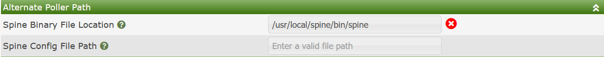

# Spine

Use only the [supported operating systems][supported-os] and maintained
dependencies compatible with this Cacti branch.

Spine is Cacti's C-based, multithreaded data collector. It replaces `cmd.php`
as the collection engine; `poller.php` remains the scheduling entry point.
Actual throughput depends on device latency, scripts, concurrency, database
capacity, and the collection interval. Measure your installation before tuning.

## Spine Architecture and Operating Principles

Spine reads polling definitions from the Cacti database, collects measurements
using SNMP and scripts, and writes results to poller output tables. Cacti's
poller or Boost processing updates the RRD files. Spine does not directly
write historical RRD files or render graphs.

Spine can run several processes and multiple threads per process. It also
maintains PHP script-server processes for methods configured to use
`script_server.php`, avoiding a separate PHP startup for each such call.

## Installing Spine

Use the Spine release corresponding to your Cacti release. For development
checkouts, use compatible branches; do not mix a development poller with a
maintenance installation without verifying compatibility.

Install a C compiler, make, Autoconf, Automake, Libtool, and the development
headers and libraries required by that Spine version, including Net-SNMP and
MySQL or MariaDB client libraries. Git checkouts also need the bootstrap tools.
Use the package names and build repository appropriate to your distribution.

Download source from [Cacti Spine
releases](https://github.com/Cacti/spine/releases)
or use your distribution's compatible package. From the extracted source:

```console
./bootstrap
./configure --prefix=/usr/local/spine
make
sudo make install
```

Inspect `./configure --help` for library locations and optional build features.
Package installations can use different paths and permission policies.

### ICMP permissions

Run the poller as its dedicated service account. ICMP availability checks need
socket permissions appropriate to the operating system and Spine version.
Possible mechanisms include permitted ping sockets, a narrowly scoped raw
socket capability, or the release's documented setuid installation.

The development branch can use unprivileged ICMP where the operating system
permits it. When started setuid root, it opens the required sockets and drops
root permanently before reading configuration. Older release behavior differs.
Do not assume Spine ships setuid or repeatedly regains root while polling.

Follow the installed release's instructions and local security policy. Keep
the executable owned by an administrative account and unwritable by the poller
account. Test the chosen availability method as the actual poller user.
SNMP collection does not itself require running the entire poller as root.

## Configuring `spine.conf`

Create the configuration file from the installed template if one is not already
provided by the package:

```console
sudo cp /usr/local/spine/etc/spine.conf.dist /usr/local/spine/etc/spine.conf
```

Set the database host, database name, user, password, and port to match the
collector's database. Use that release's `spine.conf.dist` as the reference.
For example:

```ini
DB_Host       localhost
DB_Database   cacti
DB_User       cactiuser
DB_Pass       REPLACE_WITH_DATABASE_PASSWORD
DB_Port       3306
```

Use the `DB_UseSSL` and `DB_SSL_*` options when configuring the local database
connection for TLS. Remote collectors also have `RDB_*` settings for the main
database. Do not confuse local `DB_*` with remote `RDB_*` settings.

Restrict the configuration file to the accounts that need to read it, because
it contains database credentials. One Linux example, with a poller in the
`www-data` group, is:

```console
sudo chown root:www-data /usr/local/spine/etc/spine.conf
sudo chmod 0640 /usr/local/spine/etc/spine.conf
```

Substitute the actual poller group. Do not change application code ownership to
make a credential file readable.

## Testing Spine from the Command Line

Use the poller account to run a database read-only test. The `-R` option
suppresses database writes, but still polls devices and executes configured
scripts. It is not a guarantee that those scripts have no side effects.

```console
/usr/local/spine/bin/spine -R -V 3 -S
```

To restrict the test to one device, substitute its actual ID for `DEVICE_ID`:

```console
/usr/local/spine/bin/spine -R -f DEVICE_ID -l DEVICE_ID -V 5
```

Confirm the configuration path, database connection, device availability, and
returned values. Verbose output can expose sensitive operational information;
redact it before sharing. Use the installed binary's `--help` for its options.

## Activating Spine in Cacti

1. Open **Console > Configuration > Settings > Paths** and set
   **Spine Binary File Location** to the installed executable.
2. Set **Spine Config File Path** when using a non-default configuration path.
3. Open **Settings > Poller**, choose **spine** as the **Poller Type**, and
   save.
4. Leave the existing `poller.php` scheduler in place. Check the next scheduled
   cycle for errors and confirm that graph timestamps advance.



## Tuning Spine for Optimal Performance

Change one setting at a time and compare elapsed polling time, missed samples,
CPU use, database connections, and errors. More concurrency can overload a
collector, database, or device.

- **Settings > Poller** contains global script-server counts and script
  timeout settings. Allow expected script execution time within the overall
  polling budget.
- **Data Collection > Data Collectors** sets processes and threads for each
  collector. Size them for that collector's workload and database capacity.
- **Management > Devices** provides device threads and maximum OIDs per
  request. Larger SNMP requests can reduce round trips, but can also exceed
  agent limits or fragment across the network.

There is no universal process-per-core ratio, maximum useful thread count, or
OIDs-per-request value. Start with the release defaults and measured results.

## Database Connection Sizing

Budget database connections across all collectors, poller processes, threads,
script servers, web requests, and maintenance jobs. Remote collection can
require connections to both local and main databases. Use Cacti's technical
support information and observed peak connections to size `max_connections`.

A connection failure can indicate credentials, DNS, routing, TLS, account-host
restrictions, or exhausted capacity. Check the database error before increasing
limits, and account for the memory cost of additional connections.

## Security Policies

SELinux or AppArmor can restrict execution, network connections, or
configuration
file access. Inspect policy denials and apply rules appropriate to the poller
account and executable. Do not disable enforcement to diagnose a path or
credential error. See [Hardening](Hardening-Cacti-Installation.md).

## Troubleshooting Spine

- **Configuration unreadable**: verify the configured path and read access as
  the poller user.
- **ICMP failure**: check the selected ping method, socket permissions,
  operating-system policy, and firewall. Do not assume SNMP must also fail.
- **Database failure**: verify the correct local or remote connection settings
  and inspect the database's error and connection count.
- **Missing samples**: inspect script output, timeouts, SNMP responses, and the
  configured collection interval.

A `SYSTEM STATS` log line containing `Method:spine` confirms the selected
engine, not successful collection of every item. Check errors and actual RRD
updates as well. See [Data Source Debugging](Data-Debug.md) and
[The Cacti Log](Cacti-Log.md).

[supported-os]: Requirements.md#supported-operating-systems

---

Copyright (c) 2004-2026 The Cacti Group
