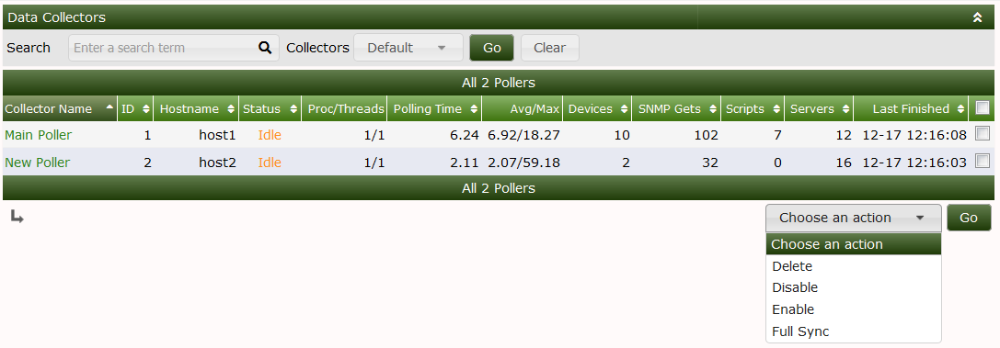

# Documentation Standards

Write instructions that match the Cacti branch being documented. State when a
feature is available only on the development branch or in a particular release.
Verify commands, configuration names, links, and screenshots against that
version. Keep changes focused on the affected topic.

## Source and corrections

This manual is maintained in the
[Cacti documentation repository](https://github.com/Cacti/documentation).
Submit corrections there, linking an existing issue when applicable. Use
`develop` unless maintainers request a maintenance branch. A repository change
reaches the public website through the project's build and deployment process.

## Markdown format

The repository's `.mdlrc` loads `.mdl_style.rb`. These files define the local
Markdown checks. Preserve the existing page's style where it does not conflict
with those checks.

### Titles

Use ATX headings with a space after the hash characters. Use one level-one
heading for the page title, then organize sections with levels two through five.
Use level six for numbered example, figure, or table captions when needed.
Avoid punctuation at the end of headings and keep heading text descriptive.

```markdown
# Page title

## Main section

### Subsection

Paragraph text.
```

Separate headings from surrounding content with a blank line. Preserve existing
heading anchors when possible; when renaming a heading, update links to it.
Empty HTML anchors may preserve public fragment links when headings move or
change. Use Markdown for visible links and ordinary page content.

### Text and lists

Wrap prose at 79 characters. Leave one blank line between paragraphs and around
lists and code blocks. Do not leave trailing whitespace or repeated blank
lines. Do not use raw HTML for ordinary page content.

Use `-` for unordered lists, a number followed by a full stop for ordered lists,
and consistent indentation for nested items and continuation text.

```markdown
- First item.
- Second item with a continuation that remains part of the same list item.

1. First step.
2. Second step.
```

Use backticks for file paths, commands, configuration keys, and literal values.
Use bold text for interface labels where it improves readability.

### Code blocks

Use fenced code blocks with a language label such as `console`, `bash`, `php`,
`sql`, or `ini`. Keep example commands reproducible and identify placeholders.
Use continuation lines for long commands where the shell supports them. Code
and table widths are exempt from the prose line-length rule in the current
style configuration.

Do not include real credentials, tokens, private keys, or unredacted logs.
Explain required privileges and commands that alter or delete stored data.

### Links and images

Use Markdown links with meaningful labels. Use relative `.md` paths for manual
pages so the links work in the repository and published manual.

```markdown
[Data Collectors](Data-Collectors.md)
[Collection settings](Settings-Poller.md#general-settings)

```

Check that target files and heading anchors exist. Add new guides to
`Manual-Index.md` and link entry pages from `README.md`. Check image filenames
and use alternate text that describes the image. Explain when a screenshot
shows an older interface or a specific theme.

### Tables

Use Markdown tables with a header and separator row. Keep column names and
units explicit. Add a caption when the table needs to be referenced elsewhere.

## Copyright

End pages with a separator and the Cacti Group copyright notice, following the
target branch's current year:

```markdown
---

Copyright (c) 2004-2026 The Cacti Group
```

## Validate changes

Install Ruby and the `mdl` gem, then run checks from the documentation root:

```console
gem install mdl
bin/check_markdown_style.sh Changed-Page.md
bin/check_missing_link.sh
```

Omit the filename to run the Markdown check across the repository. Existing
files may have unrelated lint failures; distinguish those from failures added
by the change. `check_missing_link.sh` validates homepage, index, and project
links, local image paths, heading fragments, legacy homepage fragments in
`UriMap.json`,
and whether every manual page is indexed. The PDF builder uses that same index
order. It does not crawl external sites or validate every link inside every
chapter. Run its regression checks with:

```console
python3 -m unittest discover -s bin/tests -p 'test_*.py'
```

The repository's GitHub Actions spelling workflow installs the pinned
requirements from `.github/codespell-requirements.txt`. To run the same spelling
check in a Python virtual environment:

```console
python3 -m venv /tmp/cacti-docs-spelling
/tmp/cacti-docs-spelling/bin/python -m pip install \
  --only-binary :all: --require-hashes \
  -r .github/codespell-requirements.txt
/tmp/cacti-docs-spelling/bin/codespell --config .codespell.cfg
```

Review `git diff --check` and the rendered Markdown before submitting. Verify
that commands and menus describe the intended version; passing Markdown and
spelling checks does not establish technical accuracy.

---

Copyright (c) 2004-2026 The Cacti Group
