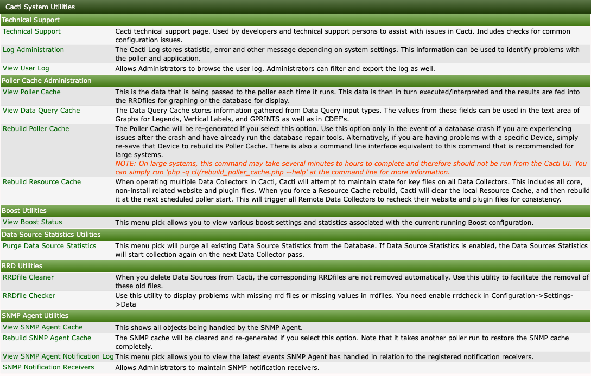
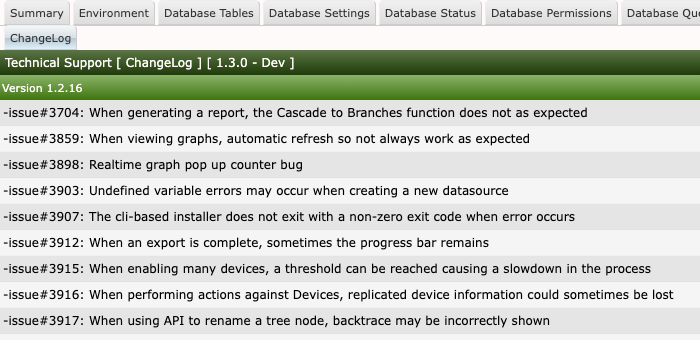
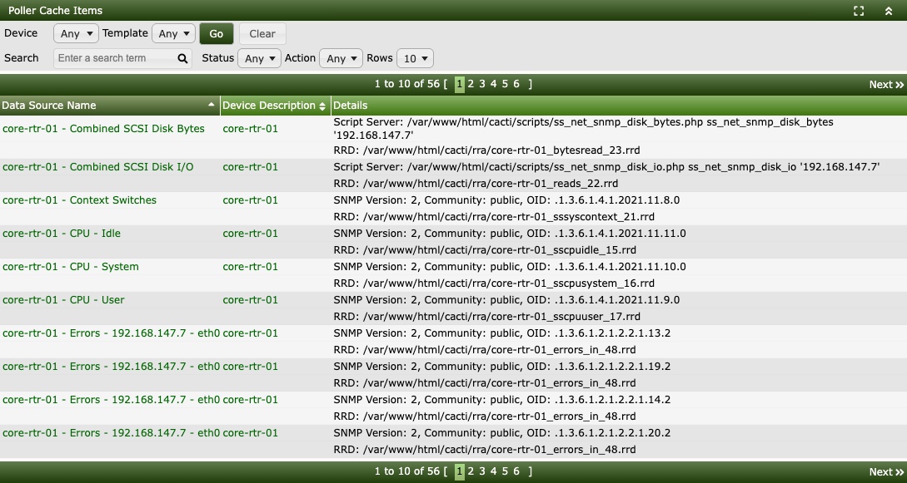
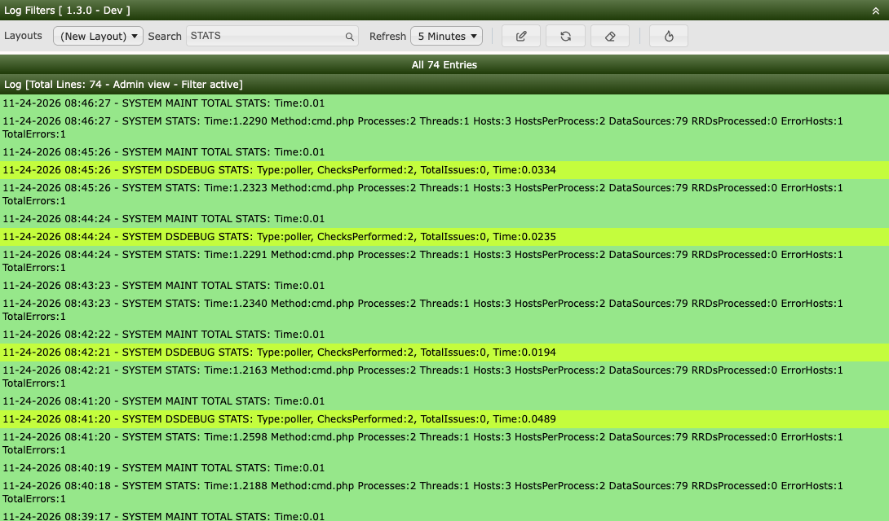

# System Utilities

This section will describe **System Utilities** in Cacti.

The system utilities page in Cacti contains tools used for administering
Cacti. From this page you can do the following:

- Rebuild poller cache.

- Rebuild the resource cache.

- Purge Data Source Statistics.

- Rebuild the SNMP Agent cache and view the SNMP Agent notification log, when
  SNMP Agent support is enabled.

- View technical support information.

- Adjust log settings.

- View the user log for audits.

.

Some of the most important tools are listed below

## Rebuild poller cache

The Poller Cache will be re-generated if you select this option. Use this
option only in the event of a database crash if you are experiencing issues
after the crash and have already run the database repair tools. Alternatively,
if you are having problems with a specific Device, simply re-save that Device
to rebuild its Poller Cache. There is also a command line interface equivalent
to this command that is recommended for large systems. NOTE: On large systems,
this command may take several minutes to hours to complete and therefore
should not be run from the Cacti UI. You can simply run
'php -q cli/rebuild_poller_cache.php --help' at the command line for more
information.

## Rebuild resource cache

`Console > Utilities > System Utilities > Rebuild Resource Cache`

When operating multiple Data Collectors, Cacti attempts to maintain state for
key files on all Data Collectors.  This includes all core, non-install related
website and plugin files.  When you force a Resource Cache rebuild, Cacti clears
the local Resource Cache and rebuilds it at the next scheduled poller start.
This triggers all Remote Data Collectors to recheck their website and plugin
files for consistency.

## Purge Data Source Statistics

`Console > Utilities > System Utilities > Purge Data Source Statistics`

This option purges all existing Data Source Statistics from the database.  If
Data Source Statistics is enabled, collection starts again on the next Data
Collector pass.

## SNMP Agent utilities

These utilities are shown only when SNMP Agent support is enabled.

- **View SNMP Agent Cache** - Shows all objects being handled by the SNMP Agent.
- **Rebuild SNMP Agent Cache** - Clears and re-generates the SNMP cache.  It
  takes another poller run to restore the SNMP cache completely.
- **View SNMP Agent Notification Log** - Shows the latest events the SNMP Agent
  has handled in relation to the registered notification receivers.

See [SNMP Agent and Notification Receivers](SNMP-Agent.md) for how the cache
and the receivers are used.

### Technical support

Cacti technical support page.  Used by developers and technical support
persons to assist with issues in Cacti.  Includes checks for common
configuration issues.  There are also built-in checks that help you tune
your Cacti installation.

For example, in the technical support section under the summary, you will see a
calculation for how many MySQL connections you should have. (Cacti 1.2.16+)
You will also see poller information such as the last polling time, process
count and more detailed info that can be used for a quick view of how the
system is configured.

.

You will also see all of the system variables such as allocated PHP memory
as well as MySQL variables.

Any Variable appearing in red indicates a subpar setting and should be looked
at. The recommendations are dynamic in that they change when more system
resources are detected, so if you upgrade your server hardware be sure to check
back to this page to get the most out of your new hardware.

### RRD cleaner

`Console > utilities > System Utilities > RRDfile Cleaner`

When you delete Data Sources from Cacti, the corresponding RRDfiles are not
removed automatically. Use this utility to facilitate the removal of
these old files.

In system utilities you can manually start the RRD cleaning procedure.
You can either archive the selected RRDs
or have them deleted in the next polling cycle.

RRDfiles can also be scheduled to be removed automatically. This option can
be configured in `Console > Configuration > Settings > Paths` by selecting
the RRDfile autoclean selection.

In the development source, the cleaner is its own menu entry,
`Console > Utilities > RRDfile Cleaner`, and requires the
**Settings/Utilities** permission.  The entry is not shown on a
**Remote Data Collector**.  To use it:

1. Press **Rescan**.  Cacti lists the RRDfiles found under the `rra`
   directory, or reported by the RRDtool Proxy Server when that storage
   location is selected, that no **Data Source** in Cacti uses.  Files in the
   **Archive directory** are skipped when that directory is inside the `rra`
   directory.  The legend shows the total size and the time of the
   **Last Scan**.
2. Narrow the list with **Search** and **Time Since Update**, which filters on
   how long ago each file was last modified.
3. Select files and choose **Delete** or **Archive** from the action
   drop-down, or press **Delete All** or **Archive All** to schedule every
   listed file.

The page only schedules the work.  The files are deleted, or moved to the
**Archive directory** set on the Paths tab, by Cacti's maintenance process
during a later polling cycle.  A deleted file cannot be recovered by Cacti.

### RRDfile Checker

`Console > utilities > System Utilities > RRDfile Checker`

The RRDfile checker is a tool that scans all RRDfiles at a
scheduled time and tests the stored data:

- Stale values for 1 or 24 hours
- Whether the file is updated regularly
- Incorrect file read/write access
- Whether the Database Data Source objects match the RRDfiles Data Sources

For very large Cacti installs the **RRDfile checker** can take quite
a long time to complete.
You can set the number of concurrent parallel processes in `Console > Configuration > Settings > Data`

In the development source, the checker is found at
`Console > Troubleshooting > RRDfile Checker`, the settings tab is labeled
**Data/Statistics**, and the page requires the **Settings/Utilities**
permission.  The entry is not shown on a **Remote Data Collector**.  The check
is disabled by default; until **Enable RRDfile Check** is checked in
[Data Settings](Settings-Data.md#rrdfile-checker), the page only reports that
the check is disabled.

When enabled, the main **Data Collector** starts `poller_rrdcheck.php` in the
background at the end of each polling cycle, and the check runs when the
**Check Frequency** has elapsed.  When **Boost** on-demand RRD updates are
enabled, the check runs when the Boost poller finishes instead.  The run is
limited by the **RRDChecker Timeout** on the
[Scheduler](Settings-Poller.md#scheduler-settings) tab.

Each finding is listed with the **Host Description**, **Data Source**,
**Local Data ID**, **Message** and **Date**.  The messages cover:

- An RRDfile that does not exist or is not writable
- An RRDfile whose modify time or last update is older than one hour
- An RRDfile step or minimal heartbeat that does not match the
  **Data Source Profile**
- Data Sources that the database and the RRDfile do not have in common
- No data returned, stale values, or more than 50% NaN values in the last hour
  or the last 24 hours

Use **Search** and **Age** to filter the list.  **Purge** removes all findings
from the database.  Findings older than 7 days are removed when a check
completes.

### Viewing Change log from system utilities

With Cacti 1.2.16+, you are now able to view the CHANGELOG information up to the
version your server is currently running.  This is available via the system
utilities menu which is useful for seeing what fixes and occasional features are
included in your version.

### View user login history

`Console > utilities > System Utilities > View user Log`

In system utilities you are able to view a log of user logins
both successes and failures. The Log will also show what Client IP address
the login originated from along with info
if the login was based on password or token-based login.

In the development source, the log is its own menu entry,
`Console > Utilities > User Log`, titled **User Login History**, and requires
the **Settings/Utilities** permission.  Each row shows the **User**,
**Full Name**, **Authentication Realm**, **Date**, **Result** and
**IP Address** of one login attempt.  The **Result** is one of:

- **Success - Password** - A login with a password.
- **Success - Token** - A login with an authentication cookie, or a verified
  two-factor authentication token.
- **Success - Password Change**
- **Failed**

Filter the list with **Search**, **User** and **Result**.  The **User** filter
also offers **Deleted/Invalid**, for attempts whose account no longer exists.

**Purge** asks for confirmation and then removes the failed attempts, all but
the most recent successful password login and token login of each existing
user, and every entry for a user that no longer exists.  If logging is set to
both Cacti and Syslog, the log information remains in Syslog.

### View boost update status and stats

`Console > Utilities > System Utilities > View Boost Status`

In this view you can see statistics on how Boost is running. You will be able to see
information such as when the last time Boost started, how long it ran for,
and the average Boost record size.

### Viewing the Data Source Query Cache

`Console > Utilities > System Utilities > View Data Source Query Cache`

The Data Query Cache stores information gathered from Data Query input types.
The values from these fields can be used in the text area of Graphs for Legends,
Vertical Labels, and GPRINTs as well as in CDEFs.

### Viewing the Poller Cache

`Console > Utilities > System Utilities > View Poller Cache`

This is the data that is being passed to the poller each time it runs.

### Viewing System log via System Utilities

You are able to view the system log via the System utilities
page. This will show the RAW log.
This slightly differs from the view log tab as the device names
will show the device ID rather than
the Device name. This is the same view as when you read the log in the OS.

---
Copyright (c) 2004-2026 The Cacti Group
