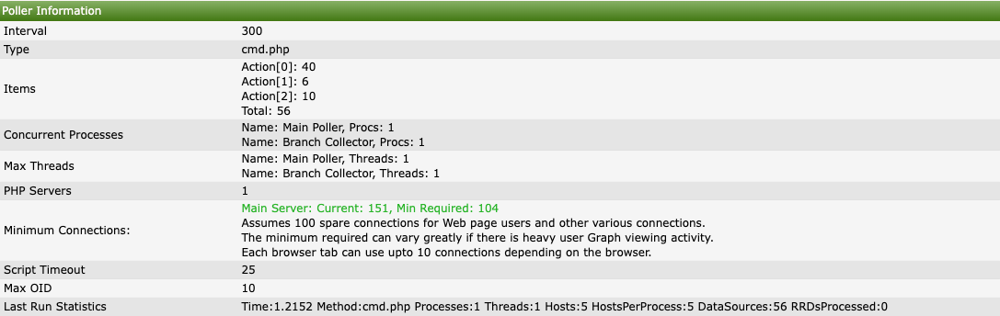
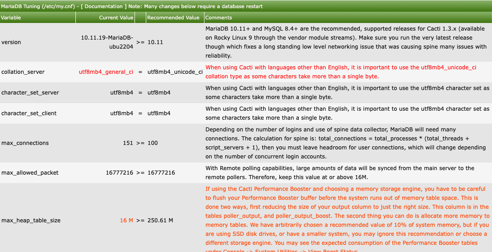
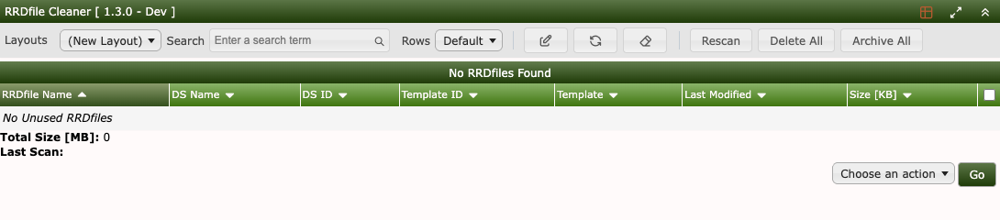
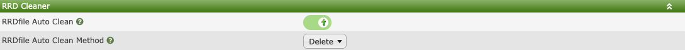
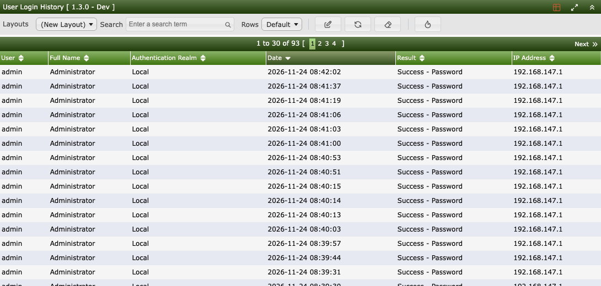
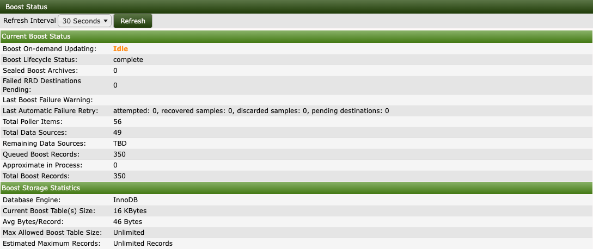
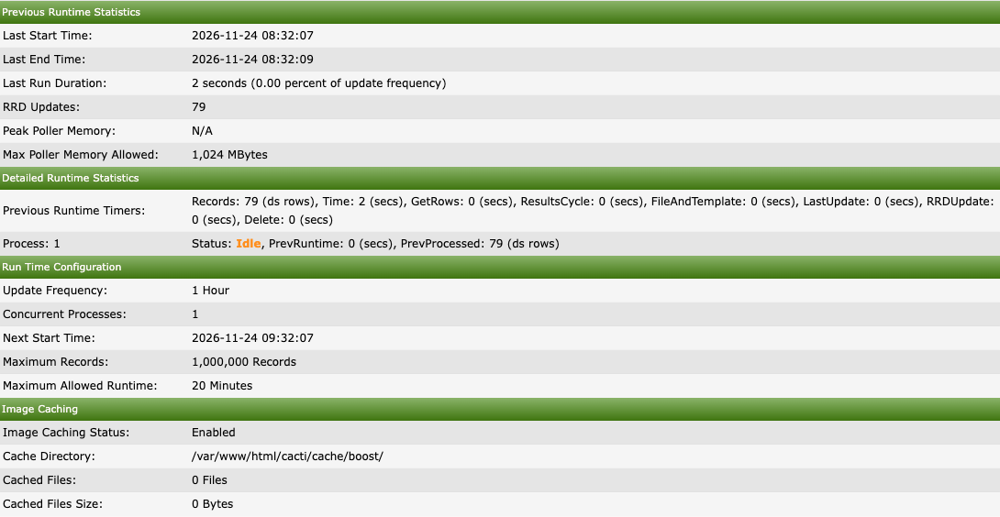
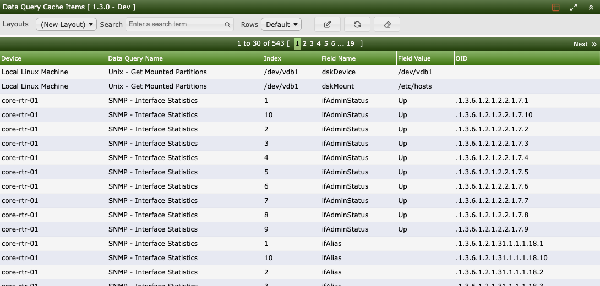

# System Utilities

This section will describe **System Utilities** in Cacti.

The system utilities page in Cacti contains tools used for administering
Cacti.  From this page, you can do the following:

- Rebuild poller cache.

- View technical support information.

- Administer the Cacti log (Log Administration).

- View the user log for audits.

.

Some of the most important tools are listed below

## Rebuild poller cache

The Poller Cache will be re-generated if you select this option. Use this
option only in the event of a database crash if you are experiencing issues
after the crash and have already run the database repair tools. Alternatively,
if you are having problems with a specific Device, simply re-save that Device
to rebuild its Poller Cache. There is also a command line interface equivalent
to this command that is recommended for large systems. NOTE: On large systems,
this command may take several minutes to hours to complete and therefore
should not be run from the Cacti UI. You can simply run
'php -q cli/rebuild_poller_cache.php --help' at the command line for more
information.

### Technical support

Cacti technical support page.  Used by developers and technical support
persons to assist with issues in Cacti.  Includes checks for common
configuration issues.  There are also built-in checks that help you tune
your Cacti installation.

For example, in the technical support section under the summary, you will see a
calculation for how many MySQL connections you should have (Cacti 1.2.16+).
You will also see poller information such as the last polling time, process
count, and more detailed info that can be used for a quick view of how the
system is configured.

.

You will also see all of the system variables such as allocated PHP memory
as well as MySQL variables.



Any Variable appearing in red indicates a subpar setting and should be looked
at.  The recommendations are dynamic in that they change when more system
resources are detected, so if you upgrade your server hardware be sure to check
back to this page to get the most out of your new hardware.

### Rebuild resource cache

`Console > Utilities > System Utilities > Rebuild Resource Cache`

When operating multiple Data Collectors in Cacti, Cacti will attempt to
maintain state for key files on all Data Collectors. This includes all core,
non-install related website and plugin files. When you force a Resource Cache
rebuild, Cacti will clear the local Resource Cache, and then rebuild it at the
next scheduled poller start. This will trigger all Remote Data Collectors to
recheck their website and plugin files for consistency.

### Purge Data Source Statistics

`Console > Utilities > System Utilities > Purge Data Source Statistics`

This menu pick will purge all existing Data Source Statistics from the
Database. If Data Source Statistics is enabled, the Data Sources Statistics
will start collection again on the next Data Collector pass.

### SNMP Agent utilities

These entries appear under `Console > Utilities > System Utilities` when SNMP
Agent Support is enabled in the Poller settings.

- **View SNMP Agent Cache** - This shows all objects being handled by the SNMP
  Agent.
- **Rebuild SNMP Agent Cache** - The SNMP cache will be cleared and
  re-generated if you select this option. Note that it takes another poller run
  to restore the SNMP cache completely.
- **View SNMP Agent Notification Log** - This menu pick allows you to view the
  latest events SNMP Agent has handled in relation to the registered
  notification receivers.
- **SNMP Notification Receivers** - Allows Administrators to maintain SNMP
  notification receivers.

See [SNMP Agent and Notification Receivers](SNMP-Agent.md) for what the SNMP
Agent exposes and how the receivers are configured.

### RRD cleaner

`Console > Utilities > System Utilities > RRDfile Cleaner`

When you delete Data Sources from Cacti, the corresponding RRDfiles are not
removed automatically. Use this utility to facilitate the removal of
these old files.

In system utilities you can manually start the RRD cleaning procedure.
You can either archive the selected RRDs
or have them deleted in the next polling cycle.



The entry is only shown on the main **Data Collector**. The page works as
follows:

- The list of files is not refreshed on its own. Select `Rescan` to have
  Cacti search the RRA directory and its sub-directories for `.rrd` files and
  compare them with the existing **Data Sources**. Files that do not belong
  to a **Data Source** are listed. `Last Scan` below the list shows when the
  list was built. An archive directory inside the RRA directory is skipped.

- The list shows the **RRD File Name**, **DS Name**, **DS ID**, **Template
  ID**, **Template**, **Last Modified** and **Size [KB]** of each file, and
  the total size of the listed files.

- The **Time Since Update** filter defaults to `< 1 Week`, which shows only
  files that were modified during the last week. Select `> 1 Week` up to
  `> 1 Year` to see files that have not been updated for at least that long.

- To act on single files, select them and choose `Delete` or `Archive` from
  the actions drop-down. The buttons `Delete All` and `Archive All` apply the
  action to all unknown RRDfiles.

The files are not removed by the web page. The selected action is queued and
carried out by Cacti's maintenance process, which the main **Data Collector**
starts at the end of a poller run. `Delete` removes the file. `Archive` moves
it to the **Archive directory** that is set in
`Console > Configuration > Settings > Paths`, keeping its sub-directory.

RRDfiles can also be scheduled to be removed automatically.  This option can
be configured in `Console > Configuration > Settings > Paths` by selecting
the RRDfile autoclean selection.



### RRDfile Checker

`Console > Utilities > System Utilities > RRDfile Checker`

The RRDfile checker is a tool that scans all RRDfiles at a
scheduled time and tests the stored data:

- Stale values for 1 or 24 hours
- Whether the file is updated regularly
- Incorrect file read/write access
- Whether the Database Data Source objects match the RRDfiles Data Sources

For very large Cacti installs the **RRDfile checker** can take quite
a long time to complete.
You can set the number of concurrent parallel processes in `Console > Configuration > Settings > Data`

The entry is only shown on the main **Data Collector**. The checks only run
when **Enable RRDfile Check** is checked in the
[Data](Settings-Data.md#rrdfile-check) settings, which is not the default.
While it is disabled, the page shows the message `RRD check is disabled,
please enable in Configuration -> Settings -> Data`.

The main **Data Collector** starts `poller_rrdcheck.php` in the background at
the end of a poller run. The checks themselves run when the **Check
Frequency** has elapsed. It defaults to `4 Hours`. If **Enable On-demand RRD
Updating** is checked in the [Performance](Settings-Performance.md) settings,
the checks run at the end of a Boost run that updated RRDfiles instead. The
runtime is limited by the **RRDChecker Timeout** in the
[Poller](Settings-Poller.md) settings.

The page lists the problems that were found with the **Host Description**,
**Data Source**, **Local Data ID**, **Message** and **Date**. The **Age**
filter defaults to `< 2 hours`, which shows the problems found during the
last two hours. Select `> 4 hours` up to `> 5 days` to see older ones. The
`Purge` button removes all recorded problems. After each run of the checks,
problems that are older than seven days are removed.

A check can also be started from the command line:

```console
shell>php -q poller_rrdcheck.php [--force] [--debug]
```

- `--force` - Force the execution of an update process, even when the check
  is disabled or the **Check Frequency** has not elapsed. The checks are
  still left to Boost when Boost is enabled.

- `--debug` - Display verbose output during execution.

### Viewing Change log from system utilities

With Cacti 1.2.16+, you are now able to view the CHANGELOG information up to the
version your server is currently running.  This is available via the system
utilities menu which is useful for seeing what fixes and occasional features are
included in your version.


### View user login history

`Console > Utilities > System Utilities > View User Log`

In system utilities you are able to view a log of user logins,
both successful and failed.  The Log will also show what Client IP address
the login originated from along with info
if the login was based on password or token based login.



The page is titled **User Login History** and requires the
**Settings/Utilities** permission. Each row shows the **User**, **Full
Name**, **Authentication Realm**, **Date**, **Result** and **IP Address** of
one login attempt. The **Result** is one of `Success - Password`, `Success -
Token`, `Success - Password Change` or `Failed`. A password change that a
**User** makes on the `Change Password` page, see
[User Profile](User-Profile.md#changing-your-password), is recorded as
`Success - Password Change`.

The filter offers the following options:

- **User** - `All`, a single user, or `Deleted/Invalid` for entries whose
  user name does not match an existing account.

- **Result** - `Any` or one of the results listed above.

- **Search** - Matches the user name, the date, the full name and the IP
  address.

The `Purge` button does not empty the log completely. For every existing
account it keeps the most recent `Success - Password` entry and the most
recent `Success - Token` entry, and removes the older ones together with all
`Failed` entries. Entries of accounts that no longer exist are removed
entirely.

### View boost update status and stats

`Console > Utilities > System Utilities > View Boost Status`

In this view you can see statistics on how Boost is running.  You will be able
to see information such as when the last time Boost started, how long it ran
for, and the average Boost record size.





### Viewing the Data Query Cache

`Console > Utilities > System Utilities > View Data Query Cache`

The Data Query Cache stores information gathered from Data Query input types.
The values from these fields can be used in the text area of Graphs for Legends,
Vertical Labels, and GPRINTs as well as in CDEFs.



### Viewing the Poller Cache

`Console > Utilities > System Utilities > View Poller Cache`

This is the data that is being passed to the poller each time it runs.


### Viewing the Cacti log via Log Administration

You are able to view the Cacti log via the Log Administration
entry on the System utilities page.  This will show the RAW log.
This slightly differs from the view log tab as the device names
will show the device ID rather than
the Device name.  This is the same view as when you read the log in the OS.


---
Copyright (c) 2004-2026 The Cacti Group
