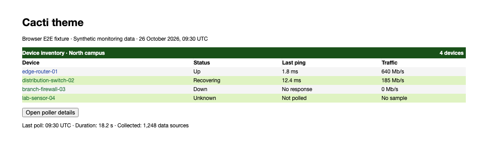
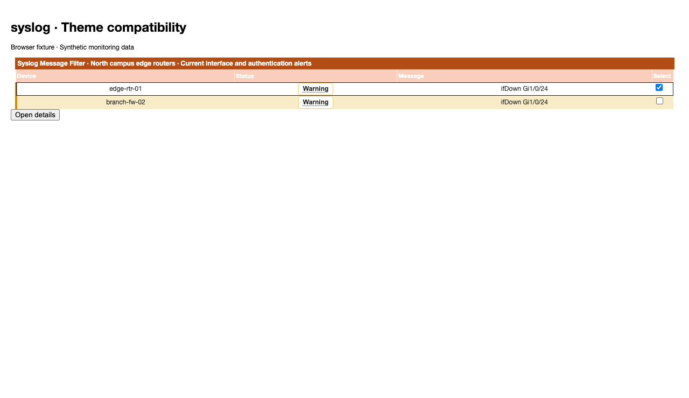

# Themes and Plugin Appearance

Cacti themes control the appearance of navigation, tables, forms, and dialogs.
Installed plugins can add their own styles, so check both the theme and the
plugin when investigating a display problem.

This development browser fixture contains synthetic device measurements.
It illustrates the Cacti theme; it does not show a live monitoring system.

## Choose a Theme

Administrators choose the default **Theme** in
[Visual Settings](Settings-Visual.md#theme-table-tree-and-filter-settings).
Users can choose **Theme** in their personal settings when those settings
are available. A personal selection takes precedence over the global default.
Theme names and available options depend on the installed Cacti version.

The development theme set includes Cacti, Carrot, Dark, Deepness, Hollyberry,
Midwinter, Modern, Paper Plane, Paw, Raspberry, and Sunrise. Midwinter has light
and dark palettes. Additional themes installed by an RTM distribution belong
to that distribution and can have different compatibility requirements.

## Check Plugin Appearance

Confirm that the [plugin](Plugins.md) supports your Cacti version before
comparing appearances. Some plugins provide a stylesheet for each theme;
others use shared Cacti styles or their own color palette. A theme change can
therefore affect a plugin's titlebars, links, row selection, or status labels.

The Syslog example uses the development Carrot theme and synthetic alerts.
Plugin versions and fixture revisions are recorded with the development tests.
See [Development and Testing][testing]
for validation scope and browser evidence.

## Report a Display Problem

Include the following in a [bug report](Contributing.md#report-a-problem):

- Cacti version, theme, and palette.
- Plugin name and version, if the problem appears in a plugin.
- Browser version and window size, including whether the issue is on mobile.
- The affected page and steps that reproduce the problem.
- A populated screenshot with sensitive device names and addresses removed,
  or a synthetic example that reproduces the issue.

Check resting, hovered, focused, and selected states where applicable.
Distinguish a missing value from text whose color blends into its background.
Use [data source debugging](Data-Debug.md) when the underlying monitoring
measurements are missing. Check [Known Issues](Known-Issues.md) for reports.

[testing]: Development-and-Testing.md#theme-and-plugin-checks

---

Copyright (c) 2004-2026 The Cacti Group
