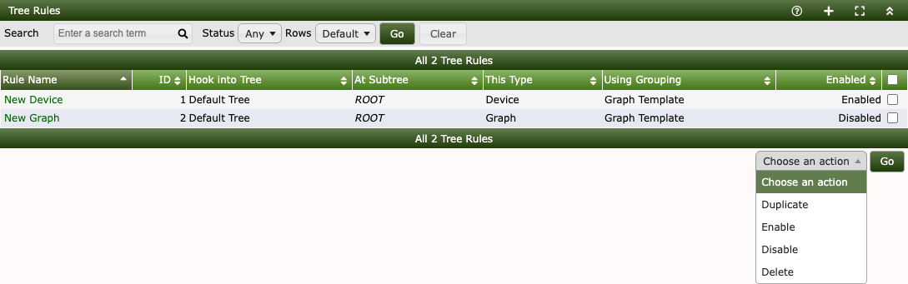

# Automation Tree Rules

This section will describe **Tree Rules** in Cacti.

Tree rules allow Automation to bunch up devices based on matches
on rules we come up with. You can say bunch all Cisco devices on to a Cisco
tree. Or if you have a site where all of the hostnames start with siteb, you can
have a site b tree, etc. See below for some examples.

To get started you will need to create a Tree rule. On the top right, click the +
to start a new rule. You are also able to duplicate rules to make it easier as
well.

We need a way to tell automation what device we are looking for.
In the example above we are looking for a device with the hostname Linux.
This is done via a REGEX; any Perl based REGEX can be used.

To test this REGEX on existing devices you can open the Matching Items tab of
the rule item; this will check the Devices currently in Cacti for a match.

Once a device is a match it will be placed on the tree chosen in the rule's
Tree field.  A Tree is required to save a rule, and it must already exist.
To change which tree the device will be placed on simply select the tree name
from the dropdown list.

Tree rules do not create trees.  They create the header branches defined by
the rule items, such as a branch named Linux, under the selected tree if the
branch does not already exist.

## Video Walkthrough

---
Copyright (c) 2004-2026 The Cacti Group
