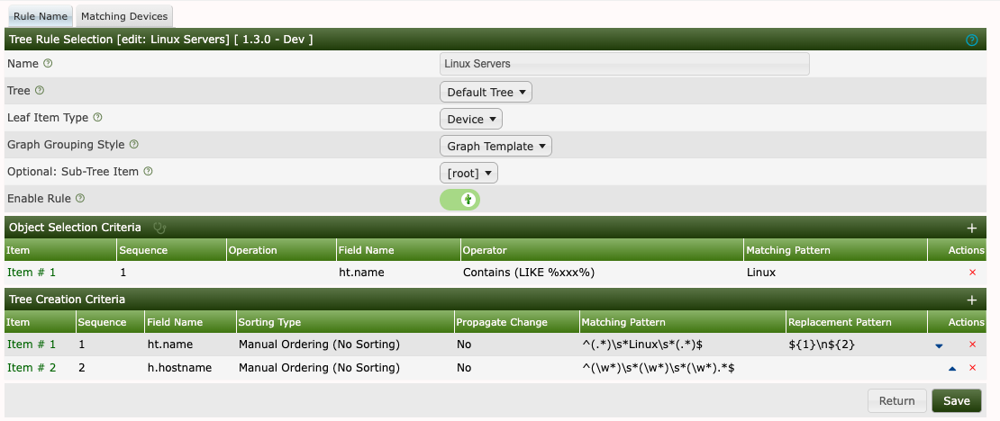
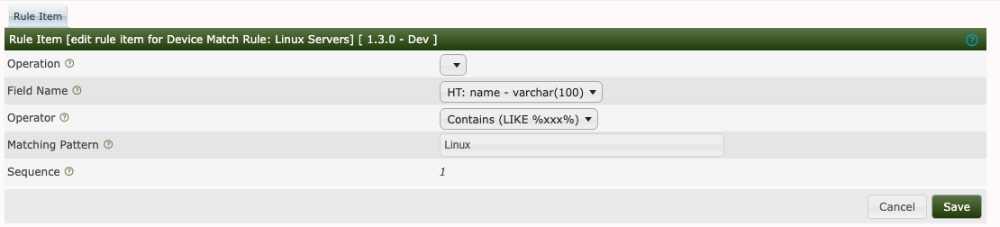
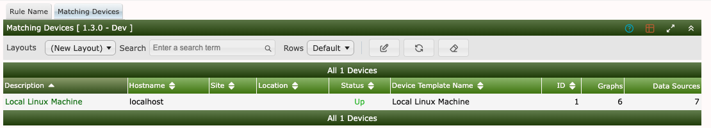
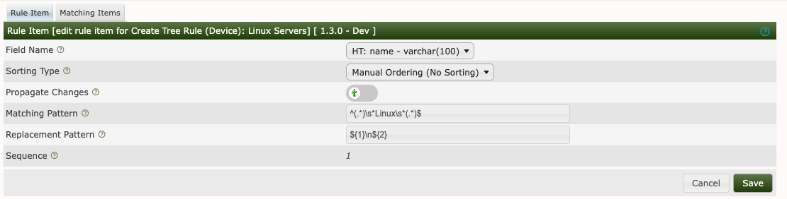

# Automation Tree Rules

This section will describe **Tree Rules** in Cacti.

Tree rules allow Automation to bunch up devices based on matches
on rules we come up with. You can say bunch all Cisco devices onto a Cisco tree.
Or if you have a site where all of the hostnames start with siteb, you can
have a site b tree, etc. See below for some examples.

To get started, you will need to create a Tree rule. On the top right, click the
+ to start a new rule. You are also able to duplicate rules to make it easier as
well.

We need a way to tell Automation what device we are looking for.
In the example above we are looking for a device with the hostname Linux;
this is done via a REGEX using the `matches regular expression` operator,
which the database evaluates with its `REGEXP` operator.

To test this REGEX on existing devices you can click the show eligible Objects.
This will check the Devices currently in Cacti for a match.

Once a device is a match it will be placed on the default tree.
To change which tree the device will be placed on simply select the tree name
from the dropdown list.

We also have the option to create a branch (a header) in the selected tree based
on our rule. In this case a new branch named Linux will be created in that tree
if it does not already exist.

## Video Walkthrough

---
Copyright (c) 2004-2026 The Cacti Group
