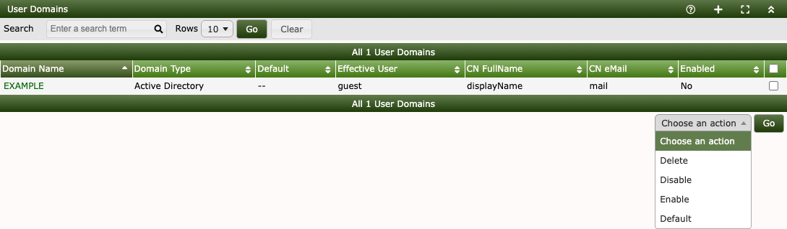
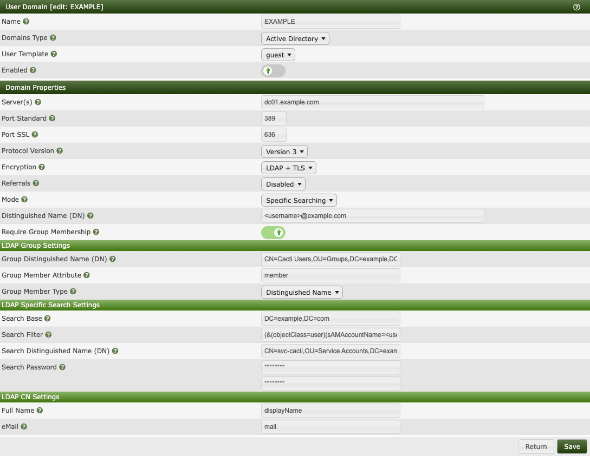
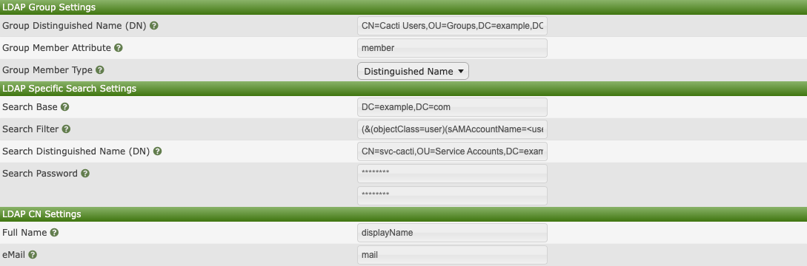

# User Domain Management

This page describes **User Domains in Cacti 1.2**. The unreleased Cacti 1.3
development branch replaces this screen with
[Login Providers](Login-Providers.md). User Domains are a core Cacti feature
in 1.2, not a separate plugin.

User Domains in Cacti are a way of providing Custom Login
experiences to differing groups of users and using LDAP
or Active Directory Group Permissions to limit who
can login using those custom permissions.

Once a user logs in for the first time, their permissions
will inherit the Template account's permission settings
including User Groups and their permissions.

So, as the name implies, you can have from one to many
LDAP and Active Directory entries in the User Domains interface.

A use example would be 3 levels of customers
who will have access to the system.  For example, let's
say those three groups are:

- Administrators
- Managers
- Client Team

Each of these user groups is controlled by Active Directory;
there are AD User Groups that map one-to-one with these
Groups.  When you have these three Domains set up and enabled,
when you go to the Cacti Login screen there will be a drop-down
settings with the three Domains listed in the drop-down.

If a normal user tries logging in as an Administrator, their
login will be blocked and so on.

The first image shows the list of domains, which domain is
primary, and the actions you can take on a Domain.

In this second screen, you can see the User Domain login screen
where you can pick AD or LDAP, the credentials, importantly the
Template User Account (That which holds base permissions),
and the required group membership, which when you check it,
you can then specify the AD and LDAP User Group paths.

In the last images, you can see the Group Settings information, and
if you have the user's Full Name and Email stored in LDAP or
AD, you can pull that information and make it a part of the
Cacti wrapper account when it's first created.

---
Copyright (c) 2004-2026 The Cacti Group
