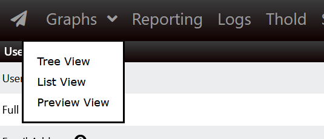
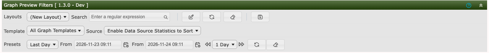
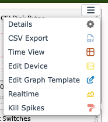

# Viewing Graphs

## Background

When Cacti was first invented in 2001 by Ian Berry, his vision was to make it
the fastest and easiest way to view and render Network Monitoring **Graphs** for
people in the Network, Site, and Data Center Operations Space.  As such, its
focus from the very beginning was on rendering just one thing, **Graphs**.  So,
as such, the second **Top Tab** on a Cacti system is the **Graphs** tab.

## The Graphs Top Tab

The **Graphs** **Top Tab** has a few personalities.  They include:

- **Tree View**

  Allows Cacti Users to view **Graphs** in the form of hierarchical **Trees**.
  These **Trees** are generally constructed by the Cacti Administrator and are
  controlled either at the **User** or **User Group** level.

- **Preview View**

  The **Preview View** provides a view of all **Graphs** that a Cacti User has
  access to.  **Table Filters** are provided to constrain the list of **Graphs**
  returned to the page.

- **List View**

  The **List View** allows the Cacti user to Create their own **Preview Page**
  by allowing them to select graphs from various pages, and then finally view
  those pages from the **Preview View**.

The way these various personalities appear in Cacti is somewhat different
depending on your Theme.  Review the two images below, for how you navigate to
the various **Graph View** modes.

In this first image, we see the way the **Graph View** options are displayed to
the end user.  This is the layout of the Classic, Modern and Dark themes.

In this second image, you can see the way the **Graph View** page will appear for
users of the Paw, Paper-Plane, and Sunrise themes.

## Graph Manipulation and Options

Once you can view the **Graphs**, there will be a Filter Panel that will provide
you multiple options to limit your view of them.  Below, you can see an image of
that Filter Panel.

From this sub-panel, you can do the following:

- Search by regular expression
- Select one to many, or all **Graph Templates** to view
- Specify the number of Graphs per Page
- Specify the number of columns to Display
- View either Legendless Thumbnails or full Graphs with their legends
- Set various Preset Time-spans, or select a Time Range
- Shift the Time either forward or backward by the Shift Time-span

Once you have the Filter where you like it from a Columns, Thumbnails, and Graphs
per Page setting, you can press the `Save` button, if you have the correct
permissions and save those defaults for your next login.

Depending again on permissions, to the right of the **Graphs**, you will find a
number of action icons that allow you to operate on the **Graphs**.

The image below shows what that might look like if you have the **Thold** and
**QuickTree** **Plugins** installed.

From top to bottom, the Graph Action Icons do the following.

Name | Description
--- | ---
Details | Allow you to perform precision zooming, view RRDtool debug information and perform CSV exports of your Graph Data.
CSV Export | Allows you to directly CSV Export your Graph Data
Realtime View | Allows you to view your Graphs at down to a 1 second granularity either in place, or in a pop-up Window
Kill Spikes | Allow you to clear up Spikes and Gaps in your Graph
Create Threshold | Create a Threshold for the Graph
Add to QuickTree | Allow you to select Graphs to add to Trees by simply tooling around the Graphs page.

## Graph Zooming

Cacti also has a powerful Graph Zoom interface built in.  You can discover
what it allows you to do by simply right clicking in the Graph area.  When
zooming, you will zoom all the **Graphs** on a page.  It's quite powerful.

There are many options for the Zoom menu.  Instead of explaining them here,
try them out for yourself.

## CSV Export

The CSV export downloads the data behind a **Graph** as a comma separated
file, so that you can work with the numbers outside of Cacti. It requires the
**View Graphs** permission.

There are three ways to reach it:

- The `CSV Export` action icon next to a **Graph** on the **Graphs** tab
  downloads the data for the time range that is currently set in the filter.
- The `Time View` action icon opens a page that shows the **Graph** once per
  timespan. Each of them has its own `CSV Export` icon.
- The `Details` action icon opens a page with a `Graph Data` icon. It shows
  the same data as a sortable table, with a `Summary Details` block and a
  `Download` link that downloads the CSV file.

The file is named after the title of the **Graph** with the extension `.csv`.
It starts with a block of summary rows:

###### Table 1. Summary rows of the CSV export

| Row | Content |
| --- | --- |
| `Title` | The title of the **Graph** |
| `Vertical Label` | The vertical label of the **Graph** |
| `Start Date` and `End Date` | The time range of the exported data |
| `Step` | The number of seconds between two rows |
| `Total Rows` | The number of data rows in the file |
| `Expected Rows` and `Missing Rows` | The number of rows that the time range and step call for, and how many of them are absent |
| `Graph ID` and `Host ID` | The ids of the **Graph** and its **Device** |
| `Nth Percentile` and `Summation` | One row per Nth Percentile or Summation value used by the **Graph**, with its value and format. These rows are only present when the **Graph** uses such values. |

After an empty row follows a header row with `Date` and one column per
exported **Graph** item, named after its legend, and then one row per step
with the date in the format `YYYY-MM-DD HH:MM:SS` and the values.

Text values that begin with `=`, `+`, `-` or `@` are written with a leading
single quote, so that a spreadsheet program does not treat them as formulas.
Numbers are written unchanged.

## Realtime Graphs

A Realtime **Graph** shows a single **Graph** at a much shorter interval than
the normal polling interval, down to one second, without changing the stored
data of the **Graph**.

The `Realtime` action icon is shown next to a **Graph** when **Enable
Real-time Graphing** is checked in `Console > Configuration > Settings >
Visual`, see [Visual Settings](Settings-Visual.md), and the **User** holds
the **Realtime Graphs** permission. The **Realtime View Mode** setting of the
[User Profile](User-Profile.md) decides how it opens:

- `Inline`, the default, replaces the **Graph** on the page with its Realtime
  version. Selecting the icon again, or the `Stop` button in the filter,
  returns to the normal **Graph**.
- `New Window` opens the Realtime **Graph** in a separate browser window.

The following options control the display. Cacti remembers your last choices.

###### Table 2. Realtime Graph options

| Option | Description |
| --- | --- |
| `Window`, in a new window `Presets` | The timespan shown on the **Graph**, from `30 Seconds` to `1 Hour`. The system default is the **Graph Timespan** setting, which defaults to `1 Minute`. |
| `Interval`, in a new window `Refresh Interval` | How often the **Graph** is updated, from `1 Seconds` to `2 Minutes`. In a new window, only intervals that are not shorter than the **Minimum Refresh Interval** setting are offered. That setting defaults to `10 Seconds`. |
| `Size` | The size of the **Graph** from `40%` to `100%` of its normal size. The default is `50%`. |
| `Thumbnails` | In a new window, draws the **Graph** without its legend. |

Each time a Realtime **Graph** is refreshed, the web server runs
`poller_realtime.php` for that **Graph**. It calls `cmd_realtime.php`, which
polls only the **Data Sources** used by the **Graph**. The results are
written to separate RRDfiles in the Realtime **Cache Directory**, one set per
login session, and the **Graph** image is created from those files. The
regular RRDfiles are not touched. The default **Cache Directory** is
`cache/realtime/` below the Cacti base directory.

Keep the following in mind:

- The **Cache Directory** must exist and must be writable by the web server.
  Otherwise the Realtime window shows a message that the Image Cache Directory
  does not exist or is not writable.
- The Realtime RRDfiles are created with the **Minimum Refresh Interval** as
  their step. If a **Device** caches its data and does not provide realtime
  updates, you may have to increase the **Minimum Refresh Interval** to
  prevent **Graphs** with gaps.
- Every refresh runs an additional poll of the **Data Sources** of that
  **Graph**, independent of the normal poller.
- Cacti's maintenance process removes Realtime image and RRDfiles that have
  not changed for two hours.

---
Copyright (c) 2004-2026 The Cacti Group
