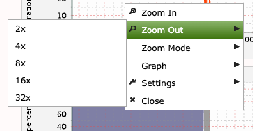

# Viewing Graphs

## Background

When Cacti was first invented in 2001 by Ian Berry, his vision was to make it
the fastest and easiest way to view and render Network Monitoring **Graphs** for
people in the Network, Site, and Data Center Operations Space.  As such, its
focus from the very beginning was on rendering just one thing, **Graphs**.  So,
as such, the second **Top Tab** on a Cacti system is the **Graphs** tab.

## The Graphs Top Tab

The **Graphs** **Top Tab** has a few personalities.  They include:

- **Tree View**

  Allows Cacti Users to view **Graphs** in the form of hierarchical **Trees**.
  These **Trees** are generally constructed by the Cacti Administrator and are
  controlled either at the **User** or **User Group** level.

- **Preview View**

  The **Preview View** provides a view of all **Graphs** that a Cacti User has
  access to.  **Table Filters** are provided to constrain the list of **Graphs**
  returned to the page.

- **List View**

  The **List View** allows the Cacti user to Create their own **Preview Page**
  by allowing them to select graphs from various pages, and then finally view
  those pages from the **Preview View**.

The way these various personalities appear in Cacti is somewhat different
depending on your Theme.  Review the two images below, for how you navigate to
the various **Graph View** modes.

In this first image, we see the way the **Graph View** options are displayed to
the end user.  This is the layout of the Classic, Modern and Dark themes.

In this second image, you can see the way the **Graph View** page will appear for
users of the Paw, Paper-Plane, and Sunrise themes.

## Graph Manipulation and Options

Once you can view the **Graphs**, there will be a Filter Panel that will provide
you multiple options to limit your view of them.  Below, you can see an image of
that Filter Panel.

From this sub-panel, you can do the following:

- Search by regular expression
- Select one to many, or all **Graph Templates** to view
- Specify the number of Graphs per Page
- Specify the number of columns to Display
- View either Legendless Thumbnails or full Graphs with their legends
- Set various Preset Time-spans, or select a Time Range
- Shift the Time either forward or backward by the Shift Time-span

Once you have the Filter where you like it from a Columns, Thumbnails, and Graphs
per Page setting, you can press the `Save` button, if you have the correct
permissions and save those defaults for your next login.

Depending again on permissions, to the right of the **Graphs**, you will find a
number of action icons that allow you to operate on the **Graphs**.

The image below shows what that might look like if you have the **Thold** and
**QuickTree** **Plugins** installed.

From top to bottom, the Graph Action Icons do the following.

Name | Description
--- | ---
Graph Details | Allows you to perform precision zooming, view RRDtool debug information and perform CSV exports of your Graph Data.
CSV Export | Allows you to directly CSV Export your Graph Data
Realtime View | Allows you to view your Graphs at down to a 1 second granularity either in place, or in a pop-up Window
Spike Kill | Allows you to clear up Spikes and Gaps in your Graph
Create Threshold | Create a Threshold for the Graph
Add to QuickTree | Allows you to select Graphs to add to Trees by simply tooling around the Graphs page.

## Graph Zooming

Cacti also has a powerful Graph Zoom interface built in.  You can discover
what it allows you to do by simply right clicking in the Graph area.  When
zooming, you will zoom all the **Graphs** on a page.  It's quite powerful.

There are many options for the Zoom menu.  Instead of explaining them here,
try them out for yourself.

## Realtime Graphs

A Realtime **Graph** redraws one **Graph** every few seconds from samples that
Cacti collects only for the user who is viewing it, without changing the
stored RRDfiles.  The description below follows the development source.

The **Realtime** action is offered beside a **Graph** when
**Enable Real-time Graphing** is checked in
[Visual Settings](Settings-Visual.md#realtime-and-rrdtool-graph-options) and
the user has the **Realtime Graphs** permission.  Graph action icons are shown
only to users with the **Show Graph Action Icons** permission.  The user
setting **Realtime View Mode** in the [User Profile](User-Profile.md) selects
how the action behaves:

- **Inline** (the default) - The **Graph** is replaced in place by its Realtime
  version.  The filter shows a **Window** and an **Interval** selection, a
  countdown, and a **Stop** button.  Selecting the action again, which is then
  labeled **Stop Realtime**, restores the normal **Graph**.
- **New Window** - The **Graph** opens in a pop-up window with **Timespan**,
  **Refresh Interval**, **Size** and **Thumbnails** controls, and a countdown
  to the next refresh.

The **Timespan** or **Window** ranges from 30 seconds to 1 hour.  The refresh
interval ranges from 1 second to 2 minutes; the pop-up window offers only
intervals at or above the **Minimum Refresh Interval** setting.  The values
that a user selects are saved as that user's settings and are used the next
time.

On each refresh, the web server runs `poller_realtime.php`, which runs
`cmd_realtime.php` to collect the **Data Sources** of that **Graph**.  The
samples are written to RRDfiles in the **Cache Directory**, with a one second
step, and the image is rendered from them.  The cache files are named after a
hash of the user's session, so each session has its own files.  Realtime data
is always stored locally on the web server, also when the RRDtool Proxy Server
is the storage location.  Cacti's maintenance process removes `.png` and
`.rrd` files from the **Cache Directory** two hours after their last change.

Limits shown by the code:

- The page reports an error when Realtime has been disabled by the
  administrator, or when the **Cache Directory** does not exist or is not
  writable.
- The page reports that the Cacti poller has not run yet when no poller
  statistics exist.
- Every refresh collects from the **Device** again, in addition to normal
  polling.

## CSV Export

The CSV export downloads the values behind a **Graph**, for the time range
being viewed, as a comma separated file.  The description below follows the
development source.

Select the **CSV Export** action beside a **Graph** in the **Tree View** or
**Preview View**, or beside one of the time ranges on the **Graph** details
page.  The details page also has a **Graph Data** action that shows the same
data as a sortable table, with a **Download as CSV** link.  The export uses
the **View Graphs** permission and the user's access to that **Graph**.

The file is named after the **Graph** title, with a `.csv` extension, and is
UTF-8 encoded with a byte order mark.  It starts with summary rows, followed
by an empty row, a header row, and one row per sample:

| Row                       | Content                                         |
| ------------------------- | ----------------------------------------------- |
| Title                     | The **Graph** title                             |
| Vertical Label            | The vertical label of the **Graph**             |
| Start Date and End Date   | The exported time range                         |
| Step                      | The number of seconds between rows              |
| Total Rows                | The number of data rows returned                |
| Expected Rows             | The rows the time range and step should contain |
| Missing Rows              | Expected Rows minus Total Rows                  |
| Graph ID and Host ID      | The Cacti IDs of the **Graph** and **Device**   |
| Nth Percentile, Summation | One row per such item on the **Graph**, if any  |

The header row has a **Date** column and one column per exported **Graph**
item, named after its legend.  Dates use the `Y-m-d H:i:s` format.

If RRDtool returns no data, no file is produced.  The page reports that the
export returned no data, and the reason is written to the Cacti log.

---
Copyright (c) 2004-2026 The Cacti Group
