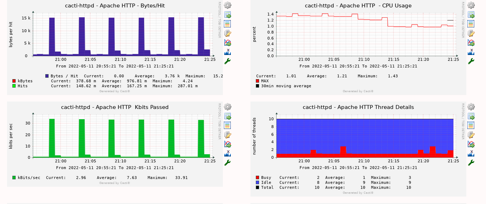

# Apache Template Config

The Apache template collects server statistics over HTTP from
`/server-status?auto`, using Apache's `mod_status` module. These examples allow
local access. Check the [mod_status documentation][mod-status] for the available
statistics and use the endpoint on the server being monitored.



## CentOS and Red Hat configuration

Check whether the installed Apache configuration already loads `mod_status`.
Add the module load only if it is missing, then configure the status location
in the site's Apache configuration, for example under `/etc/httpd/conf.d`:

```apache
LoadModule status_module modules/mod_status.so
ExtendedStatus On

<Location /server-status>
    SetHandler server-status
    Require local
</Location>
```

With administrator privileges, test the configuration before reloading a running
service:

```sh
apachectl configtest && systemctl reload httpd
```

## Debian configuration

Create `/etc/apache2/conf-available/80-server-status.conf` with:

```apache
ExtendedStatus On

<Location /server-status>
    SetHandler server-status
    Require local
</Location>
```

Enable the module and configuration with administrator privileges. Reload only
if the configuration test succeeds:

```sh
a2enmod status
a2enconf 80-server-status
apache2ctl configtest && systemctl reload apache2
```

## Verify the collection endpoint

Request `http://127.0.0.1/server-status?auto` locally and check for the expected
machine-readable statistics. Then verify collection through Cacti under the
account and from the host that actually runs the helper.

`Require local` rejects a collector on a different host. For remote collection,
configure access for the intended collector addresses and network path rather
than making server-status public. The package does not configure the target's
Apache service or access controls for you.

[mod-status]: <https://httpd.apache.org/docs/2.4/mod/mod_status.html>

---

Copyright (c) 2004-2026 The Cacti Group
